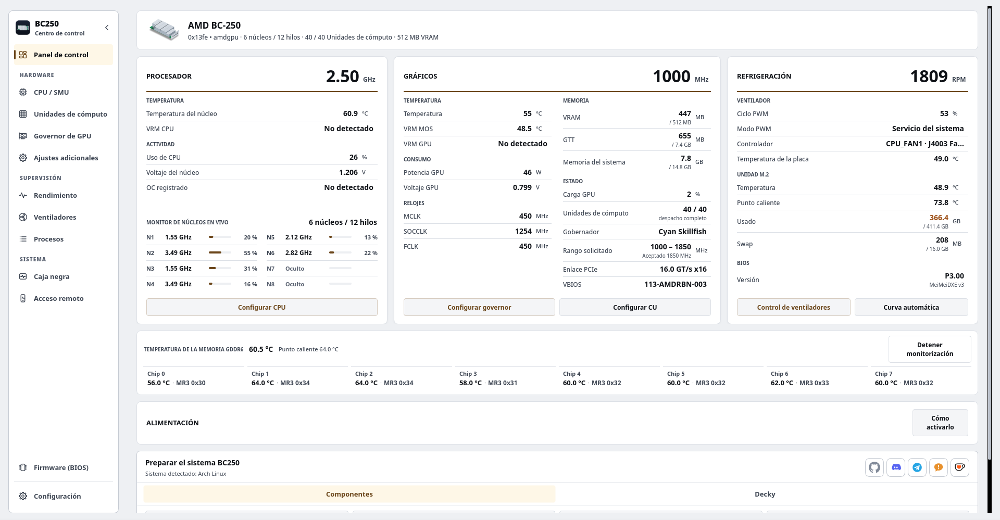

# BC250 Control Center

Set up, tune and monitor the AMD BC-250 on Linux from the desktop, a terminal or a web browser.

It covers the GPU governor, CPU tuning, Compute Units, fans, memory, BIOS update media, upscaling and system preparation for the supported distributions. The interfaces share application services, hardware limits and privileged helpers. An optional Decky plugin brings the everyday controls to Steam's Game Mode.

<p align="center">
  <a href="https://movacx.github.io/bc250-control-center/gallery/#dashboard"></a>
</p>

<p align="center">
  <a href="README.md"></a>
  <a href="docs/readmes/README.es.md"></a>
  <a href="docs/readmes/README.pt-BR.md"></a>
  <a href="docs/readmes/README.ru.md"></a>
  <a href="docs/readmes/README.uk.md"></a>
  <a href="docs/readmes/README.de.md"></a>
  <a href="docs/readmes/README.fr.md"></a>
  <a href="docs/readmes/README.pl.md"></a>
  <a href="docs/readmes/README.zh-CN.md"></a>
  <a href="docs/readmes/README.ja.md"></a>
</p>

<p align="center">
  <a href="https://ko-fi.com/movacx"></a>
</p>

More screenshots are in the [gallery](https://movacx.github.io/bc250-control-center/gallery/).

## Choose your interface

| Interface | Best suited for | Launch |
| --- | --- | --- |
| **Desktop · PyQt6** | Full setup, tuning, diagnostics and local administration | `bc250-control-center` |
| **Terminal · curses** | A local TTY, terminal emulator or SSH session | `bc250-control-center-tui` |
| **Web · React** | Monitoring and hardware controls from a phone, tablet or another computer on the home network | Start **Remote access** in the desktop app, then open its address or scan the QR |

The normal installation includes the terminal interface and the compiled web
assets. A [terminal-only installer](#terminal-mode) is available for machines
without a desktop. The browser interface needs the board's web server running;
it does not need SSH or Node.js for normal use.

## Features

- Dashboard with CPU, GPU, cooling, per-core load, GDDR6 temperature per chip, installed BIOS and power rails (the rails need the I2C hardware modification; the app includes a photo guide)
- Performance charts for CPU, GPU, VRAM, RAM, disk and network, with a sensor view and CSV export
- GPU governor management (Cyan, with Oberon as an alternative), safe frequency ranges and a voltage laboratory
- CPU tuning through the SMU, stability test and optional core unlock
- Compute Units: routing and register diagnostics, with live and boot state reported separately; available units depend on the board
- Fan control: manual PWM, temperature curves, persistent profiles, or hand-off to CoolerControl, fancontrol or fan2go
- Memory: VRAM size, ZRAM, ZSWAP and swap
- BIOS update USB creation (P3.00 Chipset Menu, MeiMeiDXE v3, P5.00, P3.00, P2.00) with every file verified
- Per-game upscaling: FSR4 INT8 through OptiScaler Client and HelixSR, with backup and restore of game files
- System preparation per distribution, run in a built-in terminal
- Compatibility fixes for GFX1013, async compute, ACPI and Mesa; Dolby Digital 5.1 over HDMI; TV control over HDMI-CEC
- In-app problem reports with error codes, origin codes and the raw error attached
- 30 languages, light and dark themes, UI scaling and controller navigation
- Terminal interface with keyboard navigation, mouse support, live telemetry and an embedded operation console
- Local-network HTTPS web interface with mobile layouts, pairing QR and per-device hardware permissions

## Supported distributions

- Arch Linux, CachyOS, Manjaro
- Fedora, Nobara
- Bazzite and other Fedora Atomic variants
- SteamOS (beta)
- Ubuntu, Linux Mint, Debian 13

Python 3.11 or newer is required. Other distributions, including OpenRC systems, are detected and handled where possible but are not tested on every release.

## Installation

### AUR

For Arch Linux, CachyOS and SteamOS:

```bash
yay -S bc250-control-center-git
```

### Release packages

Download the package for your distribution from the [latest release](https://github.com/movacx/bc250-control-center/releases/latest).

Arch Linux, CachyOS, Manjaro:

```bash
sudo pacman -U ./bc250-control-center-*-any.pkg.tar.zst
```

Fedora, Nobara:

```bash
sudo dnf install ./bc250-control-center-*.rpm
```

Bazzite and Fedora Atomic (a reboot is required):

```bash
sudo rpm-ostree install ./bc250-control-center-*.rpm
systemctl reboot
```

Ubuntu, Linux Mint, Debian:

```bash
sudo apt install ./bc250-control-center_*.deb
```

Use `apt install` rather than `dpkg -i` so that dependencies are installed. If a package was left half-installed by `dpkg -i`, run `sudo apt --fix-broken install`.

### SteamOS

SteamOS keeps its system partition read-only, so the package can only be installed while that protection is off. Open Konsole in Desktop Mode and run:

```bash
sudo steamos-readonly disable
sudo pacman-key --init
sudo pacman-key --populate archlinux holo
sudo pacman -Syy
sudo pacman -U ./bc250-control-center-*-any.pkg.tar.zst
sudo steamos-readonly enable
```

The `pacman-key` and `pacman -Syy` lines refresh the keyring and the package databases, which a SteamOS update resets. If you have not set a password for the `deck` user yet, run `passwd` first. After a SteamOS update, **Reinstall BC250 Control Center** in the Desktop Mode menu does these steps for you.


## Updating

The application checks for new releases, shows the changelog, verifies the package checksum and installs the update with the system package manager.

**SteamOS:** a SteamOS system update removes packages installed into the system, including this one. After a system update, run **Reinstall BC250 Control Center** from the Desktop Mode menu, then run Prepare BC250 system again. SteamOS asks for the password of the `deck` user; set one with `passwd` if you have not done so.

**Upgrading from 1.19:** the 1.19 updater cannot install packages. Install the current release once by hand; later versions update themselves.

```bash
# Bazzite / Fedora Atomic: replace a layered 1.19 package
sudo rpm-ostree uninstall bc250-control-center --install ./bc250-control-center-*.noarch.rpm
systemctl reboot

# A copy installed with install-local.sh: remove it, then install the package
bash scripts/uninstall-local.sh
```

## Getting started

1. Launch BC250 Control Center. The first-run screen sets the language and appearance and offers to install the required components.
2. Optionally take the guided tour, which explains what each module changes on the board.
3. On the Dashboard, run **Prepare BC250 system**. It shows what will be installed for your distribution and runs it in the built-in terminal.
4. Read the status line of a module before applying changes; it reports what is ready and what is missing.

## Terminal mode

The TUI runs in a terminal emulator, a Linux TTY or an SSH session. It shares
the desktop application's hardware controls and monitoring services. Python
3.11 or newer, `curses` and `psutil` are required; PyQt6 is not.

### With the desktop application installed

The regular package includes the TUI. Start it with:

```bash
bc250-control-center-tui
```

### Terminal-only installation

Clone the repository and run the installer as your normal user:

```bash
git clone https://github.com/movacx/bc250-control-center.git
cd bc250-control-center
bash scripts/install-tui.sh
```

The installer places the application in `~/.local` and checks its Python
dependencies. It requests administrator authorization to install missing
packages and protected hardware helpers. It does not install PyQt6 or a desktop
launcher. On Bazzite, changes installed through `rpm-ostree` require a reboot.

Start the interface:

```bash
~/.local/bin/bc250-control-center-tui
```

If `~/.local/bin` is already in your `PATH`, use `bc250-control-center-tui`.
To update a source installation, run `git pull --ff-only` in the same checkout
and rerun the installer. To remove it:

```bash
bash scripts/install-tui.sh --uninstall
```

### Navigation

| Input | Action |
| --- | --- |
| `↑` / `↓` or `j` / `k` | Select an item |
| `Enter` | Open a section or run an action |
| `Esc` or `Tab` | Return to the sidebar |
| `[` / `]` | Switch section tabs |
| `/` | Search |
| `PgUp` / `PgDn` | Scroll the page or operation output |
| Mouse | Select sections and controls; scroll with the wheel |
| `?` | Show help |
| `q` | Quit |

Operations display their output in the integrated console. Administrator
passwords are entered there when requested; `Ctrl+C` interrupts the running
command. The console retains the result and log location after completion.

To open a specific page or use monochrome output:

```bash
bc250-control-center-tui --page gpu --theme mono
```

For SSH, the board must have an SSH server enabled and reachable:

```bash
ssh -t user@board-ip bc250-control-center-tui
```

Replace `user` and `board-ip` with the board's Linux account and address.

## Web interface

Open **Remote access** in the desktop application or TUI, start web access and enable
**Reachable from the local network** to connect from another device. Choose the
address shown there or scan its visible QR. Keep both the local name and numeric
IP available: name resolution depends on the client and network.

Sign in with the access key shown on the board. New browser sessions can only
monitor. In **Connected devices**, verify the browser's device code before
granting hardware control. That permission is separate from the Linux
administrator password required by privileged operations. The owner can revoke
access and choose an expiry for each session.

The web provides Dashboard, CPU, Compute Units, GPU, Voltage laboratory, Fans,
Performance, Black box and Settings. Performance includes CPU, GPU, memory, disk, network
and individual sensor histories. Themes and language are saved per browser.

LAN access uses HTTPS. Each installation creates a local certificate authority;
browsers may warn until its public certificate is trusted on that device.
Compare the displayed fingerprint before trusting it. With LAN access disabled,
only the board itself can connect through loopback. The application does not
open router ports or configure a public tunnel.

Users do not need Node.js: packages ship the built web assets. For connection,
certificate, authorization and development details, see the [web guide](docs/WEB_ACCESS.md)
and [architecture](docs/WEB_ARCHITECTURE.md).

## Decky plugin

BC250 Quick Access is an optional panel for the Quick Access menu in Steam's Game Mode. It provides GPU, Compute Unit, CPU, fan and VRAM controls, per-game GPU and fan profiles, and live async compute readings. Advanced configuration stays in the desktop application.

Install it from the **Decky** section of the Dashboard. Decky Loader is installed as well if it is missing; nothing else in the application installs Decky. See the [plugin README](integrations/decky/bc250-quick-access/README.md) for details.

## Reporting problems

Error windows show a diagnostic code (for example `BC250-UPSCALE-001`), an origin code that identifies the function where the error occurred (for example `GPU-0142`), and the raw error with its traceback.

Use **Report this problem** in the error window, or **Settings › Diagnostics › Send a report**. The report form opens inside the application with the codes, the raw error, system specifications and recent errors filled in. You can review everything before sending; home directory paths are replaced with `~`. If the form cannot be submitted, it opens in the browser with your answers kept. The form is also available [on the web](https://docs.google.com/forms/d/e/1FAIpQLSe3M1stf3bpCoorb4hCWFX9YC_TZ_Gv6WHWQDRe1AV5rJT6rA/viewform).

The report also attaches a hardware diagnosis, collected without root on every distribution: kernel and headers, loaded sensor modules and their kernel messages (NCT6687, amdgpu), hwmon and `sensors` readings, GPU and crash lines from the kernel log, how the previous boot ended (clean shutdown or abrupt reset), services, packages and the end of the last workflow log. When the kernel log is closed to your user, the desktop asks once for the password through polkit. Reports too large for the form are trimmed automatically, least important parts first; **Open in browser** still copies the full text.

To read everything a report attaches before sending it, open **Settings › Diagnostics › View full diagnosis**: every section (kernel, previous boot, black box, sensors, GPU, services, configuration, packages, logs) is expandable, sorted into tabs, searchable, and can be copied or saved as a file. The terminal prints the same with `bc250-control-center-cli diagnose --full`.

Issues on GitHub are welcome as well. Please include your distribution, kernel version and the terminal output.

## Safety

Overclocking, unlocking Compute Units, changing fan control and flashing a BIOS can make the system unstable, cause data loss or damage the board. Change one setting at a time and keep a way to revert it. The application's checks catch common mistakes but are not a guarantee.

## Credits

This project builds on the work of the BC-250 community. The projects below belong to their authors; the application integrates them through reviewed, pinned workflows. Licenses and the scope of each integration are listed in the [third-party notices](docs/THIRD_PARTY_NOTICES.md).

**GPU**
- [cyan-skillfish-governor](https://github.com/filippor/cyan-skillfish-governor/tree/smu): GPU governor
- [Oberon Governor](https://gitlab.com/mothenjoyer69/oberon-governor): alternative governor
- [bc250-gfx1013-fix](https://github.com/DryhoppedIPA/bc250-gfx1013-fix) and [bc250-steamos](https://github.com/keyboardspecialist/bc250-steamos): kernel and Mesa/RADV for GFX1013
- [linux-cachyos-bc250](https://github.com/MastaG/linux-cachyos-bc250): kernel and Mesa/RADV for Arch and CachyOS
- [bc250-async-compute-bazzite](https://github.com/tri3gubki-ops/bc250-async-compute-bazzite): async compute on Bazzite 44, with RADV patches also built for Arch, CachyOS and Fedora on kernel 7.2 or newer

**Upscaling**
- [bc250-fsr4](https://github.com/dmorazasanchez/bc250-fsr4) and [bc250-fsr4-fork](https://github.com/daniel-h-0/bc250-fsr4-fork): OptiScaler Client, FSR4 per game
- [HelixSR](https://github.com/lonewolf0622/HelixSR): DLSS Model E reconstruction in FSR 3.1 games

**CPU and Compute Units**
- [bc250_smu_oc](https://github.com/bc250-collective/bc250_smu_oc): CPU detection and tuning through the SMU
- [bc250-core-unlock](https://github.com/rw-r-r-0644/bc250-core-unlock) and [bc250-efi-core-unlock](https://github.com/Hexxeh/bc250-efi-core-unlock): core unlock
- [bc250-acpi-fix](https://github.com/e-tho/bc250-acpi-fix): CPU performance states through ACPI
- [bc250-cu-live-manager](https://github.com/WinnieLV/bc250-cu-live-manager), [bc250-cu-live-manager-SteamOS](https://github.com/F5GO/bc250-cu-live-manager-SteamOS) and [bc250-40cu-unlock](https://github.com/duggasco/bc250-40cu-unlock): Compute Units

**Sensors, memory and fans**
- [BC250-Telemetry](https://github.com/onlinermm/BC250-Telemetry): VRM telemetry and the photos used in the I2C guide
- [bc250-memory-temperature](https://github.com/pan-Rijovich/bc250-memory-temperature): GDDR6 temperature
- [bc250_memcfg](https://github.com/fanoush/bc250_memcfg): VRAM size through CMOS
- [nct6687d](https://github.com/Fred78290/nct6687d): NCT sensors and fan PWM
- [linux-cec](https://gitlab.steamos.cloud/holo/linux-cec): cecd, Valve's HDMI-CEC daemon

**Firmware**
- [bc250-bios](https://gitlab.com/TuxThePenguin0/bc250-bios): stock P3.00 and Chipset Menu BIOS
- [AMD-BC-250-UEFI-v2.2-Firmware-Menu-Script](https://github.com/Forbidden-Darkness/AMD-BC-250-UEFI-v2.2-Firmware-Menu-Script): UEFI Shell and MeiMeiDXE v3
- [BC-250](https://github.com/kenavru/BC-250): mirror of ASRock's update kit (P2.00 and P5.00)
- [bc250-custom-bios-logo](https://github.com/tmghd272/bc250-custom-bios-logo): custom boot logo

**Related projects** (not used by the application; licenses as reported by GitHub)
- [bc250-vrm-dkms](https://github.com/Hexxeh/bc250-vrm-dkms) and [bc250-memory-dkms](https://github.com/Hexxeh/bc250-memory-dkms) (GPL-2.0): VRM and memory temperatures as kernel modules
- [bc250-bazzite-suite](https://github.com/RobertoTorino/bc250-bazzite-suite) (GPL-3.0): Bazzite setup suite
- [bc250-vcn-research](https://github.com/Shalasere/bc250-vcn-research) and [amdgpu-wddm](https://github.com/D-Ogi/amdgpu-wddm): VCN video encoding research and an open Windows driver (no license declared; linked only)

## Project structure

```text
bc250-control-center/
├── src/bc250cc/              The core, with no graphical interface
│   ├── domain/               Rules and limits for each module (GPU, CPU, CU, fans, firmware…)
│   ├── application/          Use cases that combine those rules
│   ├── infrastructure/       System access: sensors, services, packages, GitHub
│   ├── platform/             Differences between distributions and boot systems
│   └── shared/               Version, paths and contracts shared by every process
├── frontends/
│   ├── desktop/              Qt desktop application
│   │   ├── pages/            One file per module (dashboard, GPU, CPU, fans, firmware…)
│   │   ├── components/       Reusable interface pieces
│   │   ├── onboarding/       Welcome screen and guided tour
│   │   ├── console/          Built-in terminal
│   │   ├── theme/            Themes, styles, colors and icons
│   │   └── i18n/             Translations into 30 languages
│   ├── tui/                  Terminal interface: curses screen, pages and operation console
│   ├── web/                  HTTPS backend, validated action workers and browser interface
│   │   ├── app/              React source and build tools (Node.js for development only)
│   │   └── dist/             Compiled assets served by Python and shipped in packages
│   └── cli.py                Command-line mode
├── integrations/
│   ├── decky/                Decky Quick Access plugin for Game Mode
│   └── report-endpoint/      Cloudflare endpoint for user-submitted reports
├── privileged/               What runs as root, isolated and reviewed
│   ├── helpers/              One helper per privileged task
│   ├── lib/                  Code shared by those helpers
│   └── policies/             Polkit permissions
├── packaging/                .pkg.tar.zst, .rpm and .deb packages, and the AUR PKGBUILD
├── scripts/
│   ├── entrypoints/          Desktop, CLI, daemon and TUI launchers
│   ├── development/          Web build and development utilities
│   ├── system/               Distribution and system preparation workflows
│   └── qa/                   Packaging, integration and distribution checks
├── assets/                   Icons, screenshots and the web gallery
├── docs/                     Documentation, third-party notices and README translations
└── tests/                    Unit, service, desktop, TUI, web and packaging checks
```

See [Architecture](docs/ARQUITECTURA_MVC.md) for layer boundaries and
[Frontends](frontends/README.md) for interface entry points and development commands.
