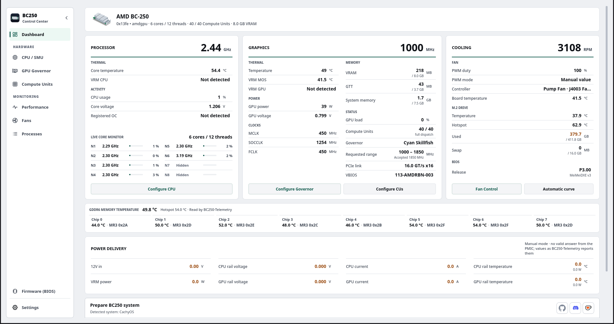

# BC250 Control Center

Desktop application for setting up, tuning and monitoring the AMD BC-250 on Linux.

It covers the GPU governor, CPU tuning, Compute Units, fans, memory, BIOS update media, upscaling and system preparation for the supported distributions. Every change to the hardware is range-checked and confirmed before it is applied. An optional Decky plugin brings the everyday controls to Steam's Game Mode.

<p align="center">
  <a href="https://movacx.github.io/bc250-control-center/gallery/#dashboard"></a>
</p>

<p align="center">
  <a href="README.md"></a>
  <a href="docs/readmes/README.es.md"></a>
  <a href="docs/readmes/README.pt-BR.md"></a>
  <a href="docs/readmes/README.ru.md"></a>
  <a href="docs/readmes/README.uk.md"></a>
  <a href="docs/readmes/README.de.md"></a>
  <a href="docs/readmes/README.fr.md"></a>
  <a href="docs/readmes/README.pl.md"></a>
  <a href="docs/readmes/README.zh-CN.md"></a>
  <a href="docs/readmes/README.ja.md"></a>
</p>

<p align="center">
  <a href="https://ko-fi.com/movacx"></a>
</p>

More screenshots are in the [gallery](https://movacx.github.io/bc250-control-center/gallery/).

## Features

- Dashboard with CPU, GPU, cooling, per-core load, GDDR6 temperature per chip, installed BIOS and power rails (the rails need the I2C hardware modification; the app includes a photo guide)
- Performance charts for CPU, GPU, VRAM, RAM, disk and network, with a sensor view and CSV export
- GPU governor management (Cyan, with Oberon as an alternative), safe frequency ranges and a voltage laboratory
- CPU tuning through the SMU, stability test and optional core unlock
- Compute Units: 24 to 40 CU, with live and boot state reported separately
- Fan control: manual PWM, temperature curves, persistent profiles, or hand-off to CoolerControl, fancontrol or fan2go
- Memory: VRAM size, ZRAM, ZSWAP and swap
- BIOS update USB creation (P3.00 Chipset Menu, MeiMeiDXE v3, P5.00, P3.00, P2.00) with every file verified
- Per-game upscaling: FSR4 INT8 through OptiScaler Client and HelixSR, with backup and restore of game files
- System preparation per distribution, run in a built-in terminal
- Compatibility fixes for GFX1013, async compute, ACPI and Mesa; Dolby Digital 5.1 over HDMI; TV control over HDMI-CEC
- In-app problem reports with error codes, origin codes and the raw error attached
- 30 languages, light and dark themes, UI scaling and controller navigation
- Terminal mode (`bc250-control-center tui`): the same sections, live telemetry and actions over SSH or a plain TTY, with no extra dependencies

## Supported distributions

- Arch Linux, CachyOS, Manjaro
- Fedora, Nobara
- Bazzite and other Fedora Atomic variants
- SteamOS (beta)
- Ubuntu, Linux Mint, Debian 13

Python 3.11 or newer is required. Other distributions, including OpenRC systems, are detected and handled where possible but are not tested on every release.

## Installation

### AUR

For Arch Linux, CachyOS and SteamOS:

```bash
yay -S bc250-control-center-git
```

### Release packages

Download the package for your distribution from the [latest release](https://github.com/movacx/bc250-control-center/releases/latest).

Arch Linux, CachyOS, Manjaro:

```bash
sudo pacman -U ./bc250-control-center-*-any.pkg.tar.zst
```

Fedora, Nobara:

```bash
sudo dnf install ./bc250-control-center-*.rpm
```

Bazzite and Fedora Atomic (a reboot is required):

```bash
sudo rpm-ostree install ./bc250-control-center-*.rpm
systemctl reboot
```

Ubuntu, Linux Mint, Debian:

```bash
sudo apt install ./bc250-control-center_*.deb
```

Use `apt install` rather than `dpkg -i` so that dependencies are installed. If a package was left half-installed by `dpkg -i`, run `sudo apt --fix-broken install`.

### SteamOS

SteamOS keeps its system partition read-only, so the package can only be installed while that protection is off. Open Konsole in Desktop Mode and run:

```bash
sudo steamos-readonly disable
sudo pacman-key --init
sudo pacman-key --populate archlinux holo
sudo pacman -Syy
sudo pacman -U ./bc250-control-center-*-any.pkg.tar.zst
sudo steamos-readonly enable
```

The `pacman-key` and `pacman -Syy` lines refresh the keyring and the package databases, which a SteamOS update resets. If you have not set a password for the `deck` user yet, run `passwd` first. After a SteamOS update, **Reinstall BC250 Control Center** in the Desktop Mode menu does these steps for you.


## Updating

The application checks for new releases, shows the changelog, verifies the package checksum and installs the update with the system package manager.

**SteamOS:** a SteamOS system update removes packages installed into the system, including this one. After a system update, run **Reinstall BC250 Control Center** from the Desktop Mode menu, then run Prepare BC250 system again. SteamOS asks for the password of the `deck` user; set one with `passwd` if you have not done so.

**Upgrading from 1.19:** the 1.19 updater cannot install packages. Install the current release once by hand; later versions update themselves.

```bash
# Bazzite / Fedora Atomic: replace a layered 1.19 package
sudo rpm-ostree uninstall bc250-control-center --install ./bc250-control-center-*.noarch.rpm
systemctl reboot

# A copy installed with install-local.sh: remove it, then install the package
bash scripts/uninstall-local.sh
```

## Getting started

1. Launch BC250 Control Center. The first-run screen sets the language and appearance and offers to install the required components.
2. Optionally take the guided tour, which explains what each module changes on the board.
3. On the Dashboard, run **Prepare BC250 system**. It shows what will be installed for your distribution and runs it in the built-in terminal.
4. Read the status line of a module before applying changes; it reports what is ready and what is missing.

## Terminal mode

The same control center runs inside a terminal, with no window system: over SSH, on a plain TTY, in Konsole or in a Game Mode console. It needs only Python's standard `curses` module, so there is nothing to install on top of the application and it behaves the same on Fedora, Bazzite, SteamOS, Arch, CachyOS, Ubuntu, Linux Mint and Debian.

```bash
bc250-control-center tui          # or: bc250-control-center-tui
bc250-control-center-cli tui --page gpu --theme mono
```

The normal installation already includes it. For a server, a TTY or an SSH-only machine, install just the terminal interface, without PyQt6, a desktop entry or icons:

```bash
scripts/install-tui.sh
```

It needs Python 3.11 or newer with `curses` and `psutil`, and installs whichever of those is missing with the system package manager (`dnf`, `rpm-ostree`, `apt-get`, `pacman`, `zypper` or `apk`). As a normal user it installs to `~/.local`, so it works on Bazzite and SteamOS, where `/` is read-only. It asks for `sudo` only for those packages and for the privileged helpers that hardware actions use. Running it again updates the installation in place. To remove it:

```bash
scripts/install-tui.sh --uninstall
```

From a source checkout, without installing, run `scripts/entrypoints/bc250-control-center-tui`.

It has the desktop's sidebar, grouped and ordered the same way: Dashboard; Hardware (CPU / SMU, Compute Units, GPU Governor, Additional settings); Monitoring (Performance, Fans, Processes, Black box); Firmware (BIOS) and Settings. The title bar keeps the GPU and CPU clock and temperature in view on every page.

It does not reimplement anything: every reading and every action goes through the same service layer, privileged helpers and error catalog as the desktop application. Anything that changes the system asks for confirmation first (dangerous ones need an explicit `y`). Workflows the desktop runs in its console panel run in a console pane inside the interface: the output and progress appear live, a `sudo` or Polkit password is typed right there, `Ctrl+C` stops the command, and the result and the path of the full log stay on screen until you close the pane. No other terminal is opened and the interface is never suspended.

| Key | Action |
| --- | --- |
| `↑` `↓` or `j` `k` | Move |
| `Enter`, `→` or `l` | Open a section / run an action |
| `Esc`, `←` or `h`, `Tab` | Back to the sidebar |
| `[` `]` or `←` `→` | Previous / next tab of a section (`←` `→` change a value on an adjustable row) |
| `1`–`9`, `0`, `,` | Jump to a section (from anywhere; `,` is Settings) |
| `/` | Search an item on the page, or a section |
| `PgUp` `PgDn` | Scroll a page or the console pane |
| Mouse | Click a section or tab; click an item to select it, again to open it; the wheel scrolls |
| `r` | Refresh |
| `?` | Help |
| `q` | Quit |

The interface draws no background colour, so it follows a light or dark terminal on its own; `--theme mono` (or `NO_COLOR`) removes colour. It uses the language chosen in Settings (`--lang` overrides it) and falls back to ASCII on the Linux console. If this Python was built without `curses` the command says so and points to the desktop application. Errors are logged to `~/.local/state/bc250-control-center/tui.log`, never over the screen.

## Decky plugin

BC250 Quick Access is an optional panel for the Quick Access menu in Steam's Game Mode. It provides GPU, Compute Unit, CPU, fan and VRAM controls, per-game GPU and fan profiles, and live async compute readings. Advanced configuration stays in the desktop application.

Install it from the **Decky** section of the Dashboard. Decky Loader is installed as well if it is missing; nothing else in the application installs Decky. See the [plugin README](integrations/decky/bc250-quick-access/README.md) for details.

## Reporting problems

Error windows show a diagnostic code (for example `BC250-UPSCALE-001`), an origin code that identifies the function where the error occurred (for example `GPU-0142`), and the raw error with its traceback.

Use **Report this problem** in the error window, or **Settings › Diagnostics › Send a report**. The report form opens inside the application with the codes, the raw error, system specifications and recent errors filled in. You can review everything before sending; home directory paths are replaced with `~`. If the form cannot be submitted, it opens in the browser with your answers kept. The form is also available [on the web](https://docs.google.com/forms/d/e/1FAIpQLSe3M1stf3bpCoorb4hCWFX9YC_TZ_Gv6WHWQDRe1AV5rJT6rA/viewform).

The report also attaches a hardware diagnosis, collected without root on every distribution: kernel and headers, loaded sensor modules and their kernel messages (NCT6687, amdgpu), hwmon and `sensors` readings, GPU and crash lines from the kernel log, how the previous boot ended (clean shutdown or abrupt reset), services, packages and the end of the last workflow log. When the kernel log is closed to your user, the desktop asks once for the password through polkit. Reports too large for the form are trimmed automatically, least important parts first; **Open in browser** still copies the full text.

### Black box (freezes and resets)

A hard freeze leaves nothing in the kernel log. The black box records the GPU clock, load, temperatures, GFX voltage, power, fan speed, CPU clock and free memory four times a second, flushing every line to disk, so the next report shows the board's last seconds before a freeze or reset. It needs no root and its file is bounded (512 KB, then rotated).

```bash
# Desktop Mode: leave the terminal open while playing, stop with Ctrl+C
bc250-control-center-cli black-box

# Game Mode (SteamOS): start it in the background before switching
systemd-run --user --unit=bc250-black-box bc250-control-center-cli black-box
systemctl --user stop bc250-black-box
```

The log is kept in `~/.local/state/bc250-control-center/black-box/`. `bc250-control-center-cli diagnose` prints the same hardware diagnosis the report sends.

You do not need the terminal: open **Black box** in the sidebar (above Firmware (BIOS)) to start and stop the recording, see the last rows it wrote in a table, and turn on *Start with the session* so it runs from every login (systemd only). A recording cut off by a restart or a freeze is flagged there.

To read everything a report attaches before sending it, open **Settings › Diagnostics › View full diagnosis**: every section (kernel, previous boot, black box, sensors, GPU, services, configuration, packages, logs) is expandable, sorted into tabs, searchable, and can be copied or saved as a file. The terminal prints the same with `bc250-control-center-cli diagnose --full`.

Issues on GitHub are welcome as well. Please include your distribution, kernel version and the terminal output.

## Safety

Overclocking, unlocking Compute Units, changing fan control and flashing a BIOS can make the system unstable, cause data loss or damage the board. Change one setting at a time and keep a way to revert it. The application's checks catch common mistakes but are not a guarantee.

## Credits

This project builds on the work of the BC-250 community. The projects below belong to their authors; the application integrates them through reviewed, pinned workflows. Licenses and the scope of each integration are listed in the [third-party notices](docs/THIRD_PARTY_NOTICES.md).

**GPU**
- [cyan-skillfish-governor](https://github.com/filippor/cyan-skillfish-governor/tree/smu): GPU governor
- [Oberon Governor](https://gitlab.com/mothenjoyer69/oberon-governor): alternative governor
- [bc250-gfx1013-fix](https://github.com/DryhoppedIPA/bc250-gfx1013-fix) and [bc250-steamos](https://github.com/keyboardspecialist/bc250-steamos): kernel and Mesa/RADV for GFX1013
- [linux-cachyos-bc250](https://github.com/MastaG/linux-cachyos-bc250): kernel and Mesa/RADV for Arch and CachyOS
- [bc250-async-compute-bazzite](https://github.com/tri3gubki-ops/bc250-async-compute-bazzite): async compute on Bazzite 44, with RADV patches also built for Arch, CachyOS and Fedora on kernel 7.2 or newer

**Upscaling**
- [bc250-fsr4](https://github.com/dmorazasanchez/bc250-fsr4) and [bc250-fsr4-fork](https://github.com/daniel-h-0/bc250-fsr4-fork): OptiScaler Client, FSR4 per game
- [HelixSR](https://github.com/lonewolf0622/HelixSR): DLSS Model E reconstruction in FSR 3.1 games

**CPU and Compute Units**
- [bc250_smu_oc](https://github.com/bc250-collective/bc250_smu_oc): CPU detection and tuning through the SMU
- [bc250-core-unlock](https://github.com/rw-r-r-0644/bc250-core-unlock) and [bc250-efi-core-unlock](https://github.com/Hexxeh/bc250-efi-core-unlock): core unlock
- [bc250-acpi-fix](https://github.com/e-tho/bc250-acpi-fix): CPU performance states through ACPI
- [bc250-cu-live-manager](https://github.com/WinnieLV/bc250-cu-live-manager), [bc250-cu-live-manager-SteamOS](https://github.com/F5GO/bc250-cu-live-manager-SteamOS) and [bc250-40cu-unlock](https://github.com/duggasco/bc250-40cu-unlock): Compute Units

**Sensors, memory and fans**
- [BC250-Telemetry](https://github.com/onlinermm/BC250-Telemetry): VRM telemetry and the photos used in the I2C guide
- [bc250-memory-temperature](https://github.com/pan-Rijovich/bc250-memory-temperature): GDDR6 temperature
- [bc250_memcfg](https://github.com/fanoush/bc250_memcfg): VRAM size through CMOS
- [nct6687d](https://github.com/Fred78290/nct6687d): NCT sensors and fan PWM
- [linux-cec](https://gitlab.steamos.cloud/holo/linux-cec): cecd, Valve's HDMI-CEC daemon

**Firmware**
- [bc250-bios](https://gitlab.com/TuxThePenguin0/bc250-bios): stock P3.00 and Chipset Menu BIOS
- [AMD-BC-250-UEFI-v2.2-Firmware-Menu-Script](https://github.com/Forbidden-Darkness/AMD-BC-250-UEFI-v2.2-Firmware-Menu-Script): UEFI Shell and MeiMeiDXE v3
- [BC-250](https://github.com/kenavru/BC-250): mirror of ASRock's update kit (P2.00 and P5.00)
- [bc250-custom-bios-logo](https://github.com/tmghd272/bc250-custom-bios-logo): custom boot logo

**Related projects** (not used by the application; licenses as reported by GitHub)
- [bc250-vrm-dkms](https://github.com/Hexxeh/bc250-vrm-dkms) and [bc250-memory-dkms](https://github.com/Hexxeh/bc250-memory-dkms) (GPL-2.0): VRM and memory temperatures as kernel modules
- [bc250-bazzite-suite](https://github.com/RobertoTorino/bc250-bazzite-suite) (GPL-3.0): Bazzite setup suite
- [bc250-vcn-research](https://github.com/Shalasere/bc250-vcn-research) and [amdgpu-wddm](https://github.com/D-Ogi/amdgpu-wddm): VCN video encoding research and an open Windows driver (no license declared; linked only)

## Project structure

```text
bc250-control-center/
├── src/bc250cc/              The core, with no graphical interface
│   ├── domain/               Rules and limits for each module (GPU, CPU, CU, fans, firmware…)
│   ├── application/          Use cases that combine those rules
│   ├── infrastructure/       System access: sensors, services, packages, GitHub
│   ├── platform/             Differences between distributions and boot systems
│   └── shared/               Version, paths and contracts shared by every process
├── frontends/
│   ├── desktop/              Qt desktop application
│   │   ├── pages/            One file per module (dashboard, GPU, CPU, fans, firmware…)
│   │   ├── components/       Reusable interface pieces
│   │   ├── onboarding/       Welcome screen and guided tour
│   │   ├── console/          Built-in terminal
│   │   ├── theme/            Themes, styles, colors and icons
│   │   └── i18n/             Translations into 30 languages
│   ├── tui/                  Terminal interface (curses): pages, layout, screen
│   └── cli.py                Command-line mode
├── integrations/decky/       Decky Quick Access plugin for Game Mode
├── privileged/               What runs as root, isolated and reviewed
│   ├── helpers/              One helper per privileged task
│   ├── lib/                  Code shared by those helpers
│   └── policies/             Polkit permissions
├── packaging/                .pkg.tar.zst, .rpm and .deb packages, and the AUR PKGBUILD
├── scripts/                  Launchers, local installer and system utilities
├── assets/                   Icons, screenshots and the web gallery
├── docs/                     Documentation, third-party notices and README translations
└── tests/                    More than 5000 automated tests, with os-release files from 37 real distributions
```


