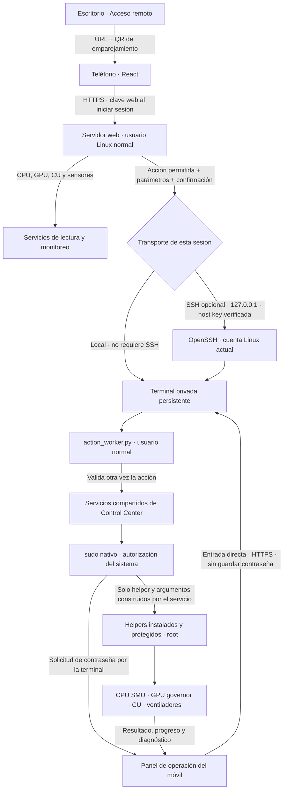

# Estructura del control web de BC250

La web vive en la rama `feature/bc250-web`. Comparte servicios y helpers con la
aplicación de escritorio. React organiza la interfaz móvil; Python sirve la
web y coordina las operaciones; OpenSSH y sudo se encargan de sus respectivas
autorizaciones. Node se necesita para compilar React, no para usar la web.



## Archivos

```text
frontends/
├── web/
│   ├── app/                       # Fuentes React y herramientas de compilación
│   │   ├── build.mjs
│   │   └── src/
│   │       ├── main.jsx           # Sesión, navegación, SSH y panel de operación
│   │       ├── lib.jsx            # API, polling, traducción y contexto
│   │       ├── ui.jsx             # Controles y diálogos accesibles
│   │       ├── styles.css         # Responsive y paleta compartida del escritorio
│   │       └── pages/             # Dashboard, Cpu, Compute, Gpu, Fans, Performance, Settings
│   ├── dist/                      # Web compilada que sirve la aplicación
│   ├── server.py                  # HTTPS, sesiones, CSRF y aislamiento entre navegadores
│   ├── actions.py                 # Catálogo cerrado y validación de parámetros
│   ├── data.py                    # Lecturas y series de monitoreo
│   ├── ssh.py                     # Terminal persistente local u OpenSSH; salida y entrada
│   ├── ssh_worker.py              # Protocolo privado; cede la terminal a cada operación
│   └── action_worker.py           # Ejecuta una acción validada como usuario normal
└── desktop/pages/remote_access.py # Única sección GUI de escritorio modificada; URL/QR/HTTPS
src/bc250cc/
├── application/system/web_access.py  # Fachada del acceso web
├── infrastructure/
│   ├── web_control.py               # Configuración, certificados, procesos y SSH local
│   ├── polkit_session.py            # Ruta sudo exclusiva del worker web; desktop conserva Polkit
│   └── terminal_repository.py       # Flujos compartidos; registro de salida
└── _vendor/                         # Generador QR con su licencia
privileged/helpers/                  # Helpers existentes; no se convierten los workers en root
tests/web/                          # Pruebas HTTP, QR, SSH y terminal persistente
docs/WEB_ACCESS.md                  # Uso, requisitos y límites de autorización
```

## Qué significa cada contraseña

- **Clave web:** permite entrar a la web. No se repite al editar CU o aplicar un perfil.
- **SSH:** autentica la conexión SSH si la eliges. Puede usar una clave SSH autorizada o contraseña.
- **Linux/sudo:** permite al helper realizar una operación privilegiada. Puede volver a pedirla cuando venza la autorización del sistema.

Una conexión SSH correcta no concede root. El error `BC250-AUTH-002` observado
procedía de un flujo con `pkexec`: la política instalada denegaba sesiones
remotas antes de mostrar una solicitud de contraseña. La ruta web usa ahora
sudo con una terminal disponible, sin cambiar las políticas del equipo.

La autorización sigue dependiendo de sudoers: si la cuenta no tiene permiso,
la web muestra el rechazo. No elimina contraseñas del sistema ni instala reglas
`NOPASSWD`. Cancelar una operación conserva la terminal para la siguiente;
cerrar sesión, rotar la clave web o vencer la sesión cierra sus terminales.
