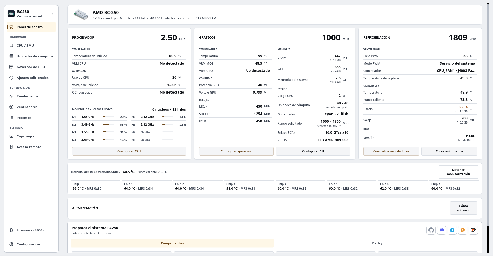

# BC250 Control Center

Richten Sie den AMD BC-250 unter Linux über den Desktop, ein Terminal oder einen Webbrowser ein, optimieren und überwachen Sie ihn.

Es behandelt den GPU-Governor, die CPU-Optimierung, Recheneinheiten, Lüfter, Speicher, BIOS-Aktualisierungsmedien, Hochskalierung und Systemvorbereitung für die unterstützten Distributionen. Die Schnittstellen teilen sich Anwendungsdienste, Hardwarebeschränkungen und privilegierte Helfer. Ein optionales Decky-Plugin bringt die alltäglichen Steuerelemente in den Spielemodus von Steam.

<p align="center">
  <a href="https://movacx.github.io/bc250-control-center/gallery/#dashboard"></a>
</p>

<p align="center">
  <a href="../../README.md"></a>
  <a href="README.es.md"></a>
  <a href="README.pt-BR.md"></a>
  <a href="README.ru.md"></a>
  <a href="README.uk.md"></a>
  <a href="README.de.md"></a>
  <a href="README.fr.md"></a>
  <a href="README.pl.md"></a>
  <a href="README.zh-CN.md"></a>
  <a href="README.ja.md"></a>
</p>

<p align="center">
  <a href="https://ko-fi.com/movacx"></a>
</p>

Weitere Screenshots finden Sie in der [Galerie](https://movacx.github.io/bc250-control-center/gallery/).

## Wählen Sie Ihre Schnittstelle

| Schnittstelle | Bestens geeignet für | Start |
| --- | --- | --- |
| **Desktop · PyQt6** | Vollständige Einrichtung, Abstimmung, Diagnose und lokale Verwaltung | `bc250-control-center` |
| **Terminal · curses** | Eine lokale TTY-, Terminalemulator- oder SSH-Sitzung | `bc250-control-center-tui` |
| **Web · React** | Überwachung und Hardwaresteuerung von einem Telefon, Tablet oder einem anderen Computer im Heimnetzwerk aus | Starten Sie **Remote Access** in der Desktop-App und öffnen Sie dann die Adresse oder scannen Sie den QR |

Die normale Installation umfasst die Terminalschnittstelle und die kompilierten Web-Assets. Für Maschinen ohne Desktop ist ein [Nur-Terminal-Installationsprogramm](#terminal-mode) verfügbar. Für die Browseroberfläche muss der Webserver des Boards ausgeführt werden. Für den normalen Gebrauch ist weder SSH noch Node.js erforderlich.

## Funktionen

- Dashboard mit CPU, GPU, Kühlung, Last pro Kern, GDDR6-Temperatur pro Chip, installiertem BIOS und Spannungsschienen (die Schienen benötigen die I2C-Hardwaremodifikation; die Anwendung enthält eine Anleitung mit Fotos)
- Leistungsdiagramme für CPU, GPU, VRAM, RAM, Datenträger und Netzwerk, mit Sensoransicht und CSV-Export
- Verwaltung des GPU-Governors (Cyan, mit Oberon als Alternative), sichere Frequenzbereiche und ein Spannungslabor
- CPU-Abstimmung über die SMU, Stabilitätstest und optionales Freischalten von Kernen
- Recheneinheiten: Routing- und Registerdiagnose, wobei Live- und Boot-Status separat gemeldet werden; Die verfügbaren Einheiten hängen von der Platine ab
- Lüftersteuerung: manueller PWM-Wert, Temperaturkurven, dauerhafte Profile oder Übergabe an CoolerControl, fancontrol oder fan2go
- Speicher: VRAM-Größe, ZRAM, ZSWAP und Swap
- Erstellung eines USB-Sticks für BIOS-Updates (P3.00 Chipset Menu, MeiMeiDXE v3, P5.00, P3.00, P2.00), wobei jede Datei geprüft wird
- Upscaling pro Spiel: FSR4 INT8 über OptiScaler Client und HelixSR, mit Sicherung und Wiederherstellung der Spieldateien
- Systemvorbereitung je nach Distribution, ausgeführt in einem integrierten Terminal
- Kompatibilitätskorrekturen für GFX1013, Async Compute, ACPI und Mesa; Dolby Digital 5.1 über HDMI; Steuerung des Fernsehers über HDMI-CEC
- Problemberichte innerhalb der Anwendung, mit Fehlercodes, Ursprungscodes und dem angehängten Rohfehler
- 30 Sprachen, helles und dunkles Design, Skalierung der Oberfläche und Navigation mit dem Controller
- Terminalschnittstelle mit Tastaturnavigation, Mausunterstützung, Live-Telemetrie und einer eingebetteten Bedienkonsole
- Lokales Netzwerk-HTTPS-Webinterface mit mobilen Layouts, gekoppeltem QR und Hardware-Berechtigungen pro Gerät

## Unterstützte Distributionen

- Arch Linux, CachyOS, Manjaro
- Fedora, Nobara
- Bazzite und andere Fedora-Atomic-Varianten
- SteamOS (Beta)
- Ubuntu, Linux Mint, Debian 13

Python 3.11 oder neuer ist erforderlich. Andere Distributionen, einschließlich Systeme mit OpenRC, werden nach Möglichkeit erkannt und behandelt, aber nicht bei jeder Version getestet.

## Installation

### AUR

Für Arch Linux, CachyOS und SteamOS:

```bash
yay -S bc250-control-center-git
```

### Release-Pakete

Lade das Paket für deine Distribution aus der [neuesten Version](https://github.com/movacx/bc250-control-center/releases/latest) herunter.

Arch Linux, CachyOS, Manjaro:

```bash
sudo pacman -U ./bc250-control-center-*-any.pkg.tar.zst
```

Fedora, Nobara:

```bash
sudo dnf install ./bc250-control-center-*.rpm
```

Bazzite und Fedora Atomic (ein Neustart ist nötig):

```bash
sudo rpm-ostree install ./bc250-control-center-*.rpm
systemctl reboot
```

Ubuntu, Linux Mint, Debian:

```bash
sudo apt install ./bc250-control-center_*.deb
```

Verwende `apt install` statt `dpkg -i`, damit die Abhängigkeiten mitinstalliert werden. Wenn ein Paket durch `dpkg -i` halb installiert blieb, führe `sudo apt --fix-broken install` aus.

### SteamOS

SteamOS hält die Systempartition schreibgeschützt, daher kann das Paket nur installiert werden, wenn dieser Schutz deaktiviert ist. Öffne im Desktop-Modus Konsole und führe aus:

```bash
sudo steamos-readonly disable
sudo pacman-key --init
sudo pacman-key --populate archlinux holo
sudo pacman -Syy
sudo pacman -U ./bc250-control-center-*-any.pkg.tar.zst
sudo steamos-readonly enable
```

Die Zeilen mit `pacman-key` und `pacman -Syy` aktualisieren den Schlüsselbund und die Paketdatenbanken, die ein SteamOS-Update zurücksetzt. Falls du noch kein Passwort für den Benutzer `deck` gesetzt hast, führe zuerst `passwd` aus. Nach einem SteamOS-Update erledigt **Reinstall BC250 Control Center** im Menü des Desktop-Modus diese Schritte für dich.


## Aktualisierungen

Die Anwendung sucht nach neuen Versionen, zeigt das Änderungsprotokoll, prüft die Prüfsumme des Pakets und installiert das Update mit dem Paketmanager des Systems.

**SteamOS:** Ein Systemupdate von SteamOS entfernt Pakete, die im System installiert wurden, und damit auch dieses. Führe nach einem Systemupdate **Reinstall BC250 Control Center** im Menü des Desktop-Modus aus und starte danach Prepare BC250 system erneut. SteamOS fragt nach dem Passwort des Benutzers `deck`; falls du keins hast, setze eins mit `passwd`.

**Upgrade von 1.19:** Der Updater von 1.19 kann keine Pakete installieren. Installiere die aktuelle Version einmal von Hand; spätere Versionen aktualisieren sich selbst.

```bash
# Bazzite / Fedora Atomic: replace a layered 1.19 package
sudo rpm-ostree uninstall bc250-control-center --install ./bc250-control-center-*.noarch.rpm
systemctl reboot

# A copy installed with install-local.sh: remove it, then install the package
bash scripts/uninstall-local.sh
```

## Erste Schritte

1. Starte BC250 Control Center. Der Ersteinrichtungsbildschirm legt Sprache und Erscheinungsbild fest und bietet an, die nötigen Komponenten zu installieren.
2. Optional kannst du die geführte Tour machen, die erklärt, was jedes Modul auf dem Board verändert.
3. Führe im Dashboard **Prepare BC250 system** aus. Es zeigt, was für deine Distribution installiert wird, und führt es im integrierten Terminal aus.
4. Lies vor dem Anwenden von Änderungen die Statuszeile eines Moduls; sie zeigt, was bereit ist und was fehlt.

<a id="terminal-mode"></a>

## Terminalmodus

Die TUI läuft in einem Terminalemulator, einem Linux TTY oder einer SSH-Sitzung. Es teilt die Hardwaresteuerung und Überwachungsdienste der Desktop-Anwendung. Python 3.11 oder neuer, `curses` und `psutil` sind erforderlich; PyQt6 ist nicht.

### Mit installierter Desktop-Anwendung

Im regulären Paket ist die TUI enthalten. Beginnen Sie mit:

```bash
bc250-control-center-tui
```

### Nur-Terminal-Installation

Klonen Sie das Repository und führen Sie das Installationsprogramm als Ihr normaler Benutzer aus:

```bash
git clone https://github.com/movacx/bc250-control-center.git
cd bc250-control-center
bash scripts/install-tui.sh
```

Das Installationsprogramm platziert die Anwendung in `~/.local` und überprüft ihre Python-Abhängigkeiten. Für die Installation fehlender Pakete und geschützter Hardware-Hilfsprogramme wird eine Administratorberechtigung angefordert. Es installiert weder PyQt6 noch einen Desktop-Launcher. Auf Bazzite/Fedora Atomic überspringt dieses Skript die Installation des Systemhilfsprogramms; Die Helfer müssen über RPM mit `rpm-ostree` installiert werden, gefolgt von einem Neustart.

Starten Sie die Schnittstelle:

```bash
~/.local/bin/bc250-control-center-tui
```

Wenn `~/.local/bin` bereits in deinem `PATH` steht, verwende `bc250-control-center-tui`. Zum Aktualisieren einer Quellcodeinstallation führe `git pull --ff-only` im selben Repository aus und starte den Installer erneut. Zum Entfernen:

```bash
bash scripts/install-tui.sh --uninstall
```

### Navigation

| Eingabe | Aktion |
| --- | --- |
| `↑` / `↓` oder `j` / `k` | Wählen Sie ein Element aus |
| `Enter` | Öffnen Sie einen Abschnitt oder führen Sie eine Aktion aus |
| `Esc` oder `Tab` | Kehren Sie zur Seitenleiste zurück |
| `[` / `]` | Abschnittsregisterkarten wechseln |
| `/` | Suchen |
| `PgUp` / `PgDn` | Scrollen Sie durch die Seite oder die Operationsausgabe |
| Maus | Abschnitte und Steuerelemente auswählen; Scrollen Sie mit dem Rad |
| `?` | Hilfe anzeigen |
| `q` | Beenden |

Operationen zeigen ihre Ausgabe in der integrierten Konsole an. Auf Anfrage werden dort Administrator-Passwörter eingegeben; `Ctrl+C` unterbricht den laufenden Befehl. Die Konsole behält das Ergebnis und den Protokollspeicherort nach Abschluss bei.

So öffnen Sie eine bestimmte Seite oder verwenden die monochrome Ausgabe:

```bash
bc250-control-center-tui --page gpu --theme mono
```

Für SSH muss auf dem Board ein SSH-Server aktiviert und erreichbar sein:

```bash
ssh -t user@board-ip bc250-control-center-tui
```

Ersetzen Sie `user` und `board-ip` durch das Linux-Konto und die Adresse des Boards.

## Webschnittstelle

Öffnen Sie **Fernzugriff** in der Desktop-Anwendung oder TUI, starten Sie den Webzugriff und aktivieren Sie **Erreichbar über das lokale Netzwerk**, um eine Verbindung von einem anderen Gerät herzustellen. Wählen Sie die dort angezeigte Adresse oder scannen Sie deren sichtbaren QR. Halten Sie sowohl den lokalen Namen als auch die numerische IP verfügbar: Die Namensauflösung hängt vom Client und Netzwerk ab.

Melden Sie sich mit dem auf der Tafel angezeigten Zugangsschlüssel an. Neue Browsersitzungen können nur überwacht werden. Überprüfen Sie unter **Verbundene Geräte** den Gerätecode des Browsers, bevor Sie die Hardwaresteuerung gewähren. Diese Berechtigung ist unabhängig vom Linux-Administratorkennwort, das für privilegierte Vorgänge erforderlich ist. Der Eigentümer kann den Zugriff widerrufen und für jede Sitzung einen Ablauf festlegen.

Das Web bietet Dashboard, CPU, Recheneinheiten, GPU, Spannungslabor, Lüfter, Leistung, Blackbox und Einstellungen. Die Leistung umfasst CPU, GPU, Speicher, Festplatte, Netzwerk und einzelne Sensorverläufe. Themen und Sprache werden pro Browser gespeichert.

Der LAN-Zugriff erfolgt über HTTPS. Bei jeder Installation wird eine lokale Zertifizierungsstelle erstellt. Browser warnen möglicherweise, bis das öffentliche Zertifikat auf dem Gerät vertrauenswürdig ist. Vergleichen Sie den angezeigten Fingerabdruck, bevor Sie ihm vertrauen. Wenn der LAN-Zugriff deaktiviert ist, kann nur die Karte selbst eine Verbindung über Loopback herstellen. Die Anwendung öffnet keine Router-Ports und konfiguriert keinen öffentlichen Tunnel.

Benutzer benötigen kein Node.js: Pakete liefern die erstellten Web-Assets.

## Decky-Plugin

BC250 Quick Access ist ein optionales Panel für das Schnellzugriffsmenü des Spielmodus von Steam. Es bietet Steuerungen für GPU, Compute Units, CPU, Lüfter und VRAM, GPU- und Lüfterprofile pro Spiel sowie Live-Anzeigen für Async Compute. Die erweiterte Konfiguration bleibt in der Desktop-Anwendung.

Installiere es über den Abschnitt **Decky** im Dashboard. Decky Loader wird ebenfalls installiert, falls es fehlt; sonst installiert nichts in der Anwendung Decky. Details stehen im [README des Plugins](../../integrations/decky/bc250-quick-access/README.md).

## Probleme melden

Fehlerfenster zeigen einen Diagnosecode (zum Beispiel `BC250-UPSCALE-001`), einen Ursprungscode, der die Funktion angibt, in der der Fehler auftrat (zum Beispiel `GPU-0142`), und den Rohfehler mit seinem Traceback.

Verwende **Dieses Problem melden** im Fehlerfenster oder **Einstellungen › Diagnose › Bericht senden**. Das Berichtsformular öffnet sich in der Anwendung, mit bereits ausgefüllten Codes, dem Rohfehler, den Systemdaten und den letzten Fehlern. Du kannst alles vor dem Senden prüfen; Pfade im Home-Verzeichnis werden durch `~` ersetzt. Lässt sich das Formular nicht absenden, öffnet es sich im Browser, wobei deine Antworten erhalten bleiben. Das Formular ist außerdem [im Web](https://docs.google.com/forms/d/e/1FAIpQLSe3M1stf3bpCoorb4hCWFX9YC_TZ_Gv6WHWQDRe1AV5rJT6rA/viewform) verfügbar.

Der Bericht enthält außerdem eine Hardware-Diagnose, die auf jeder Distribution ohne root gesammelt wird: Kernel und Header, geladene Sensormodule und ihre Kernelmeldungen (NCT6687, amdgpu), hwmon- und `sensors`-Werte, GPU- und Absturzzeilen aus dem Kernel-Log, wie der vorherige Start endete (sauberes Herunterfahren oder abrupter Reset), Dienste, Pakete und das Ende des letzten Workflow-Logs. Ist das Kernel-Log für deinen Benutzer gesperrt, fragt der Desktop einmal über polkit nach dem Passwort. Zu große Berichte werden automatisch gekürzt, wobei zuerst die weniger wichtigen Teile entfernt werden; **Im Browser öffnen** kopiert weiterhin den vollständigen Text.

Um alle Anhänge eines Berichts vor dem Senden zu lesen, öffnen Sie **Einstellungen › Diagnose › Vollständige Diagnose anzeigen**: Jeder Abschnitt (Kernel, vorheriger Start, Blackbox, Sensoren, GPU, Dienste, Konfiguration, Pakete, Protokolle) ist erweiterbar, in Registerkarten sortiert, durchsuchbar und kann als Datei kopiert oder gespeichert werden. Das Terminal druckt dasselbe mit `bc250-control-center-cli diagnose --full`.

Probleme auf GitHub sind ebenfalls willkommen. Bitte gib deine Distribution, die Kernelversion und die Terminalausgabe an.

## Sicherheit

Overclocking, das Freischalten von Compute Units, das Ändern der Lüftersteuerung und das Flashen eines BIOS können das System instabil machen, zu Datenverlust führen oder das Board beschädigen. Ändere jeweils nur eine Einstellung und behalte einen Weg, sie zurückzusetzen. Die Prüfungen der Anwendung fangen gängige Fehler ab, sind aber keine Garantie.

## Danksagungen

Dieses Projekt baut auf der Arbeit der BC-250-Community auf. Die folgenden Projekte gehören ihren Autoren; die Anwendung bindet sie über geprüfte, auf eine Version festgelegte Abläufe ein. Lizenzen und der Umfang jeder Integration stehen in den [Hinweisen zu Drittanbietern](../THIRD_PARTY_NOTICES.md).

**GPU**
- [cyan-skillfish-governor](https://github.com/filippor/cyan-skillfish-governor/tree/smu): GPU-Governor
- [Oberon Governor](https://gitlab.com/mothenjoyer69/oberon-governor): alternativer Governor
- [bc250-gfx1013-fix](https://github.com/DryhoppedIPA/bc250-gfx1013-fix) und [bc250-steamos](https://github.com/keyboardspecialist/bc250-steamos): Kernel und Mesa/RADV für GFX1013
- [linux-cachyos-bc250](https://github.com/MastaG/linux-cachyos-bc250): Kernel und Mesa/RADV für Arch und CachyOS
- [bc250-async-compute-bazzite](https://github.com/tri3gubki-ops/bc250-async-compute-bazzite): Async Compute auf Bazzite 44, mit RADV-Patches, die auch für Arch, CachyOS und Fedora mit Kernel 7.2 oder neuer gebaut werden

**Upscaling**
- [bc250-fsr4](https://github.com/dmorazasanchez/bc250-fsr4) und [bc250-fsr4-fork](https://github.com/daniel-h-0/bc250-fsr4-fork): OptiScaler Client, FSR4 pro Spiel
- [HelixSR](https://github.com/lonewolf0622/HelixSR): DLSS-Model-E-Rekonstruktion in Spielen mit FSR 3.1

**CPU und Compute Units**
- [bc250_smu_oc](https://github.com/bc250-collective/bc250_smu_oc): CPU-Erkennung und -Abstimmung über die SMU
- [bc250-core-unlock](https://github.com/rw-r-r-0644/bc250-core-unlock) und [bc250-efi-core-unlock](https://github.com/Hexxeh/bc250-efi-core-unlock): Freischalten von Kernen
- [bc250-acpi-fix](https://github.com/e-tho/bc250-acpi-fix): CPU-Leistungszustände über ACPI
- [bc250-cu-live-manager](https://github.com/WinnieLV/bc250-cu-live-manager), [bc250-cu-live-manager-SteamOS](https://github.com/F5GO/bc250-cu-live-manager-SteamOS) und [bc250-40cu-unlock](https://github.com/duggasco/bc250-40cu-unlock): Compute Units

**Sensoren, Speicher und Lüfter**
- [BC250-Telemetry](https://github.com/onlinermm/BC250-Telemetry): VRM-Telemetrie und die Fotos der I2C-Anleitung
- [bc250-memory-temperature](https://github.com/pan-Rijovich/bc250-memory-temperature): GDDR6-Temperatur
- [bc250_memcfg](https://github.com/fanoush/bc250_memcfg): VRAM-Größe über CMOS
- [nct6687d](https://github.com/Fred78290/nct6687d): NCT-Sensoren und Lüfter-PWM
- [linux-cec](https://gitlab.steamos.cloud/holo/linux-cec): cecd, der HDMI-CEC-Daemon von Valve

**Firmware**
- [bc250-bios](https://gitlab.com/TuxThePenguin0/bc250-bios): originales P3.00-BIOS und Chipset Menu
- [AMD-BC-250-UEFI-v2.2-Firmware-Menu-Script](https://github.com/Forbidden-Darkness/AMD-BC-250-UEFI-v2.2-Firmware-Menu-Script): UEFI Shell und MeiMeiDXE v3
- [BC-250](https://github.com/kenavru/BC-250): Spiegel des Update-Kits von ASRock (P2.00 und P5.00)
- [bc250-custom-bios-logo](https://github.com/tmghd272/bc250-custom-bios-logo): eigenes Boot-Logo

**Verwandte Projekte** (von der Anwendung nicht verwendet; Lizenzen laut GitHub)
- [bc250-vrm-dkms](https://github.com/Hexxeh/bc250-vrm-dkms) und [bc250-memory-dkms](https://github.com/Hexxeh/bc250-memory-dkms) (GPL-2.0): VRM- und Speichertemperaturen als Kernelmodule
- [bc250-bazzite-suite](https://github.com/RobertoTorino/bc250-bazzite-suite) (GPL-3.0): Einrichtungssuite für Bazzite
- [bc250-vcn-research](https://github.com/Shalasere/bc250-vcn-research) und [amdgpu-wddm](https://github.com/D-Ogi/amdgpu-wddm): VCN-Videokodierungsforschung und ein offener Windows-Treiber (keine Lizenz angegeben; nur verlinkt)

## Projektstruktur

```text
bc250-control-center/
├── src/bc250cc/              Der Kern, ohne grafische Oberfläche
│   ├── domain/               Regeln und Grenzwerte jedes Moduls (GPU, CPU, CU, Lüfter, Firmware…)
│   ├── application/          Anwendungsfälle, die diese Regeln kombinieren
│   ├── infrastructure/       Systemzugriff: Sensoren, Dienste, Pakete, GitHub
│   ├── platform/             Unterschiede zwischen Distributionen und Startsystemen
│   └── shared/               Version, Pfade und Verträge, die alle Prozesse teilen
├── frontends/
│   ├── desktop/              Desktop-Anwendung in Qt
│   │   ├── pages/            Eine Datei pro Modul (Dashboard, GPU, CPU, Lüfter, Firmware…)
│   │   ├── components/       Wiederverwendbare Oberflächenteile
│   │   ├── onboarding/       Willkommensbildschirm und geführte Tour
│   │   ├── console/          Integriertes Terminal
│   │   ├── theme/            Designs, Stile, Farben und Symbole
│   │   └── i18n/             Übersetzungen in 30 Sprachen
│   ├── tui/                  Terminalschnittstelle: curses-Bildschirm, Seiten und Bedienkonsole
│   ├── web/                  HTTPS-Backend, validierte Action Worker und Browser-Schnittstelle
│   │   ├── app/              React Quell- und Build-Tools (Node.js nur für die Entwicklung)
│   │   └── dist/             Kompilierte Assets, die von Python bereitgestellt und in Paketen versendet werden
│   └── cli.py                Command-line mode
├── integrations/
│   ├── decky/                Decky-Quick-Access-Plugin für den Spielmodus
│   └── report-endpoint/      Cloudflare-Endpunkt für vom Benutzer übermittelte Berichte
├── privileged/               Was als root läuft, isoliert und geprüft
│   ├── helpers/              Ein Helfer pro privilegierter Aufgabe
│   ├── lib/                  Code, den diese Helfer gemeinsam nutzen
│   └── policies/             Polkit-Berechtigungen
├── packaging/                .pkg.tar.zst-, .rpm- und .deb-Pakete sowie das AUR-PKGBUILD
├── scripts/
│   ├── entrypoints/          Desktop-, CLI-, Daemon- und TUI-Launcher
│   ├── development/          Web-Build- und Entwicklungsdienstprogramme
│   ├── system/               Arbeitsabläufe für Verteilung und Systemvorbereitung
│   └── qa/                   Verpackungs-, Integrations- und Vertriebskontrollen
├── assets/                   Symbole, Screenshots und Web-Galerie
├── docs/                     Dokumentation, Hinweise zu Drittanbietern und Übersetzungen dieses READMEs
└── tests/                    Unit-, Service-, Desktop-, TUI-, Web- und Verpackungskontrollen
```

Siehe [Architecture](../ARQUITECTURA_MVC.md) für Ebenengrenzen und [Frontends](../../frontends/README.md) für Schnittstelleneinstiegspunkte und Entwicklungsbefehle.
