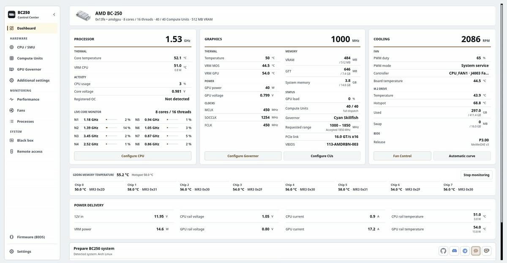
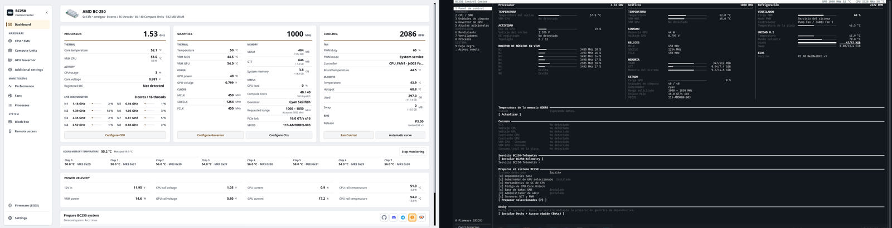
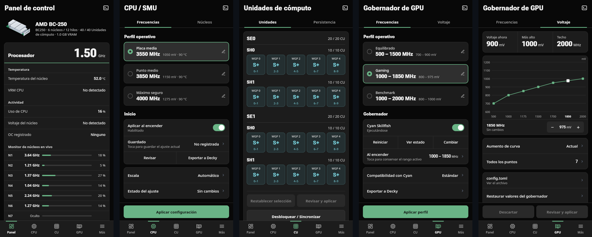

<h1 align="center">BC250 Control Center</h1>

<p align="center">
  Configura, ajusta y vigila la <b>AMD BC-250</b> en Linux desde el escritorio, la terminal, el navegador o tu teléfono.
</p>

<p align="center">
  <a href="https://github.com/movacx/bc250-control-center/releases/latest"></a>
  <a href="../../LICENSE"></a>
  
  
  <a href="https://ko-fi.com/movacx"></a>
</p>

<p align="center">
  <a href="https://movacx.github.io/bc250-control-center/gallery/#dashboard"></a>
</p>

<p align="center">
  <a href="../../README.md"></a>
  <a href="README.es.md"></a>
  <a href="README.pt-BR.md"></a>
  <a href="README.ru.md"></a>
  <a href="README.uk.md"></a>
  <a href="README.de.md"></a>
  <a href="README.fr.md"></a>
  <a href="README.pl.md"></a>
  <a href="README.zh-CN.md"></a>
  <a href="README.ja.md"></a>
</p>

---

Un solo programa para todo lo que la placa necesita: el gobernador de la GPU, el ajuste de la CPU, las unidades de cómputo, los ventiladores, la memoria, la BIOS, el escalado en juegos y la preparación del sistema según tu distribución.

Todas las interfaces usan los mismos límites y comprobaciones: ninguna puede hacer algo que otra considere inseguro. El programa nunca se ejecuta como administrador; los cambios en el hardware los hacen controles protegidos, cada uno con una lista cerrada de operaciones.

## Instalación rápida

Con tu usuario normal, sin `sudo`:

```bash
git clone https://github.com/movacx/bc250-control-center.git
cd bc250-control-center
bash scripts/install-local.sh
```

Después abre **BC250 Control Center** desde el menú, o escribe `bc250-control-center`. Si prefieres el paquete de tu distribución o una sola interfaz, sigue leyendo.

## Contenido

1. [Elige tu interfaz](#elige-tu-interfaz)
2. [Requisitos](#requisitos)
3. [Instalación](#instalación)
4. [Primeros pasos](#primeros-pasos)
5. [Qué puedes hacer](#qué-puedes-hacer)
6. [Usar cada interfaz](#usar-cada-interfaz)
7. [Contraseña y permisos](#contraseña-y-permisos)
8. [Actualizar y desinstalar](#actualizar-y-desinstalar)
9. [Solución de problemas](#solución-de-problemas)
10. [Preguntas frecuentes](#preguntas-frecuentes)
11. [Seguridad del hardware](#seguridad-del-hardware)
12. [Para desarrolladores](#para-desarrolladores)
13. [Créditos](#créditos)

## Elige tu interfaz

| | Interfaz | Úsala si… | Se abre con |
| --- | --- | --- | --- |
| 🖥️ | **Escritorio** | Tienes pantalla en la placa y quieres todas las funciones | `bc250-control-center` |
| ⌨️ | **Terminal** | Trabajas en una consola o por SSH | `bc250-control-center-tui` |
| 🌐 | **Web** | Quieres controlarla desde otro equipo de tu casa, sin pantalla en la placa | La dirección que muestra la placa |
| 📱 | **Android** | Quieres lo mismo que la web, como aplicación en el teléfono | La aplicación |
| 🎮 | **Decky** (opcional) | Quieres los controles de cada día dentro del Modo Juego de Steam | El menú rápido de Steam |

<p align="center">
  
</p>

La instalación de escritorio ya trae la terminal y la web. Si solo quieres una de ellas, cada una tiene su instalador y no instala lo que no necesita.

## Requisitos

- Una placa **AMD BC-250**.
- **Python 3.11** o posterior.
- Una cuenta con permiso de administrador (`sudo`).
- Para la aplicación de Android: **Android 7.0** o posterior y la misma red que la placa.

| Distribución | Estado | Formato |
| --- | --- | --- |
| Arch Linux, CachyOS, Manjaro | Soportada | AUR o `.pkg.tar.zst` |
| Fedora, Nobara | Soportada | `.rpm` |
| Bazzite y otras Fedora Atomic | Soportada | `.rpm` con `rpm-ostree` |
| Ubuntu, Linux Mint, Debian 13 | Soportada | `.deb` |
| SteamOS | Beta | `.pkg.tar.zst` o AUR |

Otras distribuciones, también las que usan OpenRC, se detectan y se atienden en lo posible, pero no se prueban en cada versión.

## Instalación

Hay dos caminos y los dos instalan lo mismo:

- **Paquete de tu distribución:** lo recomendado. Se actualiza con el sistema.
- **Desde el repositorio:** clonas el proyecto. Sirve para instalar una sola interfaz o para seguir la versión en desarrollo.

### Opción A · Paquete

Descarga el paquete de tu distribución desde la [última versión](https://github.com/movacx/bc250-control-center/releases/latest) y, en la carpeta donde lo guardaste:

<table>
<tr><th>Distribución</th><th>Comando</th></tr>
<tr><td>Arch, CachyOS, Manjaro</td><td>

```bash
sudo pacman -U ./bc250-control-center-*-any.pkg.tar.zst
```

o desde AUR: `yay -S bc250-control-center-git`
</td></tr>
<tr><td>Fedora, Nobara</td><td>

```bash
sudo dnf install ./bc250-control-center-*.rpm
```
</td></tr>
<tr><td>Bazzite, Fedora Atomic</td><td>

```bash
sudo rpm-ostree install ./bc250-control-center-*.rpm
systemctl reboot
```
</td></tr>
<tr><td>Ubuntu, Linux Mint, Debian</td><td>

```bash
sudo apt install ./bc250-control-center_*.deb
```

Usa `apt install`, no `dpkg -i`: así se instalan también las dependencias.
</td></tr>
</table>

El paquete trae las tres interfaces. Al instalarlo con `sudo`, tu cuenta queda lista para usar CPU, GPU, unidades de cómputo y ventiladores sin escribir la contraseña cada vez ([más detalles](#contraseña-y-permisos)).

### Opción B · Desde el repositorio

Clona el proyecto una vez, con tu usuario normal:

```bash
git clone https://github.com/movacx/bc250-control-center.git
cd bc250-control-center
```

Después, desde esa carpeta, elige qué instalar:

| Quiero… | Comando | Qué instala |
| --- | --- | --- |
| **Las tres** | `bash scripts/install-local.sh` | Escritorio con su acceso en el menú, terminal y web |
| **Solo la terminal** | `bash scripts/install-tui.sh` | La terminal, sin PyQt6 ni nada gráfico |
| **Solo la web** | `bash scripts/install-web.sh` | La web, y la deja encendida para tu red |

Los tres instaladores:

- colocan el programa en `~/.local`, sin tocar los archivos del sistema;
- comprueban qué falta y te piden permiso de administrador solo para instalar dependencias y los controles protegidos del hardware;
- descargan la web ya compilada de la página de versiones y comprueban su huella antes de usarla, así que la primera vez necesitan internet;
- se pueden ejecutar otra vez para actualizar.

Para ver qué haría uno sin cambiar nada, añade `--check`. Por ejemplo, `bash scripts/install-tui.sh --check`.

> [!NOTE]
> Si la terminal no encuentra el comando, `~/.local/bin` no está en tu `PATH`. Ábrelo con la ruta completa, por ejemplo `~/.local/bin/bc250-control-center-tui`.

> [!IMPORTANT]
> En Bazzite y Fedora Atomic los controles protegidos no se pueden instalar desde el repositorio. Usa el paquete `.rpm` con `rpm-ostree` y reinicia.

#### Solo la web

`install-web.sh` deja la web encendida y muestra la dirección, la clave y un código QR. La placa no necesita pantalla. Desde entonces:

| Comando | Qué hace |
| --- | --- |
| `bc250-control-center web setup` | Enciende el acceso web y muestra dirección, clave y QR |
| `bc250-control-center web status` | Los vuelve a mostrar |
| `bc250-control-center web stop` | Apaga el acceso web |

No hace falta Node.js ni otro servidor. Con `--no-start`, la instala sin encenderla.

### Aplicación para Android

1. Descarga el archivo `.apk` desde la [última versión](https://github.com/movacx/bc250-control-center/releases/latest) e instálalo. Android te pedirá permiso para instalar aplicaciones de fuera de la tienda.
2. En la placa, enciende el acceso web: **Acceso remoto › Iniciar acceso web** y activa **Accesible desde la red local**. Sin pantalla, usa `bc250-control-center web setup`.
3. Con el teléfono en la misma red Wi-Fi, abre la aplicación y escribe la dirección que muestra la placa, o pega el enlace de su código QR.

La aplicación recuerda la sesión y comprueba que siempre habla con tu placa. Funciona solo dentro de tu red; no usa ningún servidor de internet.

<p align="center">
  
</p>

En un iPhone, abre la dirección en el navegador: es la misma interfaz y se puede añadir a la pantalla de inicio.

### SteamOS

SteamOS protege su partición de sistema contra escritura, así que el paquete se instala mientras esa protección está apagada. En el Modo Escritorio, abre Konsole:

```bash
sudo steamos-readonly disable
sudo pacman-key --init
sudo pacman-key --populate archlinux holo
sudo pacman -Syy
sudo pacman -U ./bc250-control-center-*-any.pkg.tar.zst
sudo steamos-readonly enable
```

Si el usuario `deck` no tiene contraseña, créala antes con `passwd`. Cada actualización de SteamOS borra los paquetes instalados así: después de actualizar, usa **Reinstall BC250 Control Center** en el menú del Modo Escritorio y vuelve a preparar el sistema.

## Primeros pasos

1. **Abre el programa.** La bienvenida te pide idioma, unidad de temperatura y apariencia.
2. **Prepara el sistema.** En el **Panel**, pulsa **Preparar el sistema BC250**. Antes de instalar nada, te muestra qué necesita tu distribución.
3. **Reinicia** si te lo pide.
4. **Lee la línea de estado** de cada página antes de cambiar algo: dice qué está listo y qué falta.
5. **Cambia una cosa a la vez.** Comprueba temperaturas y estabilidad antes de guardarla para el arranque.

El recorrido guiado explica qué cambia cada página en la placa. Puedes repetirlo en **Configuración › General**.

## Qué puedes hacer

| Página | Para qué sirve |
| --- | --- |
| **Panel** | Lecturas de CPU, gráficos, refrigeración y alimentación; temperatura de la GDDR6 por chip; BIOS instalada. Desde aquí se prepara el sistema. |
| **CPU / SMU** | Perfiles de frecuencia, voltaje y límite de temperatura; prueba de estabilidad; aplicarlos al encender; desbloqueo de los núcleos ocultos, temporal o permanente. |
| **Unidades de cómputo** | Activar o desactivar pares de unidades en vivo, ver sus registros y recuperar la selección al arrancar. Cuántas hay disponibles depende de cada placa. |
| **Gobernador de GPU** | Perfiles de frecuencia, control del gobernador (Cyan u Oberon), compatibilidad con cada kernel y laboratorio de voltaje. |
| **Ventiladores** | Velocidad fija, curvas por temperatura, mezcla de varias fuentes, perfiles, calibración y control desde el arranque. |
| **Rendimiento** | Gráficas de CPU, GPU, VRAM, RAM, disco y red, todos los sensores y exportación a CSV. |
| **Procesos** | Qué usa la memoria y la GPU; pausar o cerrar programas y liberar memoria mientras juegas. |
| **Ajustes adicionales** | Kernel, Mesa, async compute y ACPI; escalado por juego (FSR4 con OptiScaler y HelixSR); VRAM, ZRAM, ZSWAP y swap; Dolby Digital 5.1; control de la TV por HDMI-CEC. |
| **Firmware (BIOS)** | Prepara un USB con P3.00 Chipset Menu, MeiMeiDXE v3, P5.00, P3.00 o P2.00, y un logotipo de arranque propio. Cada archivo se verifica y el programa nunca escribe la BIOS por sí mismo. |
| **Caja negra** | Graba lo que hace la placa, para que un reporte muestre los segundos previos a un cuelgue. |
| **Acceso remoto** | Enciende la web, muestra el QR y administra los dispositivos y los permisos. |

Además: 30 idiomas, tema claro y oscuro, tamaño de la interfaz, °C o °F y manejo con mando.

> [!NOTE]
> Las lecturas de alimentación necesitan la modificación I2C de la placa. El programa incluye una guía con fotos.

## Usar cada interfaz

### Terminal

| Tecla | Acción |
| --- | --- |
| `↑` `↓` o `j` `k` | Elegir |
| `Enter` | Abrir o ejecutar |
| `Esc` o `Tab` | Volver al menú |
| `[` `]` | Cambiar de pestaña |
| `/` | Buscar |
| `RePág` `AvPág` | Desplazar |
| `?` | Ayuda |
| `q` | Salir |

También funciona con el ratón. Las operaciones se ven en la consola integrada: ahí se escribe la contraseña si hace falta, y `Ctrl+C` detiene lo que está en marcha.

```bash
bc250-control-center-tui --page gpu --theme mono      # abrir en una página y sin color
ssh -t usuario@ip-de-la-placa bc250-control-center-tui   # desde otro equipo
```

### Web y teléfono

| Para… | Haz esto |
| --- | --- |
| Emparejar un teléfono | Escanea el QR de **Acceso remoto**. Sirve una sola vez y se renueva solo. |
| Entrar desde un ordenador | Abre la dirección y escribe la **clave de acceso remoto**. |
| Limitar un dispositivo | En **Dispositivos emparejados**: déjalo solo para mirar, ponle una duración o desconéctalo. |
| Echar a todos | **Nueva clave de acceso**. Úsala si alguien más conoce la clave. |

Un dispositivo emparejado puede controlar el hardware. La conexión va cifrada con un certificado creado en tu propia placa: el navegador avisará hasta que confíes en él. Puedes descargarlo en **Acceso remoto** y comparar su huella.

La web solo acepta conexiones de tu red de casa. El programa no abre puertos en el router ni crea túneles. Con **Accesible desde la red local** apagado, solo se puede usar desde la propia placa.

### Decky

**BC250 Quick Access** añade un panel al menú rápido del Modo Juego, con GPU, unidades de cómputo, CPU, ventiladores y VRAM, y perfiles por juego. Se instala desde la sección **Decky** del Panel. Más detalles en el [README del complemento](../../integrations/decky/bc250-quick-access/README.md).

### Línea de comandos

```bash
bc250-control-center-cli --help
```

Sirve para consultar el sistema y los sensores, la caja negra, los perfiles, las copias de recuperación y el diagnóstico completo (`diagnose --full`).

## Contraseña y permisos

**Acciones sin contraseña.** Los cambios de CPU, unidades de cómputo, GPU y ventiladores no te piden la contraseña de Linux cada vez.

| | |
| --- | --- |
| **Viene** | Activado para la cuenta que instala el programa con `sudo` |
| **Se cambia en** | **Acceso remoto › Permisos**, o **Configuración › General** |
| **Al actualizar** | Respeta lo que elegiste; si lo apagaste, sigue apagado |
| **Sigue pidiendo contraseña** | Desbloqueo de núcleos, temperatura de la GDDR6, instalar componentes, memoria, kernel y BIOS |

> [!WARNING]
> Mientras está activo, quien use tu sesión, o un dispositivo emparejado con control, puede hacer esos cambios sin contraseña. Apágalo si compartes el equipo.

Las confirmaciones de las acciones con riesgo aparecen siempre, esté activado o no. Si tu instalación no pudo activarlo (por ejemplo, desde una tienda de aplicaciones), actívalo tú una vez desde **Acceso remoto**.

## Actualizar y desinstalar

**Paquetes.** El programa avisa cuando hay una versión nueva, te enseña los cambios, verifica el paquete y lo instala. También puedes usar tu gestor de paquetes.

**Repositorio.** Desde la misma carpeta, repite el instalador que usaste:

```bash
git pull --ff-only
bash scripts/install-local.sh
```

Si la web cambió, el instalador descarga la que corresponde.

**Android.** Instala el `.apk` nuevo encima: conserva la sesión.

**Desinstalar lo instalado desde el repositorio:**

```bash
bash scripts/uninstall-local.sh
```

Añade `--dry-run` para ver qué quitaría o `--purge-user-data` para borrar también tu configuración. `install-tui.sh` e `install-web.sh` aceptan `--uninstall`.

**Desinstalar un paquete:** `sudo pacman -R bc250-control-center`, `sudo dnf remove bc250-control-center`, `sudo rpm-ostree uninstall bc250-control-center` o `sudo apt remove bc250-control-center`. Si quedan ajustes que hay que deshacer antes (memoria, arranque o ACPI), la desinstalación se detiene y te dice cuáles.

## Solución de problemas

| Qué pasa | Qué hacer |
| --- | --- |
| El teléfono no encuentra la placa | Comprueba que estén en la misma red y que **Accesible desde la red local** esté activado. Prueba con la dirección numérica. |
| La web dice que el firewall bloquea | **Acceso remoto › Configurar firewall de la red local**. |
| El navegador avisa del certificado | Es normal la primera vez. Compara la huella con la de **Acceso remoto**. |
| Sigue pidiendo contraseña | **Acceso remoto › Permisos**. Si ya estaba activado, apágalo y vuelve a encenderlo. |
| Ventiladores en solo lectura | **Ventiladores › Preparar controlador PWM**. |
| El gobernador no arranca | **Ver estado** en la página de GPU dice la causa y cómo arreglarla. |
| La instalación desde el repositorio no instala la web | Necesita internet la primera vez. Vuelve a ejecutar el instalador con conexión. |

**Configuración › Soporte** tiene un manual sin conexión con los [errores conocidos](../errores/README.md), adaptado a tu distribución.

### Enviar un reporte

Cada error muestra un código, por ejemplo `BC250-GPU-001`. Pulsa **Reportar este problema** y se abre un formulario con el código, el error y los datos del sistema ya puestos. Puedes leerlo todo antes de enviarlo; las rutas de tu carpeta personal se sustituyen por `~`.

También puedes abrir un [issue en GitHub](https://github.com/movacx/bc250-control-center/issues) con tu distribución, la versión del kernel y la salida de la terminal.

## Preguntas frecuentes

**¿Puede dañar mi placa?**
Cambiar frecuencias, voltajes o ventiladores siempre tiene riesgo. El programa limita los valores a rangos revisados y comprueba cada cambio, pero no puede garantizar que tu placa en concreto los aguante. Ve paso a paso.

**¿Escribe la BIOS?**
No. Prepara un USB con los archivos verificados, y la actualización la haces tú desde el arranque de la placa.

**¿Necesito internet?**
Para instalar componentes, sí. Para usar el programa, no. La web y la aplicación de Android funcionan solo dentro de tu red.

**¿Envía datos a algún sitio?**
No envía nada por su cuenta. Consulta GitHub para saber si hay una versión nueva, descarga los componentes que tú pides y envía los reportes que tú decides, después de que los leas.

**¿Por qué me pide la contraseña?**
Porque cambiar el hardware necesita permiso de administrador. En CPU, GPU, unidades de cómputo y ventiladores puedes dejar de escribirla; mira [Contraseña y permisos](#contraseña-y-permisos).

## Seguridad del hardware

> [!CAUTION]
> Subir frecuencias, desbloquear unidades o núcleos, cambiar los ventiladores o grabar una BIOS puede volver inestable el sistema, hacer perder datos o dañar la placa. Cambia una cosa a la vez y ten siempre cómo volver atrás. Las comprobaciones del programa evitan los errores comunes, pero no son una garantía.

## Para desarrolladores

```text
src/bc250cc/        El núcleo, sin interfaz: reglas, operaciones y acceso al sistema
frontends/desktop/  Aplicación de escritorio (PyQt6)
frontends/tui/      Interfaz de terminal (curses)
frontends/web/      Servidor web y sus operaciones
frontends/web/app/  Web y aplicación de Android (Kotlin Multiplatform y Compose)
integrations/       Complemento de Decky y recepción de reportes
privileged/         Lo que se ejecuta como administrador, aislado y revisado
packaging/          Paquetes .pkg.tar.zst, .rpm, .deb y AUR
scripts/            Instaladores, herramientas de desarrollo y pruebas
tests/              Pruebas
```

| Tarea | Comando |
| --- | --- |
| Abrir el escritorio sin instalar | `./run.sh` |
| Compilar la web (necesita un JDK) | `scripts/development/build-web.sh` |
| Compilar la aplicación de Android (necesita su SDK) | `cd frontends/web/app && ./gradlew :androidApp:assembleDebug` |
| Empaquetar una web nueva para publicarla | `python3 scripts/development/empaquetar_web.py` |

La web compilada no se guarda en git: los instaladores y los paquetes descargan la que indica `frontends/web/web-build.json` y comprueban su huella. Más detalles en [Arquitectura](../ARQUITECTURA_MVC.md) y [Frontends](../../frontends/README.md). Para avisar de un problema de seguridad, sigue [SECURITY.md](../../SECURITY.md).

## Créditos

Este proyecto se apoya en el trabajo de la comunidad de la BC-250. Los proyectos de abajo pertenecen a sus autores; la aplicación los integra mediante flujos revisados y fijados a una versión concreta. Las licencias y el alcance de cada integración están en los [avisos de terceros](../THIRD_PARTY_NOTICES.md).

**GPU**
- [cyan-skillfish-governor](https://github.com/filippor/cyan-skillfish-governor/tree/smu): gobernador de la GPU
- [Oberon Governor](https://gitlab.com/mothenjoyer69/oberon-governor): gobernador alternativo
- [bc250-gfx1013-fix](https://github.com/DryhoppedIPA/bc250-gfx1013-fix) y [bc250-steamos](https://github.com/keyboardspecialist/bc250-steamos): kernel y Mesa/RADV para GFX1013
- [linux-cachyos-bc250](https://github.com/MastaG/linux-cachyos-bc250): kernel y Mesa/RADV para Arch y CachyOS
- [bc250-async-compute-bazzite](https://github.com/tri3gubki-ops/bc250-async-compute-bazzite): async compute en Bazzite 44, con parches de RADV también compilados para Arch, CachyOS y Fedora con kernel 7.2 o posterior

**Escalado**
- [bc250-fsr4](https://github.com/dmorazasanchez/bc250-fsr4) y [bc250-fsr4-fork](https://github.com/daniel-h-0/bc250-fsr4-fork): OptiScaler Client, FSR4 por juego
- [HelixSR](https://github.com/lonewolf0622/HelixSR): reconstrucción DLSS Model E en juegos con FSR 3.1

**CPU y Unidades de Cómputo**
- [bc250_smu_oc](https://github.com/bc250-collective/bc250_smu_oc): detección y ajuste de la CPU mediante la SMU
- [bc250-core-unlock](https://github.com/rw-r-r-0644/bc250-core-unlock) y [bc250-efi-core-unlock](https://github.com/Hexxeh/bc250-efi-core-unlock): desbloqueo de núcleos
- [bc250-acpi-fix](https://github.com/e-tho/bc250-acpi-fix): estados de rendimiento de la CPU mediante ACPI
- [bc250-cu-live-manager](https://github.com/WinnieLV/bc250-cu-live-manager), [bc250-cu-live-manager-SteamOS](https://github.com/F5GO/bc250-cu-live-manager-SteamOS) y [bc250-40cu-unlock](https://github.com/duggasco/bc250-40cu-unlock): Unidades de Cómputo

**Sensores, memoria y ventiladores**
- [BC250-Telemetry](https://github.com/onlinermm/BC250-Telemetry): telemetría de los reguladores de voltaje (VRM) y las fotos de la guía I2C
- [bc250-memory-temperature](https://github.com/pan-Rijovich/bc250-memory-temperature): temperatura de la GDDR6
- [bc250_memcfg](https://github.com/fanoush/bc250_memcfg): tamaño de la VRAM mediante CMOS
- [nct6687d](https://github.com/Fred78290/nct6687d): sensores NCT y PWM de los ventiladores
- [linux-cec](https://gitlab.steamos.cloud/holo/linux-cec): cecd, el demonio HDMI-CEC de Valve

**Firmware**
- [bc250-bios](https://gitlab.com/TuxThePenguin0/bc250-bios): BIOS P3.00 original y Chipset Menu
- [AMD-BC-250-UEFI-v2.2-Firmware-Menu-Script](https://github.com/Forbidden-Darkness/AMD-BC-250-UEFI-v2.2-Firmware-Menu-Script): UEFI Shell y MeiMeiDXE v3
- [BC-250](https://github.com/kenavru/BC-250): copia del kit de actualización de ASRock (P2.00 y P5.00)
- [bc250-custom-bios-logo](https://github.com/tmghd272/bc250-custom-bios-logo): logotipo de arranque personalizado

**Proyectos relacionados** (la aplicación no los usa; licencias según GitHub)
- [bc250-vrm-dkms](https://github.com/Hexxeh/bc250-vrm-dkms) y [bc250-memory-dkms](https://github.com/Hexxeh/bc250-memory-dkms) (GPL-2.0): temperaturas del VRM y de la memoria como módulos del kernel
- [bc250-bazzite-suite](https://github.com/RobertoTorino/bc250-bazzite-suite) (GPL-3.0): suite de configuración para Bazzite
- [bc250-vcn-research](https://github.com/Shalasere/bc250-vcn-research) y [amdgpu-wddm](https://github.com/D-Ogi/amdgpu-wddm): investigación de la codificación de vídeo VCN y un driver abierto para Windows (sin licencia declarada; solo enlazados)
