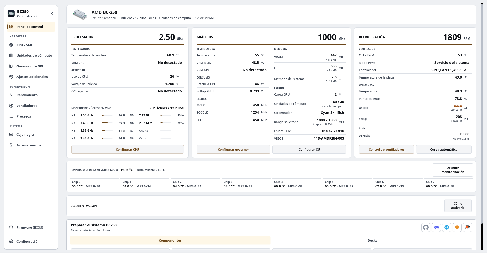

# BC250 Control Center

Configure, ajuste y supervise el AMD BC-250 en Linux desde el escritorio, un terminal o un navegador web.

Cubre el regulador de GPU, el ajuste de CPU, las unidades de cómputo, los ventiladores, la memoria, los medios de actualización del BIOS, la ampliación y la preparación del sistema para las distribuciones compatibles. Las interfaces comparten servicios de aplicaciones, límites de hardware y ayudantes privilegiados. Un complemento opcional Decky trae los controles cotidianos al modo de juego de Steam.

<p align="center">
  <a href="https://movacx.github.io/bc250-control-center/gallery/#dashboard"></a>
</p>

<p align="center">
  <a href="../../README.md"></a>
  <a href="README.es.md"></a>
  <a href="README.pt-BR.md"></a>
  <a href="README.ru.md"></a>
  <a href="README.uk.md"></a>
  <a href="README.de.md"></a>
  <a href="README.fr.md"></a>
  <a href="README.pl.md"></a>
  <a href="README.zh-CN.md"></a>
  <a href="README.ja.md"></a>
</p>

<p align="center">
  <a href="https://ko-fi.com/movacx"></a>
</p>

Hay más capturas de pantalla en la [galería](https://movacx.github.io/bc250-control-center/gallery/).

## Elige tu interfaz

| Interfaz | Más adecuado para | Cómo abrirla |
| --- | --- | --- |
| **Escritorio · PyQt6** | Configuración completa, ajuste, diagnóstico y administración local. | `bc250-control-center` |
| **Terminal · curses** | Un TTY local, un emulador de terminal o una sesión SSH | `bc250-control-center-tui` |
| **Web · React** | Monitoreo y controles de hardware desde un teléfono, tableta u otra computadora en la red doméstica | Inicie **Acceso remoto** en la aplicación de escritorio, luego abra su dirección o escanee el QR. |

La instalación normal incluye la interfaz del terminal y los recursos web compilados. Un [instalador solo para terminal](#terminal-mode) está disponible para máquinas sin escritorio. La interfaz del navegador necesita que el servidor web de la placa esté en funcionamiento; no necesita SSH ni Node.js para un uso normal.

## Funciones

- Panel con CPU, GPU, refrigeración, carga por núcleo, temperatura de la GDDR6 por chip, BIOS instalada y rieles de alimentación (los rieles necesitan la modificación de hardware I2C; la aplicación incluye una guía con fotos)
- Gráficas de rendimiento de CPU, GPU, VRAM, RAM, disco y red, con vista de sensores y exportación a CSV
- Gestión del gobernador de la GPU (Cyan, con Oberon como alternativa), rangos de frecuencia seguros y un laboratorio de voltaje
- Ajuste de la CPU mediante la SMU, prueba de estabilidad y desbloqueo opcional de núcleos
- Unidades de cómputo: diagnóstico de enrutamiento y registro, con estados en vivo y de arranque informados por separado; Las unidades disponibles dependen del tablero.
- Control de ventiladores: PWM manual, curvas por temperatura, perfiles persistentes, o cesión a CoolerControl, fancontrol o fan2go
- Memoria: tamaño de la VRAM, ZRAM, ZSWAP y swap
- Creación de USB para actualizar la BIOS (P3.00 Chipset Menu, MeiMeiDXE v3, P5.00, P3.00, P2.00) con cada archivo verificado
- Escalado por juego: FSR4 INT8 mediante OptiScaler Client y HelixSR, con copia de seguridad y restauración de los archivos del juego
- Preparación del sistema según la distribución, ejecutada en una terminal integrada
- Correcciones de compatibilidad para GFX1013, async compute, ACPI y Mesa; Dolby Digital 5.1 por HDMI; control de la TV por HDMI-CEC
- Informes de problemas dentro de la aplicación, con códigos de error, códigos de origen y el error sin procesar adjunto
- 30 idiomas, temas claro y oscuro, escalado de la interfaz y navegación con mando
- Interfaz de terminal con navegación por teclado, compatibilidad con mouse, telemetría en vivo y una consola de operación integrada
- Interfaz web HTTPS de red local con diseños móviles, emparejamiento de QR y permisos de hardware por dispositivo

## Distribuciones compatibles

- Arch Linux, CachyOS, Manjaro
- Fedora, Nobara
- Bazzite y otras variantes atómicas de Fedora
- SteamOS (beta)
- Ubuntu, Linux Mint, Debian 13

Se necesita Python 3.11 o posterior. Otras distribuciones, incluidos los sistemas con OpenRC, se detectan y se tratan en lo posible, pero no se prueban en cada versión.

## Instalación

### AUR

Para Arch Linux, CachyOS y SteamOS:

```bash
yay -S bc250-control-center-git
```

### Paquetes de cada versión

Descarga el paquete de tu distribución desde la [última versión](https://github.com/movacx/bc250-control-center/releases/latest).

Arch Linux, CachyOS, Manjaro:

```bash
sudo pacman -U ./bc250-control-center-*-any.pkg.tar.zst
```

Fedora, Nobara:

```bash
sudo dnf install ./bc250-control-center-*.rpm
```

Bazzite y Fedora Atomic (hace falta reiniciar):

```bash
sudo rpm-ostree install ./bc250-control-center-*.rpm
systemctl reboot
```

Ubuntu, Linux Mint, Debian:

```bash
sudo apt install ./bc250-control-center_*.deb
```

Usa `apt install` en lugar de `dpkg -i` para que se instalen las dependencias. Si un paquete quedó a medias por `dpkg -i`, ejecuta `sudo apt --fix-broken install`.

### SteamOS

SteamOS mantiene su partición del sistema en solo lectura, así que el paquete solo se puede instalar mientras esa protección está desactivada. Abre Konsole en el Modo Escritorio y ejecuta:

```bash
sudo steamos-readonly disable
sudo pacman-key --init
sudo pacman-key --populate archlinux holo
sudo pacman -Syy
sudo pacman -U ./bc250-control-center-*-any.pkg.tar.zst
sudo steamos-readonly enable
```

Las líneas de `pacman-key` y `pacman -Syy` actualizan el llavero y las bases de datos de paquetes, que una actualización de SteamOS reinicia. Si todavía no has puesto contraseña al usuario `deck`, ejecuta `passwd` antes. Tras una actualización de SteamOS, **Reinstall BC250 Control Center** en el menú del Modo Escritorio hace estos pasos por ti.


## Actualizaciones

La aplicación busca nuevas versiones, muestra el registro de cambios, verifica la suma de comprobación del paquete e instala la actualización con el gestor de paquetes del sistema.

**SteamOS:** una actualización del sistema de SteamOS elimina los paquetes instalados en el sistema, incluido este. Después de una actualización del sistema, ejecuta **Reinstall BC250 Control Center** desde el menú del Modo Escritorio y luego vuelve a ejecutar Prepare BC250 system. SteamOS pide la contraseña del usuario `deck`; si no la tienes, créala con `passwd`.

**Desde la 1.19:** el actualizador de la 1.19 no puede instalar paquetes. Instala una vez la versión actual a mano; las siguientes se actualizan solas.

```bash
# Bazzite / Fedora Atomic: replace a layered 1.19 package
sudo rpm-ostree uninstall bc250-control-center --install ./bc250-control-center-*.noarch.rpm
systemctl reboot

# A copy installed with install-local.sh: remove it, then install the package
bash scripts/uninstall-local.sh
```

## Primeros pasos

1. Abre BC250 Control Center. La pantalla de primer inicio elige el idioma y la apariencia, y ofrece instalar los componentes necesarios.
2. Opcionalmente, haz el recorrido guiado, que explica qué cambia cada módulo en la placa.
3. En el Panel, ejecuta **Prepare BC250 system**. Muestra lo que se instalará para tu distribución y lo ejecuta en la terminal integrada.
4. Lee la línea de estado de un módulo antes de aplicar cambios; indica qué está listo y qué falta.

<a id="terminal-mode"></a>

## Modo terminal

TUI funciona en un emulador de terminal, una TTY de Linux o una sesión SSH. Comparte los controles de hardware y los servicios de monitorización del escritorio. Requiere Python 3.11 o posterior, `curses` y `psutil`; no necesita PyQt6.

### Con la aplicación de escritorio instalada

El paquete normal incluye TUI. Para abrirla:

```bash
bc250-control-center-tui
```

### Instalar únicamente TUI

Clona el repositorio y ejecuta el instalador como tu usuario normal:

```bash
git clone https://github.com/movacx/bc250-control-center.git
cd bc250-control-center
bash scripts/install-tui.sh
```

El instalador guarda la aplicación en `~/.local` y comprueba sus dependencias de Python. Solicita autorización de administrador para instalar los paquetes que falten y los helpers protegidos. No instala PyQt6 ni un lanzador de escritorio. En Bazzite/Fedora Atomic, el script omite instalar los helpers del sistema: se necesitan los del RPM instalado mediante `rpm-ostree` y reiniciar después.

Abre la interfaz:

```bash
~/.local/bin/bc250-control-center-tui
```

Si `~/.local/bin` ya está en tu `PATH`, usa `bc250-control-center-tui`. Para actualizar una instalación desde el código fuente, ejecuta `git pull --ff-only` en el mismo repositorio y vuelve a ejecutar el instalador. Para desinstalar:

```bash
bash scripts/install-tui.sh --uninstall
```

### Navegación

| Entrada | Acción |
| --- | --- |
| `↑` / `↓` o `j` / `k` | Seleccionar un elemento |
| `Enter` | Abrir una sección o ejecutar una acción |
| `Esc` o `Tab` | Volver a la barra lateral |
| `[` / `]` | Cambiar pestañas de sección |
| `/` | Buscar |
| `PgUp` / `PgDn` | Desplazarse por la página o resultado de la operación |
| Ratón | Seleccionar secciones y controles; desplazarse con la rueda |
| `?` | Mostrar ayuda |
| `q` | Salir |

Las operaciones muestran su salida en la consola integrada. Las contraseñas de administrador se ingresan allí cuando se solicitan; `Ctrl+C` interrumpe el comando en ejecución. La consola conserva el resultado y la ubicación del registro una vez finalizado.

Para abrir una página específica o utilizar salida monocromática:

```bash
bc250-control-center-tui --page gpu --theme mono
```

Para SSH, la placa debe tener un servidor SSH habilitado y accesible:

```bash
ssh -t user@board-ip bc250-control-center-tui
```

Reemplace `user` y `board-ip` con la cuenta y dirección Linux de la placa.

## interfaz web

Abra **Acceso remoto** en la aplicación de escritorio o TUI, inicie el acceso web y habilite **Accesible desde la red local** para conectarse desde otro dispositivo. Elige la dirección que allí se muestra o escanea su QR visible. Mantenga disponibles tanto el nombre local como la IP numérica: la resolución del nombre depende del cliente y la red.

Inicia sesión con la clave de acceso que se muestra en el tablero. Las nuevas sesiones del navegador solo pueden monitorear. En **Dispositivos conectados**, verifique el código del dispositivo del navegador antes de otorgar el control del hardware. Ese permiso es independiente de la contraseña de administrador de Linux requerida por las operaciones privilegiadas. El propietario puede revocar el acceso y elegir una caducidad para cada sesión.

La web proporciona Panel de control, CPU, Unidades de cómputo, GPU, Laboratorio de voltaje, Ventiladores, Rendimiento, Caja negra y Configuración. El rendimiento incluye CPU, GPU, memoria, disco, red e historiales de sensores individuales. Los temas y el idioma se guardan por navegador.

El acceso LAN utiliza HTTPS. Cada instalación crea una autoridad certificadora local; Los navegadores pueden avisar hasta que su certificado público sea confiable en ese dispositivo. Compare la huella digital mostrada antes de confiar en ella. Con el acceso a LAN deshabilitado, solo la propia placa puede conectarse a través de loopback. La aplicación no abre puertos del enrutador ni configura un túnel público.

Los usuarios no necesitan Node.js: los paquetes envían los recursos web creados.

## Plugin de Decky

BC250 Quick Access es un panel opcional para el menú de acceso rápido del Modo Juego de Steam. Ofrece controles de GPU, Unidades de Cómputo, CPU, ventiladores y VRAM, perfiles de GPU y ventiladores por juego, y lecturas en vivo de async compute. La configuración avanzada se queda en la aplicación de escritorio.

Instálalo desde la sección **Decky** del Panel. También se instala Decky Loader si falta; nada más de la aplicación instala Decky. Consulta el [README del plugin](../../integrations/decky/bc250-quick-access/README.md) para más detalles.

## Informar de problemas

Las ventanas de error muestran un código de diagnóstico (por ejemplo, `BC250-UPSCALE-001`), un código de origen que identifica la función donde ocurrió el error (por ejemplo, `GPU-0142`) y el error sin procesar con su traza.

Usa **Reportar este problema** en la ventana de error, o **Ajustes › Diagnóstico › Enviar un informe**. El formulario se abre dentro de la aplicación con los códigos, el error sin procesar, las especificaciones del sistema y los errores recientes ya rellenados. Puedes revisarlo todo antes de enviarlo; las rutas de tu carpeta personal se sustituyen por `~`. Si el formulario no se puede enviar, se abre en el navegador con tus respuestas. El formulario también está [en la web](https://docs.google.com/forms/d/e/1FAIpQLSe3M1stf3bpCoorb4hCWFX9YC_TZ_Gv6WHWQDRe1AV5rJT6rA/viewform).

El informe adjunta además un diagnóstico del hardware, recopilado sin root en todas las distribuciones: kernel y cabeceras, módulos de sensores cargados y sus mensajes del kernel (NCT6687, amdgpu), lecturas de hwmon y `sensors`, líneas de GPU y de fallos del registro del kernel, cómo terminó el arranque anterior (apagado limpio o reinicio brusco), servicios, paquetes y el final del último registro de flujo de trabajo. Si el registro del kernel no es legible para tu usuario, el escritorio pide la contraseña una vez mediante polkit. Los informes demasiado grandes para el formulario se recortan automáticamente, empezando por las partes menos importantes; **Abrir en el navegador** sigue copiando el texto completo.

Para leer todo lo que adjunta un informe antes de enviarlo, abra **Configuración › Diagnóstico › Ver diagnóstico completo**: cada sección (kernel, arranque anterior, caja negra, sensores, GPU, servicios, configuración, paquetes, registros) se puede expandir, ordenar en pestañas, buscar y se puede copiar o guardar como un archivo. El terminal imprime lo mismo con `bc250-control-center-cli diagnose --full`.

Los problemas en GitHub también son bienvenidos. Incluye tu distribución, la versión del kernel y la salida de la terminal.

## Seguridad

El overclocking, desbloquear Unidades de Cómputo, cambiar el control de ventiladores o grabar una BIOS pueden dejar el sistema inestable, causar pérdida de datos o dañar la placa. Cambia una cosa cada vez y ten forma de revertirla. Las comprobaciones de la aplicación detectan errores comunes, pero no son una garantía.

## Créditos

Este proyecto se apoya en el trabajo de la comunidad de la BC-250. Los proyectos de abajo pertenecen a sus autores; la aplicación los integra mediante flujos revisados y fijados a una versión concreta. Las licencias y el alcance de cada integración están en los [avisos de terceros](../THIRD_PARTY_NOTICES.md).

**GPU**
- [cyan-skillfish-governor](https://github.com/filippor/cyan-skillfish-governor/tree/smu): gobernador de la GPU
- [Oberon Governor](https://gitlab.com/mothenjoyer69/oberon-governor): gobernador alternativo
- [bc250-gfx1013-fix](https://github.com/DryhoppedIPA/bc250-gfx1013-fix) y [bc250-steamos](https://github.com/keyboardspecialist/bc250-steamos): kernel y Mesa/RADV para GFX1013
- [linux-cachyos-bc250](https://github.com/MastaG/linux-cachyos-bc250): kernel y Mesa/RADV para Arch y CachyOS
- [bc250-async-compute-bazzite](https://github.com/tri3gubki-ops/bc250-async-compute-bazzite): async compute en Bazzite 44, con parches de RADV también compilados para Arch, CachyOS y Fedora con kernel 7.2 o posterior

**Escalado**
- [bc250-fsr4](https://github.com/dmorazasanchez/bc250-fsr4) y [bc250-fsr4-fork](https://github.com/daniel-h-0/bc250-fsr4-fork): OptiScaler Client, FSR4 por juego
- [HelixSR](https://github.com/lonewolf0622/HelixSR): reconstrucción DLSS Model E en juegos con FSR 3.1

**CPU y Unidades de Cómputo**
- [bc250_smu_oc](https://github.com/bc250-collective/bc250_smu_oc): detección y ajuste de la CPU mediante la SMU
- [bc250-core-unlock](https://github.com/rw-r-r-0644/bc250-core-unlock) y [bc250-efi-core-unlock](https://github.com/Hexxeh/bc250-efi-core-unlock): desbloqueo de núcleos
- [bc250-acpi-fix](https://github.com/e-tho/bc250-acpi-fix): estados de rendimiento de la CPU mediante ACPI
- [bc250-cu-live-manager](https://github.com/WinnieLV/bc250-cu-live-manager), [bc250-cu-live-manager-SteamOS](https://github.com/F5GO/bc250-cu-live-manager-SteamOS) y [bc250-40cu-unlock](https://github.com/duggasco/bc250-40cu-unlock): Unidades de Cómputo

**Sensores, memoria y ventiladores**
- [BC250-Telemetry](https://github.com/onlinermm/BC250-Telemetry): telemetría de los reguladores de voltaje (VRM) y las fotos de la guía I2C
- [bc250-memory-temperature](https://github.com/pan-Rijovich/bc250-memory-temperature): temperatura de la GDDR6
- [bc250_memcfg](https://github.com/fanoush/bc250_memcfg): tamaño de la VRAM mediante CMOS
- [nct6687d](https://github.com/Fred78290/nct6687d): sensores NCT y PWM de los ventiladores
- [linux-cec](https://gitlab.steamos.cloud/holo/linux-cec): cecd, el demonio HDMI-CEC de Valve

**Firmware**
- [bc250-bios](https://gitlab.com/TuxThePenguin0/bc250-bios): BIOS P3.00 original y Chipset Menu
- [AMD-BC-250-UEFI-v2.2-Firmware-Menu-Script](https://github.com/Forbidden-Darkness/AMD-BC-250-UEFI-v2.2-Firmware-Menu-Script): UEFI Shell y MeiMeiDXE v3
- [BC-250](https://github.com/kenavru/BC-250): copia del kit de actualización de ASRock (P2.00 y P5.00)
- [bc250-custom-bios-logo](https://github.com/tmghd272/bc250-custom-bios-logo): logotipo de arranque personalizado

**Proyectos relacionados** (la aplicación no los usa; licencias según GitHub)
- [bc250-vrm-dkms](https://github.com/Hexxeh/bc250-vrm-dkms) y [bc250-memory-dkms](https://github.com/Hexxeh/bc250-memory-dkms) (GPL-2.0): temperaturas del VRM y de la memoria como módulos del kernel
- [bc250-bazzite-suite](https://github.com/RobertoTorino/bc250-bazzite-suite) (GPL-3.0): suite de configuración para Bazzite
- [bc250-vcn-research](https://github.com/Shalasere/bc250-vcn-research) y [amdgpu-wddm](https://github.com/D-Ogi/amdgpu-wddm): investigación de la codificación de vídeo VCN y un driver abierto para Windows (sin licencia declarada; solo enlazados)

## Estructura del proyecto

```text
bc250-control-center/
├── src/bc250cc/              El núcleo, sin interfaz gráfica
│   ├── domain/               Reglas y límites de cada módulo (GPU, CPU, CU, ventiladores, firmware…)
│   ├── application/          Casos de uso que combinan esas reglas
│   ├── infrastructure/       Acceso al sistema: sensores, servicios, paquetes, GitHub
│   ├── platform/             Diferencias entre distribuciones y sistemas de arranque
│   └── shared/               Versión, rutas y contratos compartidos por todos los procesos
├── frontends/
│   ├── desktop/              Aplicación de escritorio en Qt
│   │   ├── pages/            Un archivo por módulo (panel, GPU, CPU, ventiladores, firmware…)
│   │   ├── components/       Piezas reutilizables de la interfaz
│   │   ├── onboarding/       Pantalla de bienvenida y tour guiado
│   │   ├── console/          Terminal integrada
│   │   ├── theme/            Temas, estilos, colores e iconos
│   │   └── i18n/             Traducciones a 30 idiomas
│   ├── tui/                  Interfaz de terminal: pantalla de curses, páginas y consola de operación
│   ├── web/                  Backend HTTPS, trabajadores de acción validados e interfaz de navegador
│   │   ├── app/              React source y herramientas de compilación (Node.js solo para desarrollo)
│   │   └── dist/             Activos compilados servidos por Python y enviados en paquetes
│   └── cli.py                Command-line mode
├── integrations/
│   ├── decky/                Plugin Decky Quick Access para el modo Juego
│   └── report-endpoint/      Punto final de Cloudflare para informes enviados por usuarios
├── privileged/               Lo que se ejecuta como root, aislado y revisado
│   ├── helpers/              Un ayudante por tarea privilegiada
│   ├── lib/                  Código compartido por esos ayudantes
│   └── policies/             Permisos de Polkit
├── packaging/                Paquetes .pkg.tar.zst, .rpm y .deb, y el PKGBUILD del AUR
├── scripts/
│   ├── entrypoints/          Lanzadores de escritorio, CLI, demonio y TUI
│   ├── development/          Utilidades de creación y desarrollo web
│   ├── system/               Flujos de trabajo de distribución y preparación del sistema.
│   └── qa/                   Controles de embalaje, integración y distribución.
├── assets/                   Iconos, capturas y galería web
├── docs/                     Documentación, avisos de terceros y traducciones de este README
└── tests/                    Verificaciones unitarias, de servicio, de escritorio, TUI, web y de embalaje.
```

Consulte [Arquitectura](../ARQUITECTURA_MVC.md) para conocer los límites de las capas y [Frontends](../../frontends/README.md) para conocer los puntos de entrada de la interfaz y los comandos de desarrollo.
