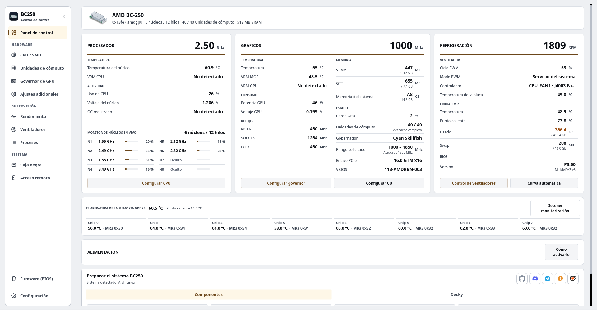

# BC250 Control Center

Configurez, réglez et surveillez le AMD BC-250 sur Linux depuis le bureau, un terminal ou un navigateur Web.

Il couvre le gouverneur du GPU, le réglage du CPU, les unités de calcul, les ventilateurs, la mémoire, les supports de mise à jour du BIOS, la mise à l'échelle et la préparation du système pour les distributions prises en charge. Les interfaces partagent des services applicatifs, des limites matérielles et des assistants privilégiés. Un plugin Decky en option apporte les commandes quotidiennes au mode jeu de Steam.

<p align="center">
  <a href="https://movacx.github.io/bc250-control-center/gallery/#dashboard"></a>
</p>

<p align="center">
  <a href="../../README.md"></a>
  <a href="README.es.md"></a>
  <a href="README.pt-BR.md"></a>
  <a href="README.ru.md"></a>
  <a href="README.uk.md"></a>
  <a href="README.de.md"></a>
  <a href="README.fr.md"></a>
  <a href="README.pl.md"></a>
  <a href="README.zh-CN.md"></a>
  <a href="README.ja.md"></a>
</p>

<p align="center">
  <a href="https://ko-fi.com/movacx"></a>
</p>

D'autres captures d'écran se trouvent dans la [gallery](https://movacx.github.io/bc250-control-center/gallery/).

## Choisissez votre interface

| Interface | Idéal pour | Ouvrir |
| --- | --- | --- |
| **Bureau · PyQt6** | Configuration complète, réglage, diagnostics et administration locale | `bc250-control-center` |
| **Terminal · curses** | Un TTY local, un émulateur de terminal ou une session SSH | `bc250-control-center-tui` |
| **Web · React** | Surveillance et contrôles matériels depuis un téléphone, une tablette ou un autre ordinateur du réseau domestique | Démarrez l'**Accès à distance** dans l'application de bureau, puis ouvrez son adresse ou scannez le QR. |

L'installation normale comprend l'interface du terminal et les ressources Web compilées. Un [installateur de terminal uniquement](#terminal-mode) est disponible pour les machines sans ordinateur de bureau. L'interface du navigateur nécessite que le serveur Web de la carte soit en cours d'exécution ; il n'a pas besoin de SSH ou de Node.js pour une utilisation normale.

## Fonctionnalités

- Tableau de bord avec CPU, GPU, refroidissement, charge par cœur, température de la GDDR6 par puce, BIOS installé et rails d’alimentation (les rails nécessitent la modification matérielle I2C ; l’application inclut un guide avec photos)
- Graphiques de performance pour CPU, GPU, VRAM, RAM, disque et réseau, avec une vue des capteurs et l’export en CSV
- Gestion du gouverneur GPU (Cyan, avec Oberon en alternative), plages de fréquences sûres et un laboratoire de tension
- Réglage du CPU via la SMU, test de stabilité et déblocage optionnel de cœurs
- Unités de calcul : diagnostics de routage et de registre, avec état en direct et de démarrage signalé séparément ; les unités disponibles dépendent de la carte
- Contrôle des ventilateurs : PWM manuel, courbes selon la température, profils persistants, ou délégation à CoolerControl, fancontrol ou fan2go
- Mémoire : taille de la VRAM, ZRAM, ZSWAP et swap
- Création d’une clé USB de mise à jour du BIOS (P3.00 Chipset Menu, MeiMeiDXE v3, P5.00, P3.00, P2.00), avec chaque fichier vérifié
- Upscaling par jeu : FSR4 INT8 via OptiScaler Client et HelixSR, avec sauvegarde et restauration des fichiers du jeu
- Préparation du système selon la distribution, exécutée dans un terminal intégré
- Correctifs de compatibilité pour GFX1013, async compute, ACPI et Mesa ; Dolby Digital 5.1 via HDMI ; contrôle de la TV via HDMI-CEC
- Rapports de problèmes dans l’application, avec codes d’erreur, codes d’origine et l’erreur brute jointe
- 30 langues, thèmes clair et sombre, mise à l’échelle de l’interface et navigation à la manette
- Interface de terminal avec navigation au clavier, prise en charge de la souris, télémétrie en direct et console de commande intégrée
- Interface Web HTTPS de réseau local avec mises en page mobiles, association des autorisations QR et matérielles par appareil

## Distributions prises en charge

- Arch Linux, CachyOS, Manjaro
- Fedora, Nobara
- Bazzite et les autres variantes Fedora Atomic
- SteamOS (bêta)
- Ubuntu, Linux Mint, Debian 13

Python 3.11 ou plus récent est requis. Les autres distributions, y compris les systèmes OpenRC, sont détectées et prises en charge dans la mesure du possible, mais elles ne sont pas testées à chaque version.

## Installation

### AUR

Pour Arch Linux, CachyOS et SteamOS :

```bash
yay -S bc250-control-center-git
```

### Paquets des versions

Téléchargez le paquet de votre distribution depuis la [dernière version](https://github.com/movacx/bc250-control-center/releases/latest).

Arch Linux, CachyOS, Manjaro :

```bash
sudo pacman -U ./bc250-control-center-*-any.pkg.tar.zst
```

Fedora, Nobara :

```bash
sudo dnf install ./bc250-control-center-*.rpm
```

Bazzite et Fedora Atomic (un redémarrage est nécessaire) :

```bash
sudo rpm-ostree install ./bc250-control-center-*.rpm
systemctl reboot
```

Ubuntu, Linux Mint, Debian :

```bash
sudo apt install ./bc250-control-center_*.deb
```

Utilisez `apt install` plutôt que `dpkg -i` pour que les dépendances soient installées. Si un paquet est resté à moitié installé à cause de `dpkg -i`, exécutez `sudo apt --fix-broken install`.

### SteamOS

SteamOS garde la partition système en lecture seule : le paquet ne peut donc être installé que si cette protection est désactivée. Ouvrez Konsole en Mode Bureau et exécutez :

```bash
sudo steamos-readonly disable
sudo pacman-key --init
sudo pacman-key --populate archlinux holo
sudo pacman -Syy
sudo pacman -U ./bc250-control-center-*-any.pkg.tar.zst
sudo steamos-readonly enable
```

Les lignes `pacman-key` et `pacman -Syy` mettent à jour le trousseau et les bases de paquets, que la mise à jour de SteamOS réinitialise. Si vous n’avez pas encore défini de mot de passe pour l’utilisateur `deck`, exécutez d’abord `passwd`. Après une mise à jour de SteamOS, **Reinstall BC250 Control Center** dans le menu du Mode Bureau effectue ces étapes à votre place.


## Mises à jour

L’application recherche les nouvelles versions, affiche le journal des modifications, vérifie la somme de contrôle du paquet et installe la mise à jour avec le gestionnaire de paquets du système.

**SteamOS :** une mise à jour système de SteamOS supprime les paquets installés dans le système, y compris celui-ci. Après une mise à jour système, exécutez **Reinstall BC250 Control Center** dans le menu du Mode Bureau, puis relancez Prepare BC250 system. SteamOS demande le mot de passe de l’utilisateur `deck` ; si vous n’en avez pas, définissez-en un avec `passwd`.

**Mise à niveau depuis la 1.19 :** le programme de mise à jour de la 1.19 ne peut pas installer de paquets. Installez la version actuelle une fois à la main ; les versions suivantes se mettront à jour seules.

```bash
# Bazzite / Fedora Atomic: replace a layered 1.19 package
sudo rpm-ostree uninstall bc250-control-center --install ./bc250-control-center-*.noarch.rpm
systemctl reboot

# A copy installed with install-local.sh: remove it, then install the package
bash scripts/uninstall-local.sh
```

## Premiers pas

1. Lancez BC250 Control Center. L’écran de premier démarrage choisit la langue et l’apparence, et propose d’installer les composants nécessaires.
2. Vous pouvez suivre la visite guidée, qui explique ce que chaque module modifie sur la carte.
3. Sur le tableau de bord, lancez **Prepare BC250 system**. Il affiche ce qui sera installé pour votre distribution et l’exécute dans le terminal intégré.
4. Lisez la ligne d’état d’un module avant d’appliquer des modifications ; elle indique ce qui est prêt et ce qui manque.

<a id="terminal-mode"></a>

## Mode terminal

Le TUI s'exécute dans un émulateur de terminal, un TTY Linux ou une session SSH. Il partage les contrôles matériels et les services de surveillance de l'application de bureau. Python 3.11 ou version ultérieure, `curses` et `psutil` sont requis ; PyQt6 ne l'est pas.

### Avec l'application de bureau installée

Le forfait régulier comprend le TUI. Commencez-le avec :

```bash
bc250-control-center-tui
```

### Installation sur terminal uniquement

Clonez le référentiel et exécutez le programme d'installation en tant qu'utilisateur normal :

```bash
git clone https://github.com/movacx/bc250-control-center.git
cd bc250-control-center
bash scripts/install-tui.sh
```

L'installateur place l'application dans `~/.local` et vérifie ses dépendances Python. Il demande l'autorisation de l'administrateur pour installer les packages manquants et les assistants matériels protégés. Il n'installe pas PyQt6 ni un lanceur de bureau. Sur Bazzite/Fedora Atomic, ce script ignore l'installation de l'assistant système ; les helpers doivent être installés via le RPM avec `rpm-ostree`, suivi d'un redémarrage.

Démarrez l'interface :

```bash
~/.local/bin/bc250-control-center-tui
```

Si `~/.local/bin` est déjà dans votre `PATH`, utilisez `bc250-control-center-tui`. Pour mettre à jour une installation depuis les sources, exécutez `git pull --ff-only` dans le même dépôt, puis relancez le script d’installation. Pour désinstaller :

```bash
bash scripts/install-tui.sh --uninstall
```

### Navigation

| Entrée | Action |
| --- | --- |
| `↑` / `↓` ou `j` / `k` | Sélectionnez un élément |
| `Enter` | Ouvrir une section ou exécuter une action |
| `Esc` ou `Tab` | Revenir à la barre latérale |
| `[` / `]` | Changer d'onglet de section |
| `/` | Rechercher |
| `PgUp` / `PgDn` | Faire défiler la page ou la sortie de l'opération |
| Souris | Sélectionnez les sections et les contrôles ; faire défiler avec la molette |
| `?` | Afficher l'aide |
| `q` | Quitter |

Les opérations affichent leur sortie dans la console intégrée. Les mots de passe administrateur y sont saisis sur demande ; `Ctrl+C` interrompt la commande en cours d'exécution. La console conserve le résultat et l'emplacement du journal une fois l'opération terminée.

Pour ouvrir une page spécifique ou utiliser une sortie monochrome :

```bash
bc250-control-center-tui --page gpu --theme mono
```

Pour SSH, la carte doit avoir un serveur SSH activé et accessible :

```bash
ssh -t user@board-ip bc250-control-center-tui
```

Remplacez `user` et `board-ip` par le compte et l'adresse Linux de la carte.

## Interface Internet

Ouvrez l'**Accès à distance** dans l'application de bureau ou TUI, démarrez l'accès Web et activez **Accessible depuis le réseau local** pour vous connecter à partir d'un autre appareil. Choisissez l’adresse qui y est affichée ou scannez son QR visible. Conservez à la fois le nom local et l'adresse IP numérique : la résolution du nom dépend du client et du réseau.

Connectez-vous avec la clé d'accès indiquée sur le tableau. Les nouvelles sessions de navigateur ne peuvent que surveiller. Dans **Appareils connectés**, vérifiez le code de l'appareil du navigateur avant d'accorder le contrôle du matériel. Cette autorisation est distincte du mot de passe de l'administrateur Linux requis par les opérations privilégiées. Le propriétaire peut révoquer l'accès et choisir une expiration pour chaque session.

Le Web fournit un tableau de bord, un CPU, des unités de calcul, un GPU, un laboratoire de tension, des ventilateurs, des performances, une boîte noire et des paramètres. Les performances incluent le CPU, le GPU, la mémoire, le disque, le réseau et l'historique des capteurs individuels. Les thèmes et la langue sont enregistrés par navigateur.

L'accès au réseau local utilise HTTPS. Chaque installation crée une autorité de certification locale ; les navigateurs peuvent avertir jusqu'à ce que son certificat public soit approuvé sur cet appareil. Comparez l'empreinte digitale affichée avant de lui faire confiance. Avec l'accès LAN désactivé, seule la carte elle-même peut se connecter via le bouclage. L'application n'ouvre pas les ports du routeur et ne configure pas de tunnel public.

Les utilisateurs n'ont pas besoin de Node.js : les packages expédient les ressources Web créées.

## Plugin Decky

BC250 Quick Access est un panneau optionnel pour le menu d’accès rapide du Mode Jeu de Steam. Il offre des commandes pour le GPU, les Compute Units, le CPU, les ventilateurs et la VRAM, des profils GPU et ventilateurs par jeu, ainsi que des relevés en direct de l’async compute. La configuration avancée reste dans l’application de bureau.

Installez-le depuis la section **Decky** du tableau de bord. Decky Loader est aussi installé s’il manque ; aucune autre partie de l’application n’installe Decky. Voir le [README du plugin](../../integrations/decky/bc250-quick-access/README.md) pour plus de détails.

## Signaler un problème

Les fenêtres d’erreur affichent un code de diagnostic (par exemple `BC250-UPSCALE-001`), un code d’origine qui indique la fonction où l’erreur s’est produite (par exemple `GPU-0142`), ainsi que l’erreur brute avec sa trace.

Utilisez **Signaler ce problème** dans la fenêtre d’erreur, ou **Paramètres › Diagnostic › Envoyer un rapport**. Le formulaire s’ouvre dans l’application avec les codes, l’erreur brute, les caractéristiques du système et les erreurs récentes déjà renseignés. Vous pouvez tout relire avant l’envoi ; les chemins du dossier personnel sont remplacés par `~`. Si le formulaire ne peut pas être envoyé, il s’ouvre dans le navigateur avec vos réponses conservées. Le formulaire est aussi disponible [sur le web](https://docs.google.com/forms/d/e/1FAIpQLSe3M1stf3bpCoorb4hCWFX9YC_TZ_Gv6WHWQDRe1AV5rJT6rA/viewform).

Le rapport joint aussi un diagnostic matériel, collecté sans root sur toutes les distributions : noyau et en-têtes, modules de capteurs chargés et leurs messages noyau (NCT6687, amdgpu), valeurs hwmon et `sensors`, lignes GPU et de plantage du journal noyau, fin du démarrage précédent (arrêt propre ou réinitialisation brutale), services, paquets et fin du dernier journal de flux de travail. Lorsque le journal noyau n’est pas accessible à votre utilisateur, le bureau demande le mot de passe une seule fois via polkit. Les rapports trop volumineux pour le formulaire sont réduits automatiquement, en commençant par les parties les moins importantes ; **Ouvrir dans le navigateur** copie toujours le texte complet.

Pour lire tout ce qu'un rapport joint avant de l'envoyer, ouvrez **Paramètres › Diagnostics › Afficher le diagnostic complet** : chaque section (noyau, démarrage précédent, boîte noire, capteurs, GPU, services, configuration, packages, journaux) est extensible, triée en onglets, consultable et peut être copiée ou enregistrée sous forme de fichier. Le terminal imprime la même chose avec `bc250-control-center-cli diagnose --full`.

Les problèmes signalés sur GitHub sont également les bienvenus. Indiquez votre distribution, la version du noyau et la sortie du terminal.

## Sécurité

L’overclocking, le déblocage de Compute Units, la modification du contrôle des ventilateurs et le flashage d’un BIOS peuvent rendre le système instable, provoquer une perte de données ou endommager la carte. Modifiez un seul réglage à la fois et gardez un moyen de revenir en arrière. Les vérifications de l’application détectent les erreurs courantes, mais ne constituent pas une garantie.

## Remerciements

Ce projet repose sur le travail de la communauté BC-250. Les projets ci-dessous appartiennent à leurs auteurs ; l’application les intègre par des procédés relus et épinglés à une version précise. Les licences et la portée de chaque intégration figurent dans les [mentions tierces](../THIRD_PARTY_NOTICES.md).

**GPU**
- [cyan-skillfish-governor](https://github.com/filippor/cyan-skillfish-governor/tree/smu) : gouverneur GPU
- [Oberon Governor](https://gitlab.com/mothenjoyer69/oberon-governor) : gouverneur alternatif
- [bc250-gfx1013-fix](https://github.com/DryhoppedIPA/bc250-gfx1013-fix) et [bc250-steamos](https://github.com/keyboardspecialist/bc250-steamos) : noyau et Mesa/RADV pour GFX1013
- [linux-cachyos-bc250](https://github.com/MastaG/linux-cachyos-bc250) : noyau et Mesa/RADV pour Arch et CachyOS
- [bc250-async-compute-bazzite](https://github.com/tri3gubki-ops/bc250-async-compute-bazzite) : async compute sur Bazzite 44, avec des correctifs RADV également compilés pour Arch, CachyOS et Fedora avec un noyau 7.2 ou plus récent

**Upscaling**
- [bc250-fsr4](https://github.com/dmorazasanchez/bc250-fsr4) et [bc250-fsr4-fork](https://github.com/daniel-h-0/bc250-fsr4-fork) : OptiScaler Client, FSR4 par jeu
- [HelixSR](https://github.com/lonewolf0622/HelixSR) : reconstruction DLSS Model E dans les jeux avec FSR 3.1

**CPU et Compute Units**
- [bc250_smu_oc](https://github.com/bc250-collective/bc250_smu_oc) : détection et réglage du CPU via la SMU
- [bc250-core-unlock](https://github.com/rw-r-r-0644/bc250-core-unlock) et [bc250-efi-core-unlock](https://github.com/Hexxeh/bc250-efi-core-unlock) : déblocage de cœurs
- [bc250-acpi-fix](https://github.com/e-tho/bc250-acpi-fix) : états de performance du CPU via ACPI
- [bc250-cu-live-manager](https://github.com/WinnieLV/bc250-cu-live-manager), [bc250-cu-live-manager-SteamOS](https://github.com/F5GO/bc250-cu-live-manager-SteamOS) et [bc250-40cu-unlock](https://github.com/duggasco/bc250-40cu-unlock) : Compute Units

**Capteurs, mémoire et ventilateurs**
- [BC250-Telemetry](https://github.com/onlinermm/BC250-Telemetry) : télémétrie des régulateurs de tension (VRM) et photos du guide I2C
- [bc250-memory-temperature](https://github.com/pan-Rijovich/bc250-memory-temperature) : température de la GDDR6
- [bc250_memcfg](https://github.com/fanoush/bc250_memcfg) : taille de la VRAM via le CMOS
- [nct6687d](https://github.com/Fred78290/nct6687d) : capteurs NCT et PWM des ventilateurs
- [linux-cec](https://gitlab.steamos.cloud/holo/linux-cec) : cecd, le démon HDMI-CEC de Valve

**Firmware**
- [bc250-bios](https://gitlab.com/TuxThePenguin0/bc250-bios) : BIOS P3.00 d’origine et Chipset Menu
- [AMD-BC-250-UEFI-v2.2-Firmware-Menu-Script](https://github.com/Forbidden-Darkness/AMD-BC-250-UEFI-v2.2-Firmware-Menu-Script) : UEFI Shell et MeiMeiDXE v3
- [BC-250](https://github.com/kenavru/BC-250) : miroir du kit de mise à jour ASRock (P2.00 et P5.00)
- [bc250-custom-bios-logo](https://github.com/tmghd272/bc250-custom-bios-logo) : logo de démarrage personnalisé

**Projets liés** (non utilisés par l’application ; licences telles qu’indiquées par GitHub)
- [bc250-vrm-dkms](https://github.com/Hexxeh/bc250-vrm-dkms) et [bc250-memory-dkms](https://github.com/Hexxeh/bc250-memory-dkms) (GPL-2.0) : températures du VRM et de la mémoire sous forme de modules noyau
- [bc250-bazzite-suite](https://github.com/RobertoTorino/bc250-bazzite-suite) (GPL-3.0) : suite de configuration pour Bazzite
- [bc250-vcn-research](https://github.com/Shalasere/bc250-vcn-research) et [amdgpu-wddm](https://github.com/D-Ogi/amdgpu-wddm) : recherche sur l’encodage vidéo VCN et un pilote Windows ouvert (aucune licence déclarée ; simples liens)

## Structure du projet

```text
bc250-control-center/
├── src/bc250cc/              Le cœur, sans interface graphique
│   ├── domain/               Règles et limites de chaque module (GPU, CPU, CU, ventilateurs, firmware…)
│   ├── application/          Cas d’usage qui combinent ces règles
│   ├── infrastructure/       Accès au système : capteurs, services, paquets, GitHub
│   ├── platform/             Différences entre distributions et systèmes de démarrage
│   └── shared/               Version, chemins et contrats partagés par tous les processus
├── frontends/
│   ├── desktop/              Application de bureau en Qt
│   │   ├── pages/            Un fichier par module (tableau de bord, GPU, CPU, ventilateurs, firmware…)
│   │   ├── components/       Éléments d’interface réutilisables
│   │   ├── onboarding/       Écran d’accueil et visite guidée
│   │   ├── console/          Terminal intégré
│   │   ├── theme/            Thèmes, styles, couleurs et icônes
│   │   └── i18n/             Traductions dans 30 langues
│   ├── tui/                  Interface du terminal : écran curses, pages et console de commande
│   ├── web/                  Backend HTTPS, travailleurs d'action validés et interface de navigateur
│   │   ├── app/              React source et outils de build (Node.js pour le développement uniquement)
│   │   └── dist/             Actifs compilés servis par Python et expédiés dans des packages
│   └── cli.py                Command-line mode
├── integrations/
│   ├── decky/                Plugin Decky Quick Access pour le Mode Jeu
│   └── report-endpoint/      Point de terminaison Cloudflare pour les rapports soumis par les utilisateurs
├── privileged/               Ce qui s’exécute en root, isolé et relu
│   ├── helpers/              Un assistant par tâche privilégiée
│   ├── lib/                  Code partagé par ces assistants
│   └── policies/             Autorisations Polkit
├── packaging/                Paquets .pkg.tar.zst, .rpm et .deb, et le PKGBUILD de l’AUR
├── scripts/
│   ├── entrypoints/          Lanceurs de bureau, CLI, démon et TUI
│   ├── development/          Utilitaires de création et de développement Web
│   ├── system/               Flux de travail de distribution et de préparation du système
│   └── qa/                   Contrôles de packaging, d'intégration et de distribution
├── assets/                   Icônes, captures et galerie web
├── docs/                     Documentation, mentions tierces et traductions de ce README
└── tests/                    Contrôles d'unités, de services, de postes de travail, de TUI, de sites Web et d'emballages
```

Voir [Architecture](../ARQUITECTURA_MVC.md) pour les limites des couches et [Frontends](../../frontends/README.md) pour les points d'entrée de l'interface et les commandes de développement.
