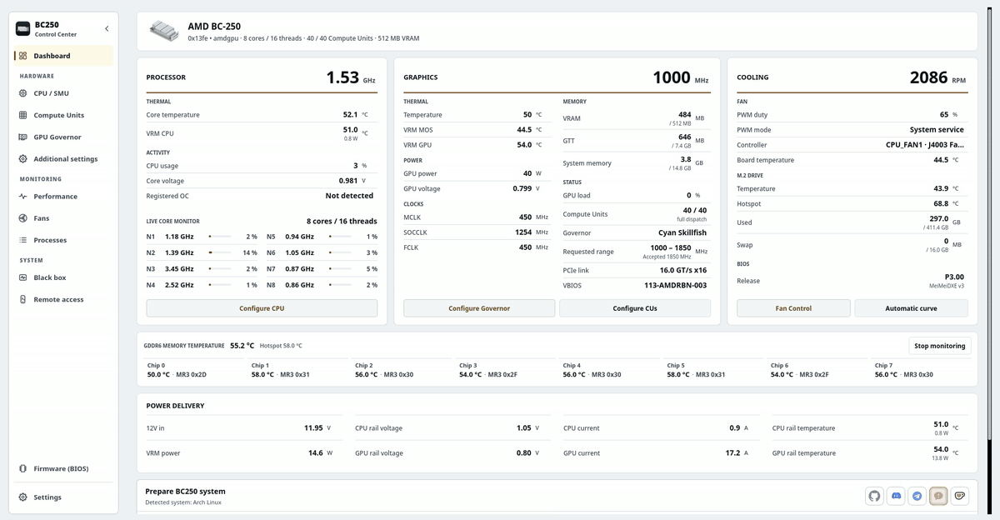

# BC250 Control Center

デスクトップ、端末、または Web ブラウザから、Linux 上の AMD BC-250 をセットアップ、調整、監視します。

GPU ガバナー、CPU チューニング、コンピューティング ユニット、ファン、メモリ、BIOS アップデート メディア、サポートされるディストリビューションのアップスケーリングとシステムの準備について説明します。インターフェイスは、アプリケーション サービス、ハードウェア制限、特権ヘルパーを共有します。オプションの Decky プラグインを使用すると、Steam のゲーム モードに日常的なコントロールが追加されます。

<p align="center">
  <a href="https://movacx.github.io/bc250-control-center/gallery/#dashboard"></a>
</p>

<p align="center">
  <a href="../../README.md"></a>
  <a href="README.es.md"></a>
  <a href="README.pt-BR.md"></a>
  <a href="README.ru.md"></a>
  <a href="README.uk.md"></a>
  <a href="README.de.md"></a>
  <a href="README.fr.md"></a>
  <a href="README.pl.md"></a>
  <a href="README.zh-CN.md"></a>
  <a href="README.ja.md"></a>
</p>

<p align="center">
  <a href="https://ko-fi.com/movacx"></a>
</p>

その他のスクリーンショットは、[ギャラリー](https://movacx.github.io/bc250-control-center/gallery/) にあります。

## インターフェイスを選択してください

| インターフェース | 最適な用途 | 起動 |
| --- | --- | --- |
| **デスクトップ · PyQt6** | 完全なセットアップ、チューニング、診断、ローカル管理 | `bc250-control-center` |
| **ターミナル · curses** | ローカル TTY、ターミナル エミュレータ、または SSH セッション | `bc250-control-center-tui` |
| **Web · React** | ホームネットワーク上の電話、タブレット、または別のコンピュータからの監視とハードウェア制御 | デスクトップ アプリで **リモート アクセス** を開始し、そのアドレスを開くか QR をスキャンします |

通常のインストールには、ターミナル インターフェイスとコンパイルされた Web アセットが含まれます。 [ターミナル専用インストーラー](#terminal-mode) は、デスクトップのないマシンで使用できます。ブラウザ インターフェイスには、ボードの Web サーバーが実行されている必要があります。通常の使用には SSH や Node.js は必要ありません。

## 機能

- ダッシュボード：CPU、GPU、冷却、コアごとの負荷、チップごとの GDDR6 温度、インストール済みの BIOS、電源レールを表示（電源レールには I2C のハードウェア改造が必要です。アプリには写真付きのガイドが含まれています）
- CPU、GPU、VRAM、RAM、ディスク、ネットワークのパフォーマンスグラフ。センサービューと CSV エクスポートに対応
- GPU ガバナーの管理（Cyan、代替として Oberon）、安全な周波数範囲、電圧ラボ
- SMU を使った CPU チューニング、安定性テスト、オプションのコアアンロック
- コンピューティング ユニット: ルーティングとレジスタ診断。ライブ状態とブート状態は個別に報告されます。利用可能なユニットはボードによって異なります
- ファン制御：手動 PWM、温度カーブ、永続プロファイル、または CoolerControl、fancontrol、fan2go への引き渡し
- メモリ：VRAM サイズ、ZRAM、ZSWAP、スワップ
- BIOS 更新用 USB の作成（P3.00 Chipset Menu、MeiMeiDXE v3、P5.00、P3.00、P2.00）。各ファイルは検証されます
- ゲームごとのアップスケーリング：OptiScaler Client 経由の FSR4 INT8 と HelixSR。ゲームファイルのバックアップと復元に対応
- ディストリビューションごとのシステム準備。内蔵ターミナルで実行されます
- GFX1013、async compute、ACPI、Mesa の互換性修正。HDMI 経由の Dolby Digital 5.1。HDMI-CEC によるテレビ操作
- エラーコード、オリジンコード、生のエラーを添付できるアプリ内の問題報告
- 30 言語、ライト／ダークテーマ、UI のスケーリング、コントローラーでの操作
- キーボード ナビゲーション、マウス サポート、ライブ テレメトリ、組み込み操作コンソールを備えたターミナル インターフェイス
- モバイル レイアウトを備えたローカル ネットワーク HTTPS Web インターフェイス、ペアリング QR およびデバイスごとのハードウェア権限

## 対応ディストリビューション

- Arch Linux、CachyOS、Manjaro
- Fedora、Nobara
- Bazzite およびその他の Fedora Atomic 系
- SteamOS（ベータ）
- Ubuntu、Linux Mint、Debian 13

Python 3.11 以降が必要です。OpenRC を使うシステムを含む他のディストリビューションも、可能な範囲で検出と対応を行いますが、すべてのリリースでテストしているわけではありません。

## インストール

### AUR

Arch Linux、CachyOS、SteamOS の場合：

```bash
yay -S bc250-control-center-git
```

### リリースパッケージ

お使いのディストリビューション向けのパッケージを[最新リリース](https://github.com/movacx/bc250-control-center/releases/latest)からダウンロードしてください。

Arch Linux、CachyOS、Manjaro：

```bash
sudo pacman -U ./bc250-control-center-*-any.pkg.tar.zst
```

Fedora、Nobara：

```bash
sudo dnf install ./bc250-control-center-*.rpm
```

Bazzite と Fedora Atomic（再起動が必要です）：

```bash
sudo rpm-ostree install ./bc250-control-center-*.rpm
systemctl reboot
```

Ubuntu、Linux Mint、Debian：

```bash
sudo apt install ./bc250-control-center_*.deb
```

依存関係が一緒にインストールされるよう、`dpkg -i` ではなく `apt install` を使ってください。`dpkg -i` でパッケージが中途半端な状態で止まった場合は、`sudo apt --fix-broken install` を実行してください。

### SteamOS

SteamOS はシステムパーティションを読み取り専用に保つため、この保護を無効にした状態でのみパッケージをインストールできます。デスクトップモードで Konsole を開き、次を実行してください：

```bash
sudo steamos-readonly disable
sudo pacman-key --init
sudo pacman-key --populate archlinux holo
sudo pacman -Syy
sudo pacman -U ./bc250-control-center-*-any.pkg.tar.zst
sudo steamos-readonly enable
```

`pacman-key` と `pacman -Syy` の行は、鍵リングとパッケージデータベースを更新します。これらは SteamOS のアップデートでリセットされます。`deck` ユーザーのパスワードをまだ設定していない場合は、先に `passwd` を実行してください。SteamOS のアップデート後は、デスクトップモードのメニューにある **Reinstall BC250 Control Center** がこれらの手順を代わりに行います。


## アップデート

アプリは新しいリリースを確認し、変更履歴を表示し、パッケージのチェックサムを検証して、システムのパッケージマネージャーでアップデートをインストールします。

**SteamOS：** SteamOS のシステムアップデートでは、システムにインストールされたパッケージが削除されます。このアプリも対象です。システムアップデートの後は、デスクトップモードのメニューから **Reinstall BC250 Control Center** を実行し、その後 Prepare BC250 system をもう一度実行してください。SteamOS は `deck` ユーザーのパスワードを求めます。まだ設定していない場合は、`passwd` で設定してください。

**1.19 からのアップグレード：** 1.19 のアップデーターではパッケージをインストールできません。現在のリリースを一度手動でインストールしてください。以降のバージョンは自動でアップデートされます。

```bash
# Bazzite / Fedora Atomic: replace a layered 1.19 package
sudo rpm-ostree uninstall bc250-control-center --install ./bc250-control-center-*.noarch.rpm
systemctl reboot

# A copy installed with install-local.sh: remove it, then install the package
bash scripts/uninstall-local.sh
```

## はじめに

1. BC250 Control Center を起動します。初回起動画面で言語と外観を設定し、必要なコンポーネントをインストールするかどうかを選べます。
2. 任意で、ガイド付きツアーを見てください。各モジュールがボードに何を変更するかを説明します。
3. ダッシュボードで **Prepare BC250 system** を実行します。お使いのディストリビューション向けに何をインストールするかを表示し、内蔵ターミナルで実行します。
4. 変更を適用する前に、モジュールのステータス行を読んでください。準備ができている項目と不足している項目が示されます。

<a id="terminal-mode"></a>

## ターミナルモード

TUI は、ターミナル エミュレータ、Linux TTY、または SSH セッションで実行されます。デスクトップ アプリケーションのハードウェア制御と監視サービスを共有します。 Python 3.11 以降、`curses` および `psutil` が必要です。 PyQt6 はそうではありません。

### デスクトップアプリケーションがインストールされている状態

通常のパッケージには TUI が含まれています。以下から始めてください:

```bash
bc250-control-center-tui
```

### 端末のみのインストール

リポジトリのクローンを作成し、通常のユーザーとしてインストーラーを実行します。

```bash
git clone https://github.com/movacx/bc250-control-center.git
cd bc250-control-center
bash scripts/install-tui.sh
```

インストーラーはアプリケーションを `~/.local` に配置し、その Python 依存関係をチェックします。不足しているパッケージと保護されたハードウェア ヘルパーをインストールするために管理者の承認を要求します。 PyQt6 やデスクトップ ランチャーはインストールされません。 Bazzite/Fedora Atomic では、このスクリプトはシステム ヘルパーのインストールをスキップします。ヘルパーは、`rpm-ostree` を使用して RPM を介してインストールし、その後再起動する必要があります。

インターフェースを開始します。

```bash
~/.local/bin/bc250-control-center-tui
```

`~/.local/bin` が `PATH` に含まれていれば、`bc250-control-center-tui` で起動できます。ソースからのインストールを更新するには、同じリポジトリで `git pull --ff-only` を実行し、インストーラーを再実行してください。アンインストール：

```bash
bash scripts/install-tui.sh --uninstall
```

### ナビゲーション

| 入力 | アクション |
| --- | --- |
| `↑` / `↓` または `j` / `k` | 項目を選択してください |
| `Enter` | セクションを開くかアクションを実行する |
| `Esc` または `Tab` | サイドバーに戻る |
| `[` / `]` | セクションのタブを切り替える |
| `/` | 検索 |
| `PgUp` / `PgDn` | ページまたは操作出力をスクロールする |
| マウス | セクションとコントロールを選択します。ホイールでスクロールする |
| `?` | ヘルプを表示する |
| `q` | 終了 |

操作の出力は統合コンソールに表示されます。管理者パスワードは、要求に応じてそこに入力されます。 `Ctrl+C` は実行中のコマンドを中断します。完了後、コンソールには結果とログの場所が保持されます。

特定のページを開くか、モノクロ出力を使用するには:

```bash
bc250-control-center-tui --page gpu --theme mono
```

SSH の場合、ボードで SSH サーバーが有効になっていてアクセス可能である必要があります。

```bash
ssh -t user@board-ip bc250-control-center-tui
```

`user` と `board-ip` をボードの Linux アカウントとアドレスに置き換えます。

## ウェブインターフェース

デスクトップ アプリケーションまたは TUI で **リモート アクセス** を開き、Web アクセスを開始して、**ローカル ネットワークからアクセス可能** を有効にして、別のデバイスから接続します。そこに表示されているアドレスを選択するか、表示されている QR をスキャンします。ローカル名と数値 IP の両方を利用可能な状態に保ちます。名前解決はクライアントとネットワークに依存します。

ボードに表示されているアクセス キーを使用してサインインします。新しいブラウザ セッションは監視のみ可能です。 **接続されたデバイス** で、ハードウェア制御を許可する前にブラウザのデバイス コードを確認します。この権限は、特権操作に必要な Linux 管理者パスワードとは別のものです。所有者はアクセスを取り消し、セッションごとに有効期限を選択できます。

Web では、ダッシュボード、CPU、コンピューティング ユニット、GPU、電圧ラボ、ファン、パフォーマンス、ブラック ボックス、および設定を提供します。パフォーマンスには、CPU、GPU、メモリ、ディスク、ネットワーク、および個々のセンサーの履歴が含まれます。テーマと言語はブラウザごとに保存されます。

LANアクセスはHTTPSを使用します。インストールごとにローカル認証局が作成されます。ブラウザーは、そのデバイス上でその公開証明書が信頼されるまで警告を表示する場合があります。表示された指紋を信頼する前に比較してください。 LAN アクセスを無効にすると、ボード自体のみがループバック経由で接続できます。アプリケーションはルーターのポートを開いたり、パブリック トンネルを構成したりしません。

ユーザーは Node.js を必要としません。パッケージは構築された Web アセットを出荷します。

## Decky プラグイン

BC250 Quick Access は、Steam のゲームモードにあるクイックアクセスメニュー用のオプションのパネルです。GPU、Compute Units、CPU、ファン、VRAM の操作に加え、ゲームごとの GPU とファンのプロファイル、リアルタイムの async compute 表示を備えています。高度な設定はデスクトップアプリに残ります。

ダッシュボードの **Decky** セクションからインストールしてください。Decky Loader が見つからない場合は一緒にインストールされます。アプリの他の部分が Decky をインストールすることはありません。詳細は[プラグインの README](../../integrations/decky/bc250-quick-access/README.md) を参照してください。

## 問題の報告

エラーウィンドウには、診断コード（例：`BC250-UPSCALE-001`）、エラーが発生した関数を示すオリジンコード（例：`GPU-0142`）、およびトレースバックを含む生のエラーが表示されます。

エラーウィンドウの **この問題を報告** または **設定 › 診断 › レポートを送信** を使ってください。報告フォームはアプリ内で開き、コード、生のエラー、システム仕様、最近のエラーがあらかじめ入力されています。送信前にすべての内容を確認できます。ホームディレクトリのパスは `~` に置き換えられます。フォームを送信できない場合は、入力内容を保持したままブラウザで開きます。フォームは [Web 上](https://docs.google.com/forms/d/e/1FAIpQLSe3M1stf3bpCoorb4hCWFX9YC_TZ_Gv6WHWQDRe1AV5rJT6rA/viewform)にもあります。

レポートには、root 権限なしであらゆるディストリビューションから収集されるハードウェア診断も添付されます。カーネルとヘッダー、読み込まれたセンサーモジュールとそのカーネルメッセージ（NCT6687、amdgpu）、hwmon と `sensors` の値、カーネルログの GPU とクラッシュの行、前回の起動がどう終わったか（正常なシャットダウンか突然のリセットか）、サービス、パッケージ、直近のワークフローログの末尾が含まれます。カーネルログがユーザーから読めない場合、デスクトップが polkit を通じて一度パスワードを求めます。フォームに入りきらないほど大きなレポートは、重要度の低い部分から順に自動的に短くされます。**ブラウザで開く** を使えば、全文をコピーできます。

レポートを送信する前にレポートに添付されているものをすべて読むには、**設定 › 診断 › 完全な診断を表示** を開きます。すべてのセクション (カーネル、以前のブート、ブラック ボックス、センサー、GPU、サービス、構成、パッケージ、ログ) は展開可能で、タブに並べ替えたり、検索したり、ファイルとしてコピーまたは保存したりできます。ターミナルは、`bc250-control-center-cli diagnose --full` を使用して同じ内容を出力します。

GitHub での issue も歓迎します。ディストリビューション、カーネルのバージョン、ターミナルの出力を含めてください。

## 安全性

オーバークロック、Compute Units のアンロック、ファン制御の変更、BIOS の書き換えは、システムを不安定にしたり、データを失わせたり、ボードを損傷させたりすることがあります。一度に 1 つの設定だけを変更し、元に戻す方法を確保しておいてください。アプリのチェックは一般的な誤りを検出しますが、保証するものではありません。

## クレジット

このプロジェクトは BC-250 コミュニティの成果の上に成り立っています。以下のプロジェクトは各作者のものです。アプリは、レビュー済みで特定のバージョンに固定されたワークフローを通じてこれらを統合しています。ライセンスと各統合の範囲は[サードパーティ通知](../THIRD_PARTY_NOTICES.md)に記載されています。

**GPU**
- [cyan-skillfish-governor](https://github.com/filippor/cyan-skillfish-governor/tree/smu)：GPU ガバナー
- [Oberon Governor](https://gitlab.com/mothenjoyer69/oberon-governor)：代替のガバナー
- [bc250-gfx1013-fix](https://github.com/DryhoppedIPA/bc250-gfx1013-fix) と [bc250-steamos](https://github.com/keyboardspecialist/bc250-steamos)：GFX1013 向けのカーネルと Mesa/RADV
- [linux-cachyos-bc250](https://github.com/MastaG/linux-cachyos-bc250)：Arch と CachyOS 向けのカーネルと Mesa/RADV
- [bc250-async-compute-bazzite](https://github.com/tri3gubki-ops/bc250-async-compute-bazzite)：Bazzite 44 の async compute。RADV パッチは Arch、CachyOS、カーネル 7.2 以降の Fedora 向けにもビルドされます

**アップスケーリング**
- [bc250-fsr4](https://github.com/dmorazasanchez/bc250-fsr4) と [bc250-fsr4-fork](https://github.com/daniel-h-0/bc250-fsr4-fork)：OptiScaler Client、ゲームごとの FSR4
- [HelixSR](https://github.com/lonewolf0622/HelixSR)：FSR 3.1 のゲームでの DLSS Model E による再構成

**CPU と Compute Units**
- [bc250_smu_oc](https://github.com/bc250-collective/bc250_smu_oc)：SMU による CPU の検出とチューニング
- [bc250-core-unlock](https://github.com/rw-r-r-0644/bc250-core-unlock) と [bc250-efi-core-unlock](https://github.com/Hexxeh/bc250-efi-core-unlock)：コアのアンロック
- [bc250-acpi-fix](https://github.com/e-tho/bc250-acpi-fix)：ACPI による CPU のパフォーマンス状態
- [bc250-cu-live-manager](https://github.com/WinnieLV/bc250-cu-live-manager)、[bc250-cu-live-manager-SteamOS](https://github.com/F5GO/bc250-cu-live-manager-SteamOS)、[bc250-40cu-unlock](https://github.com/duggasco/bc250-40cu-unlock)：Compute Units

**センサー、メモリ、ファン**
- [BC250-Telemetry](https://github.com/onlinermm/BC250-Telemetry)：VRM のテレメトリと、I2C ガイドで使われている写真
- [bc250-memory-temperature](https://github.com/pan-Rijovich/bc250-memory-temperature)：GDDR6 の温度
- [bc250_memcfg](https://github.com/fanoush/bc250_memcfg)：CMOS 経由の VRAM サイズ
- [nct6687d](https://github.com/Fred78290/nct6687d)：NCT センサーとファンの PWM
- [linux-cec](https://gitlab.steamos.cloud/holo/linux-cec)：cecd、Valve の HDMI-CEC デーモン

**ファームウェア**
- [bc250-bios](https://gitlab.com/TuxThePenguin0/bc250-bios)：オリジナルの P3.00 BIOS と Chipset Menu
- [AMD-BC-250-UEFI-v2.2-Firmware-Menu-Script](https://github.com/Forbidden-Darkness/AMD-BC-250-UEFI-v2.2-Firmware-Menu-Script)：UEFI Shell と MeiMeiDXE v3
- [BC-250](https://github.com/kenavru/BC-250)：ASRock の更新キットのミラー（P2.00 と P5.00）
- [bc250-custom-bios-logo](https://github.com/tmghd272/bc250-custom-bios-logo)：カスタムブートロゴ

**関連プロジェクト**（アプリでは使用していません。ライセンスは GitHub の表示に従います）
- [bc250-vrm-dkms](https://github.com/Hexxeh/bc250-vrm-dkms) と [bc250-memory-dkms](https://github.com/Hexxeh/bc250-memory-dkms)（GPL-2.0）：カーネルモジュールとしての VRM とメモリの温度
- [bc250-bazzite-suite](https://github.com/RobertoTorino/bc250-bazzite-suite)（GPL-3.0）：Bazzite のセットアップスイート
- [bc250-vcn-research](https://github.com/Shalasere/bc250-vcn-research) と [amdgpu-wddm](https://github.com/D-Ogi/amdgpu-wddm)：VCN ビデオエンコードの調査と、オープンな Windows 向けドライバー（ライセンスは未宣言。リンクのみ）

## プロジェクト構成

```text
bc250-control-center/
├── src/bc250cc/              GUI を持たないコア
│   ├── domain/               各モジュールのルールと上限（GPU、CPU、CU、ファン、ファームウェア…）
│   ├── application/          これらのルールを組み合わせるユースケース
│   ├── infrastructure/       システムへのアクセス：センサー、サービス、パッケージ、GitHub
│   ├── platform/             ディストリビューションと起動システムの違い
│   └── shared/               バージョン、パス、すべてのプロセスで共有される契約
├── frontends/
│   ├── desktop/              Qt によるデスクトップアプリ
│   │   ├── pages/            モジュールごとに 1 ファイル（ダッシュボード、GPU、CPU、ファン、ファームウェア…）
│   │   ├── components/       再利用できる UI の部品
│   │   ├── onboarding/       初回画面とガイド付きツアー
│   │   ├── console/          内蔵ターミナル
│   │   ├── theme/            テーマ、スタイル、色、アイコン
│   │   └── i18n/             30 言語への翻訳
│   ├── tui/                  ターミナルインターフェース：curses 画面、ページ、操作コンソール
│   ├── web/                  HTTPS バックエンド、検証済みのアクション ワーカー、ブラウザ インターフェイス
│   │   ├── app/              React ソースおよびビルド ツール (開発用のみ Node.js)
│   │   └── dist/             Python によって提供され、パッケージで出荷されるコンパイルされたアセット
│   └── cli.py                Command-line mode
├── integrations/
│   ├── decky/                ゲームモード用の Decky Quick Access プラグイン
│   └── report-endpoint/      ユーザーが送信したレポート用のCloudflareエンドポイント
├── privileged/               root で動く部分。分離され、レビュー済み
│   ├── helpers/              特権タスクごとのヘルパー
│   ├── lib/                  これらのヘルパーが共有するコード
│   └── policies/             Polkit の権限
├── packaging/                .pkg.tar.zst、.rpm、.deb パッケージと AUR の PKGBUILD
├── scripts/
│   ├── entrypoints/          デスクトップ、CLI、デーモン、TUI ランチャー
│   ├── development/          Web 構築および開発ユーティリティ
│   ├── system/               配布およびシステム準備のワークフロー
│   └── qa/                   パッケージング、統合、流通のチェック
├── assets/                   アイコン、スクリーンショット、Web ギャラリー
├── docs/                     ドキュメント、サードパーティ通知、この README の翻訳
└── tests/                    ユニット、サービス、デスクトップ、TUI、Web、およびパッケージングのチェック
```

レイヤ境界については [アーキテクチャ](../ARQUITECTURA_MVC.md) を、インターフェイスのエントリ ポイントと開発コマンドについては [フロントエンド](../../frontends/README.md) を参照してください。
