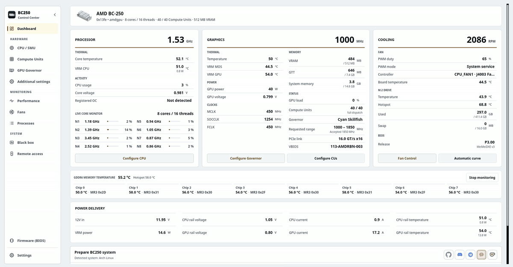

# BC250 Control Center

Skonfiguruj, dostrój i monitoruj AMD BC-250 w systemie Linux z komputera stacjonarnego, terminala lub przeglądarki internetowej.

Obejmuje zarządzanie GPU, dostrajanie CPU, jednostki obliczeniowe, wentylatory, pamięć, nośniki aktualizacji BIOS-u, skalowanie w górę i przygotowanie systemu dla obsługiwanych dystrybucji. Interfejsy współdzielą usługi aplikacyjne, ograniczenia sprzętowe i uprzywilejowane pomocniki. Opcjonalna wtyczka Decky przenosi codzienne sterowanie do trybu gry Steam.

<p align="center">
  <a href="https://movacx.github.io/bc250-control-center/gallery/#dashboard"></a>
</p>

<p align="center">
  <a href="../../README.md"></a>
  <a href="README.es.md"></a>
  <a href="README.pt-BR.md"></a>
  <a href="README.ru.md"></a>
  <a href="README.uk.md"></a>
  <a href="README.de.md"></a>
  <a href="README.fr.md"></a>
  <a href="README.pl.md"></a>
  <a href="README.zh-CN.md"></a>
  <a href="README.ja.md"></a>
</p>

<p align="center">
  <a href="https://ko-fi.com/movacx"></a>
</p>

Więcej zrzutów ekranu znajdziesz w [galeria](https://movacx.github.io/bc250-control-center/gallery/).

## Wybierz swój interfejs

| Interfejs | Najlepiej nadaje się do | Uruchamianie |
| --- | --- | --- |
| **Komputer stacjonarny · PyQt6** | Pełna konfiguracja, strojenie, diagnostyka i administracja lokalna | `bc250-control-center` |
| **Terminal · curses** | Lokalny TTY, emulator terminala lub sesja SSH | `bc250-control-center-tui` |
| **Sieć · React** | Monitoring i sterowanie sprzętem z telefonu, tabletu lub innego komputera w sieci domowej | Uruchom **Dostęp zdalny** w aplikacji komputerowej, a następnie otwórz jej adres lub zeskanuj kod QR |

Normalna instalacja obejmuje interfejs terminala i skompilowane zasoby sieciowe. [instalator tylko terminala](#terminal-mode) jest dostępny dla komputerów bez komputera stacjonarnego. Interfejs przeglądarki wymaga działania serwera sieciowego płyty; do normalnego użytkowania nie potrzebuje SSH ani Node.js.

## Funkcje

- Pulpit z CPU, GPU, chłodzeniem, obciążeniem każdego rdzenia, temperaturą GDDR6 dla każdego układu, zainstalowanym BIOS-em i szynami zasilania (szyny wymagają modyfikacji sprzętowej I2C; aplikacja zawiera przewodnik ze zdjęciami)
- Wykresy wydajności CPU, GPU, VRAM, RAM, dysku i sieci, z widokiem czujników i eksportem do CSV
- Zarządzanie governorem GPU (Cyan, z Oberon jako alternatywą), bezpieczne zakresy częstotliwości i laboratorium napięć
- Strojenie CPU przez SMU, test stabilności i opcjonalne odblokowanie rdzeni
- Jednostki obliczeniowe: diagnostyka routingu i rejestrów, z oddzielnym raportowaniem stanu działania i rozruchu; dostępne jednostki zależą od planszy
- Sterowanie wentylatorami: ręczny PWM, krzywe temperaturowe, trwałe profile lub przekazanie do CoolerControl, fancontrol albo fan2go
- Pamięć: rozmiar VRAM, ZRAM, ZSWAP i swap
- Tworzenie nośnika USB do aktualizacji BIOS-u (P3.00 Chipset Menu, MeiMeiDXE v3, P5.00, P3.00, P2.00), z weryfikacją każdego pliku
- Upscaling dla poszczególnych gier: FSR4 INT8 przez OptiScaler Client i HelixSR, z kopią zapasową i przywracaniem plików gry
- Przygotowanie systemu dostosowane do dystrybucji, uruchamiane w zintegrowanym terminalu
- Poprawki zgodności dla GFX1013, async compute, ACPI i Mesa; Dolby Digital 5.1 przez HDMI; sterowanie telewizorem przez HDMI-CEC
- Zgłoszenia problemów w aplikacji, z kodami błędów, kodami pochodzenia i surowym błędem w załączniku
- 30 języków, jasny i ciemny motyw, skalowanie interfejsu i nawigacja padem
- Interfejs terminala z nawigacją za pomocą klawiatury, obsługą myszy, telemetrią na żywo i wbudowaną konsolą operacyjną
- Interfejs sieciowy HTTPS w sieci lokalnej z układami mobilnymi, parowanie QR i uprawnienia sprzętowe dla poszczególnych urządzeń

## Obsługiwane dystrybucje

- Arch Linux, CachyOS, Manjaro
- Fedora, Nobara
- Bazzite i inne warianty Fedora Atomic
- SteamOS (beta)
- Ubuntu, Linux Mint, Debian 13

Wymagany jest Python 3.11 lub nowszy. Inne dystrybucje, w tym systemy z OpenRC, są wykrywane i obsługiwane w miarę możliwości, ale nie są testowane przy każdym wydaniu.

## Instalacja

### AUR

Dla Arch Linux, CachyOS i SteamOS:

```bash
yay -S bc250-control-center-git
```

### Pakiety wydań

Pobierz pakiet dla swojej dystrybucji z [najnowszego wydania](https://github.com/movacx/bc250-control-center/releases/latest).

Arch Linux, CachyOS, Manjaro:

```bash
sudo pacman -U ./bc250-control-center-*-any.pkg.tar.zst
```

Fedora, Nobara:

```bash
sudo dnf install ./bc250-control-center-*.rpm
```

Bazzite i Fedora Atomic (wymagany restart):

```bash
sudo rpm-ostree install ./bc250-control-center-*.rpm
systemctl reboot
```

Ubuntu, Linux Mint, Debian:

```bash
sudo apt install ./bc250-control-center_*.deb
```

Używaj `apt install` zamiast `dpkg -i`, aby zależności zostały zainstalowane. Jeśli pakiet został w połowie zainstalowany przez `dpkg -i`, uruchom `sudo apt --fix-broken install`.

### SteamOS

SteamOS utrzymuje partycję systemową w trybie tylko do odczytu, dlatego pakiet można zainstalować tylko przy wyłączonej tej ochronie. Otwórz Konsole w Trybie Pulpitu i uruchom:

```bash
sudo steamos-readonly disable
sudo pacman-key --init
sudo pacman-key --populate archlinux holo
sudo pacman -Syy
sudo pacman -U ./bc250-control-center-*-any.pkg.tar.zst
sudo steamos-readonly enable
```

Linie `pacman-key` i `pacman -Syy` odświeżają klucze i bazy pakietów, które aktualizacja SteamOS resetuje. Jeśli nie ustawiono jeszcze hasła dla użytkownika `deck`, najpierw uruchom `passwd`. Po aktualizacji SteamOS wpis **Reinstall BC250 Control Center** w menu Trybu Pulpitu wykona te kroki za Ciebie.


## Aktualizacje

Aplikacja sprawdza nowe wydania, pokazuje listę zmian, weryfikuje sumę kontrolną pakietu i instaluje aktualizację przez menedżera pakietów systemu.

**SteamOS:** aktualizacja systemu SteamOS usuwa pakiety zainstalowane w systemie, w tym tę aplikację. Po aktualizacji systemu uruchom **Reinstall BC250 Control Center** z menu Trybu Pulpitu, a następnie ponownie uruchom Prepare BC250 system. SteamOS pyta o hasło użytkownika `deck`; jeśli go nie masz, ustaw je poleceniem `passwd`.

**Aktualizacja z 1.19:** aktualizator wersji 1.19 nie potrafi instalować pakietów. Zainstaluj aktualną wersję raz ręcznie; kolejne wersje będą aktualizować się same.

```bash
# Bazzite / Fedora Atomic: replace a layered 1.19 package
sudo rpm-ostree uninstall bc250-control-center --install ./bc250-control-center-*.noarch.rpm
systemctl reboot

# A copy installed with install-local.sh: remove it, then install the package
bash scripts/uninstall-local.sh
```

## Pierwsze kroki

1. Uruchom BC250 Control Center. Ekran pierwszego uruchomienia ustawia język i wygląd oraz proponuje zainstalowanie wymaganych komponentów.
2. Opcjonalnie przejdź przewodnik, który wyjaśnia, co każdy moduł zmienia na płycie.
3. Na pulpicie uruchom **Prepare BC250 system**. Pokaże, co zostanie zainstalowane dla Twojej dystrybucji, i wykona to w zintegrowanym terminalu.
4. Przed zastosowaniem zmian przeczytaj linię stanu modułu; informuje, co jest gotowe, a czego brakuje.

<a id="terminal-mode"></a>

## Tryb terminala

TUI działa w emulatorze terminala, TTY Linux lub w sesji SSH. Udostępnia kontrolę sprzętu i usługi monitorowania aplikacji komputerowej. Python 3.11 lub nowszy, wymagane są `curses` i `psutil`; PyQt6 nie jest.

### Z zainstalowaną aplikacją komputerową

Standardowy pakiet zawiera TUI. Zacznij od:

```bash
bc250-control-center-tui
```

### Instalacja wyłącznie na terminalu

Sklonuj repozytorium i uruchom instalator jako zwykły użytkownik:

```bash
git clone https://github.com/movacx/bc250-control-center.git
cd bc250-control-center
bash scripts/install-tui.sh
```

Instalator umieszcza aplikację w `~/.local` i sprawdza jej zależności w języku Python. Żąda autoryzacji administratora w celu zainstalowania brakujących pakietów i chronionych pomocników sprzętowych. Nie instaluje PyQt6 ani programu uruchamiającego na komputerze. W Bazzite/Fedora Atomic ten skrypt pomija instalację pomocnika systemowego; pomocniki muszą zostać zainstalowane poprzez RPM z `rpm-ostree`, po czym następuje ponowne uruchomienie.

Uruchom interfejs:

```bash
~/.local/bin/bc250-control-center-tui
```

Jeśli `~/.local/bin` jest już w `PATH`, użyj `bc250-control-center-tui`. Aby zaktualizować instalację ze źródeł, wykonaj `git pull --ff-only` w tym samym repozytorium i ponownie uruchom instalator. Aby odinstalować:

```bash
bash scripts/install-tui.sh --uninstall
```

### Nawigacja

| Wejście | Akcja |
| --- | --- |
| `↑` / `↓` lub `j` / `k` | Wybierz element |
| `Enter` | Otwórz sekcję lub uruchom akcję |
| `Esc` lub `Tab` | Wróć do paska bocznego |
| `[` / `]` | Przełącz karty sekcji |
| `/` | Szukaj |
| `PgUp` / `PgDn` | Przewiń stronę lub wynik operacji |
| Mysz | Wybierz sekcje i elementy sterujące; przewijaj kółkiem |
| `?` | Pokaż pomoc |
| `q` | Zakończ |

Operacje wyświetlają swoje dane wyjściowe w zintegrowanej konsoli. Hasła administratora są tam wprowadzane na żądanie; `Ctrl+C` przerywa wykonywanie polecenia. Konsola zachowuje wynik i lokalizację dziennika po zakończeniu.

Aby otworzyć określoną stronę lub użyć wydruku monochromatycznego:

```bash
bc250-control-center-tui --page gpu --theme mono
```

W przypadku SSH płyta musi mieć włączony i osiągalny serwer SSH:

```bash
ssh -t user@board-ip bc250-control-center-tui
```

Zastąp `user` i `board-ip` kontem i adresem Linux płytki.

## Interfejs sieciowy

Otwórz **Dostęp zdalny** w aplikacji komputerowej lub TUI, uruchom dostęp do Internetu i włącz opcję **Osiągalny z sieci lokalnej**, aby połączyć się z innego urządzenia. Wybierz pokazany tam adres lub zeskanuj jego widoczny kod QR. Zachowaj dostępność zarówno nazwy lokalnej, jak i numerycznego adresu IP: rozpoznawanie nazw zależy od klienta i sieci.

Zaloguj się za pomocą klucza dostępu widocznego na tablicy. Nowe sesje przeglądarki mogą jedynie monitorować. W **Połączone urządzenia** zweryfikuj kod urządzenia przeglądarki przed przyznaniem kontroli nad sprzętem. To uprawnienie jest niezależne od hasła administratora Linux wymaganego do operacji uprzywilejowanych. Właściciel może odwołać dostęp i wybrać czas wygaśnięcia dla każdej sesji.

W Internecie dostępny jest pulpit nawigacyjny, CPU, jednostki obliczeniowe, GPU, laboratorium napięcia, wentylatory, wydajność, czarna skrzynka i ustawienia. Wydajność obejmuje historię CPU, GPU, pamięci, dysku, sieci i poszczególnych czujników. Motywy i język są zapisywane dla każdej przeglądarki.

Dostęp do sieci LAN wykorzystuje protokół HTTPS. Każda instalacja tworzy lokalny urząd certyfikacji; przeglądarki mogą ostrzegać, dopóki ich certyfikat publiczny nie będzie zaufany na tym urządzeniu. Porównaj wyświetlony odcisk palca, zanim mu zaufasz. Przy wyłączonym dostępie do sieci LAN tylko sama płyta może połączyć się poprzez pętlę zwrotną. Aplikacja nie otwiera portów routera ani nie konfiguruje tunelu publicznego.

Użytkownicy nie potrzebują Node.js: pakiety dostarczają zbudowane zasoby internetowe.

## Wtyczka Decky

BC250 Quick Access to opcjonalny panel w menu szybkiego dostępu Trybu Gry Steam. Zapewnia sterowanie GPU, Compute Units, CPU, wentylatorami i VRAM, profile GPU i wentylatorów dla poszczególnych gier oraz odczyty async compute na żywo. Zaawansowana konfiguracja pozostaje w aplikacji desktopowej.

Zainstaluj ją z sekcji **Decky** na pulpicie. Decky Loader zostanie zainstalowany, jeśli go brakuje; żadna inna część aplikacji nie instaluje Decky. Szczegóły znajdziesz w [README wtyczki](../../integrations/decky/bc250-quick-access/README.md).

## Zgłaszanie problemów

Okna błędów pokazują kod diagnostyczny (na przykład `BC250-UPSCALE-001`), kod pochodzenia wskazujący funkcję, w której wystąpił błąd (na przykład `GPU-0142`), oraz surowy błąd wraz ze śladem stosu.

Użyj **Zgłoś ten problem** w oknie błędu lub **Ustawienia › Diagnostyka › Wyślij raport**. Formularz otwiera się w aplikacji z już wypełnionymi kodami, surowym błędem, danymi systemu i ostatnimi błędami. Możesz wszystko przejrzeć przed wysłaniem; ścieżki do katalogu domowego są zamieniane na `~`. Jeśli formularza nie da się wysłać, otworzy się w przeglądarce z zachowanymi odpowiedziami. Formularz jest też [dostępny w sieci](https://docs.google.com/forms/d/e/1FAIpQLSe3M1stf3bpCoorb4hCWFX9YC_TZ_Gv6WHWQDRe1AV5rJT6rA/viewform).

Raport dołącza również diagnostykę sprzętu, zbieraną bez roota na każdej dystrybucji: jądro i nagłówki, załadowane moduły czujników i ich komunikaty z jądra (NCT6687, amdgpu), odczyty hwmon i `sensors`, wiersze GPU i awarii z logu jądra, sposób zakończenia poprzedniego uruchomienia (czyste wyłączenie lub nagły reset), usługi, pakiety oraz koniec ostatniego logu przepływu pracy. Gdy log jądra jest niedostępny dla Twojego użytkownika, pulpit raz zapyta o hasło przez polkit. Raporty zbyt duże dla formularza są automatycznie skracane, zaczynając od najmniej ważnych części; **Otwórz w przeglądarce** nadal kopiuje pełny tekst.

Aby przeczytać wszystko, co raport jest załączony przed jego wysłaniem, otwórz **Ustawienia > Diagnostyka > Wyświetl pełną diagnostykę**: każdą sekcję (jądro, poprzednie uruchomienie, czarna skrzynka, czujniki, GPU, usługi, konfiguracja, pakiety, logi) można rozwijać, sortować w zakładkach, przeszukiwać i można je kopiować lub zapisywać jako plik. Terminal wyświetla to samo z `bc250-control-center-cli diagnose --full`.

Zgłoszenia na GitHubie są również mile widziane. Podaj swoją dystrybucję, wersję jądra i wynik terminala.

## Bezpieczeństwo

Overclocking, odblokowywanie Compute Units, zmiana sterowania wentylatorami i flashowanie BIOS-u mogą spowodować niestabilność systemu, utratę danych lub uszkodzenie płyty. Zmieniaj jedno ustawienie naraz i miej sposób na cofnięcie zmiany. Sprawdzenia aplikacji wychwytują typowe błędy, ale nie dają gwarancji.

## Podziękowania

Ten projekt opiera się na pracy społeczności BC-250. Poniższe projekty należą do ich autorów; aplikacja integruje je przez sprawdzone, przypięte do wersji przepływy. Licencje i zakres każdej integracji są opisane w [uwagach o komponentach firm trzecich](../THIRD_PARTY_NOTICES.md).

**GPU**
- [cyan-skillfish-governor](https://github.com/filippor/cyan-skillfish-governor/tree/smu): governor GPU
- [Oberon Governor](https://gitlab.com/mothenjoyer69/oberon-governor): alternatywny governor
- [bc250-gfx1013-fix](https://github.com/DryhoppedIPA/bc250-gfx1013-fix) i [bc250-steamos](https://github.com/keyboardspecialist/bc250-steamos): kernel i Mesa/RADV dla GFX1013
- [linux-cachyos-bc250](https://github.com/MastaG/linux-cachyos-bc250): kernel i Mesa/RADV dla Arch i CachyOS
- [bc250-async-compute-bazzite](https://github.com/tri3gubki-ops/bc250-async-compute-bazzite): obliczenia asynchroniczne na Bazzite 44, z RADV poprawki zbudowane także dla Arch, CachyOS i Fedora na jądrze 7.2 lub nowszym

**Upscaling**
- [bc250-fsr4](https://github.com/dmorazasanchez/bc250-fsr4) i [bc250-fsr4-fork](https://github.com/daniel-h-0/bc250-fsr4-fork): OptiScaler Client, FSR4 dla każdej gry
- [HelixSR](https://github.com/lonewolf0622/HelixSR): rekonstrukcja DLSS Model E w grach z FSR 3.1

**CPU i Compute Units**
- [bc250_smu_oc](https://github.com/bc250-collective/bc250_smu_oc): wykrywanie i strojenie CPU przez SMU
- [bc250-core-unlock](https://github.com/rw-r-r-0644/bc250-core-unlock) i [bc250-efi-core-unlock](https://github.com/Hexxeh/bc250-efi-core-unlock): odblokowywanie rdzeni
- [bc250-acpi-fix](https://github.com/e-tho/bc250-acpi-fix): stany wydajności CPU przez ACPI
- [bc250-cu-live-manager](https://github.com/WinnieLV/bc250-cu-live-manager), [bc250-cu-live-manager-SteamOS](https://github.com/F5GO/bc250-cu-live-manager-SteamOS) i [bc250-40cu-unlock](https://github.com/duggasco/bc250-40cu-unlock): Compute Units

**Czujniki, pamięć i wentylatory**
- [BC250-Telemetry](https://github.com/onlinermm/BC250-Telemetry): telemetria regulatorów napięcia (VRM) i zdjęcia z przewodnika I2C
- [bc250-memory-temperature](https://github.com/pan-Rijovich/bc250-memory-temperature): temperatura GDDR6
- [bc250_memcfg](https://github.com/fanoush/bc250_memcfg): rozmiar VRAM przez CMOS
- [nct6687d](https://github.com/Fred78290/nct6687d): czujniki NCT i PWM wentylatorów
- [linux-cec](https://gitlab.steamos.cloud/holo/linux-cec): cecd, demon HDMI-CEC firmy Valve

**Firmware**
- [bc250-bios](https://gitlab.com/TuxThePenguin0/bc250-bios): oryginalny BIOS P3.00 i Chipset Menu
- [AMD-BC-250-UEFI-v2.2-Firmware-Menu-Script](https://github.com/Forbidden-Darkness/AMD-BC-250-UEFI-v2.2-Firmware-Menu-Script): UEFI Shell i MeiMeiDXE v3
- [BC-250](https://github.com/kenavru/BC-250): lustro zestawu aktualizacyjnego ASRock (P2.00 i P5.00)
- [bc250-custom-bios-logo](https://github.com/tmghd272/bc250-custom-bios-logo): niestandardowe logo startowe

**Powiązane projekty** (aplikacja ich nie używa; licencje wg GitHuba)
- [bc250-vrm-dkms](https://github.com/Hexxeh/bc250-vrm-dkms) i [bc250-memory-dkms](https://github.com/Hexxeh/bc250-memory-dkms) (GPL-2.0): temperatury VRM i pamięci jako moduły jądra
- [bc250-bazzite-suite](https://github.com/RobertoTorino/bc250-bazzite-suite) (GPL-3.0): zestaw konfiguracyjny dla Bazzite
- [bc250-vcn-research](https://github.com/Shalasere/bc250-vcn-research) i [amdgpu-wddm](https://github.com/D-Ogi/amdgpu-wddm): badania nad kodowaniem wideo VCN i otwarty sterownik dla Windows (brak zadeklarowanej licencji; tylko linki)

## Struktura projektu

```text
bc250-control-center/
├── src/bc250cc/              Rdzeń, bez interfejsu graficznego
│   ├── domain/               Reguły i limity każdego modułu (GPU, CPU, CU, wentylatory, firmware…)
│   ├── application/          Przypadki użycia łączące te reguły
│   ├── infrastructure/       Dostęp do systemu: czujniki, usługi, pakiety, GitHub
│   ├── platform/             Różnice między dystrybucjami i systemami rozruchu
│   └── shared/               Wersja, ścieżki i kontrakty wspólne dla wszystkich procesów
├── frontends/
│   ├── desktop/              Aplikacja desktopowa w Qt
│   │   ├── pages/            Jeden plik na moduł (pulpit, GPU, CPU, wentylatory, firmware…)
│   │   ├── components/       Wielokrotnego użytku elementy interfejsu
│   │   ├── onboarding/       Ekran powitalny i przewodnik
│   │   ├── console/          Zintegrowany terminal
│   │   ├── theme/            Motywy, style, kolory i ikony
│   │   └── i18n/             Tłumaczenia na 30 języków
│   ├── tui/                  Interfejs terminala: ekran curses, strony i konsola operacyjna
│   ├── web/                  Backend HTTPS, sprawdzone procesy robocze i interfejs przeglądarki
│   │   ├── app/              Narzędzia źródłowe i kompilacji React (Node.js tylko do celów programistycznych)
│   │   └── dist/             Skompilowane zasoby obsługiwane przez Python i dostarczane w paczkach
│   └── cli.py                Command-line mode
├── integrations/
│   ├── decky/                Wtyczka Decky Quick Access dla Trybu Gry
│   └── report-endpoint/      Punkt końcowy Cloudflare dla raportów przesyłanych przez użytkowników
├── privileged/               To, co działa jako root: odizolowane i sprawdzone
│   ├── helpers/              Jeden pomocnik na zadanie uprzywilejowane
│   ├── lib/                  Kod wspólny dla tych pomocników
│   └── policies/             Uprawnienia Polkit
├── packaging/                Pakiety .pkg.tar.zst, .rpm i .deb oraz PKGBUILD dla AUR
├── scripts/
│   ├── entrypoints/          Programy uruchamiające pulpit, CLI, demony i TUI
│   ├── development/          Narzędzia do tworzenia i programowania stron internetowych
│   ├── system/               Przepływy pracy związane z dystrybucją i przygotowaniem systemu
│   └── qa/                   Kontrole pakowania, integracji i dystrybucji
├── assets/                   Ikony, zrzuty ekranu i galeria internetowa
├── docs/                     Dokumentacja, uwagi o komponentach firm trzecich i tłumaczenia tego README
└── tests/                    Kontrole jednostek, usług, komputerów stacjonarnych, TUI, sieci i opakowań
```

Zobacz [Architektura](../ARQUITECTURA_MVC.md), aby zapoznać się z granicami warstw i [Frontends](../../frontends/README.md), aby zapoznać się z punktami wejścia interfejsu i poleceniami programistycznymi.
