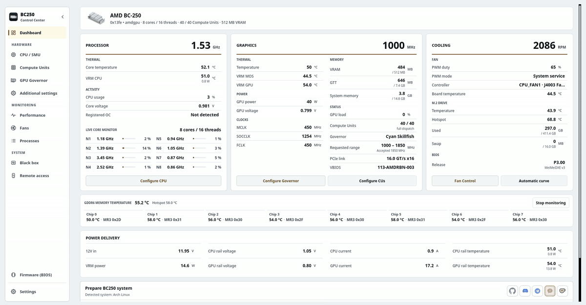

# BC250 Control Center

Настраивайте, настраивайте и контролируйте AMD BC-250 в Linux с рабочего стола, терминала или веб-браузера.

Он охватывает регулятор GPU, настройку CPU, вычислительные блоки, вентиляторы, память, носитель обновления BIOS, масштабирование и подготовку системы к поддерживаемым дистрибутивам. Интерфейсы совместно используют службы приложений, аппаратные ограничения и привилегированные помощники. Дополнительный плагин Decky обеспечивает повседневное управление игровым режимом Steam.

<p align="center">
  <a href="https://movacx.github.io/bc250-control-center/gallery/#dashboard"></a>
</p>

<p align="center">
  <a href="../../README.md"></a>
  <a href="README.es.md"></a>
  <a href="README.pt-BR.md"></a>
  <a href="README.ru.md"></a>
  <a href="README.uk.md"></a>
  <a href="README.de.md"></a>
  <a href="README.fr.md"></a>
  <a href="README.pl.md"></a>
  <a href="README.zh-CN.md"></a>
  <a href="README.ja.md"></a>
</p>

<p align="center">
  <a href="https://ko-fi.com/movacx"></a>
</p>

Дополнительные снимки экрана можно найти в [галерее](https://movacx.github.io/bc250-control-center/gallery/).

## Выберите свой интерфейс

| Интерфейс | Лучше всего подходит для | Запуск |
| --- | --- | --- |
| **Рабочий стол · PyQt6** | Полная настройка, настройка, диагностика и локальное администрирование | `bc250-control-center` |
| **Терминал · curses** | Локальный TTY, эмулятор терминала или сеанс SSH. | `bc250-control-center-tui` |
| **Интернет · React** | Мониторинг и управление оборудованием с телефона, планшета или другого компьютера в домашней сети | Запустите **Удаленный доступ** в настольном приложении, затем откройте его адрес или отсканируйте QR. |

Обычная установка включает интерфейс терминала и скомпилированные веб-ресурсы. [установщик только для терминала](#terminal-mode) доступен для компьютеров без рабочего стола. Для интерфейса браузера необходим работающий веб-сервер платы; для нормального использования не требуется SSH или Node.js.

## Возможности

- Панель с CPU, GPU, охлаждением, нагрузкой по ядрам, температурой GDDR6 по каждому чипу, установленным BIOS и линиями питания (для линий нужна аппаратная модификация I2C; в приложении есть фотоинструкция)
- Графики производительности CPU, GPU, VRAM, RAM, диска и сети, с обзором датчиков и экспортом в CSV
- Управление governor GPU (Cyan, с Oberon как альтернативой), безопасные диапазоны частот и лаборатория напряжения
- Настройка CPU через SMU, тест стабильности и необязательная разблокировка ядер
- Вычислительные блоки: диагностика маршрутизации и регистров, при этом состояние работы и загрузки сообщается отдельно; доступные юниты зависят от платы
- Управление вентиляторами: ручной PWM, температурные кривые, постоянные профили или передача CoolerControl, fancontrol или fan2go
- Память: размер VRAM, ZRAM, ZSWAP и swap
- Создание USB-накопителя для обновления BIOS (P3.00 Chipset Menu, MeiMeiDXE v3, P5.00, P3.00, P2.00), каждый файл проверяется
- Апскейлинг для каждой игры: FSR4 INT8 через OptiScaler Client и HelixSR, с резервным копированием и восстановлением файлов игры
- Подготовка системы в зависимости от дистрибутива, выполняемая во встроенном терминале
- Исправления совместимости для GFX1013, async compute, ACPI и Mesa; Dolby Digital 5.1 через HDMI; управление телевизором через HDMI-CEC
- Отчёты о проблемах внутри приложения, с кодами ошибок, кодами источника и приложенной необработанной ошибкой
- 30 языков, светлая и тёмная темы, масштабирование интерфейса и навигация с геймпада
- Интерфейс терминала с навигацией с помощью клавиатуры, поддержкой мыши, телеметрией в реальном времени и встроенной консолью управления.
- Веб-интерфейс HTTPS для локальной сети с мобильными макетами, сопряжением QR и аппаратными разрешениями для каждого устройства.

## Поддерживаемые дистрибутивы

- Arch Linux, CachyOS, Manjaro
- Fedora, Nobara
- Bazzite и другие варианты Fedora Atomic
- SteamOS (бета)
- Ubuntu, Linux Mint, Debian 13

Требуется Python 3.11 или новее. Другие дистрибутивы, включая системы с OpenRC, распознаются и по возможности поддерживаются, но тестируются не в каждом выпуске.

## Установка

### AUR

Для Arch Linux, CachyOS и SteamOS:

```bash
yay -S bc250-control-center-git
```

### Пакеты выпусков

Скачайте пакет для своего дистрибутива из [последнего выпуска](https://github.com/movacx/bc250-control-center/releases/latest).

Arch Linux, CachyOS, Manjaro:

```bash
sudo pacman -U ./bc250-control-center-*-any.pkg.tar.zst
```

Fedora, Nobara:

```bash
sudo dnf install ./bc250-control-center-*.rpm
```

Bazzite и Fedora Atomic (нужна перезагрузка):

```bash
sudo rpm-ostree install ./bc250-control-center-*.rpm
systemctl reboot
```

Ubuntu, Linux Mint, Debian:

```bash
sudo apt install ./bc250-control-center_*.deb
```

Используйте `apt install`, а не `dpkg -i`, чтобы зависимости установились автоматически. Если пакет остался наполовину установленным после `dpkg -i`, выполните `sudo apt --fix-broken install`.

### SteamOS

SteamOS держит системный раздел в режиме только для чтения, поэтому пакет можно установить только при отключённой защите. Откройте Konsole в режиме рабочего стола и выполните:

```bash
sudo steamos-readonly disable
sudo pacman-key --init
sudo pacman-key --populate archlinux holo
sudo pacman -Syy
sudo pacman -U ./bc250-control-center-*-any.pkg.tar.zst
sudo steamos-readonly enable
```

Строки `pacman-key` и `pacman -Syy` обновляют ключи и базы пакетов, которые сбрасываются при обновлении SteamOS. Если пароль для пользователя `deck` ещё не задан, сначала выполните `passwd`. После обновления SteamOS пункт **Reinstall BC250 Control Center** в меню режима рабочего стола выполнит эти шаги за вас.


## Обновления

Приложение проверяет новые выпуски, показывает список изменений, проверяет контрольную сумму пакета и устанавливает обновление менеджером пакетов системы.

**SteamOS:** системное обновление SteamOS удаляет пакеты, установленные в систему, включая это приложение. После системного обновления выполните **Reinstall BC250 Control Center** в меню режима рабочего стола, а затем снова запустите Prepare BC250 system. SteamOS запрашивает пароль пользователя `deck`; если его нет, задайте его командой `passwd`.

**Переход с 1.19:** программа обновления 1.19 не умеет устанавливать пакеты. Установите текущую версию вручную один раз; последующие версии будут обновляться сами.

```bash
# Bazzite / Fedora Atomic: replace a layered 1.19 package
sudo rpm-ostree uninstall bc250-control-center --install ./bc250-control-center-*.noarch.rpm
systemctl reboot

# A copy installed with install-local.sh: remove it, then install the package
bash scripts/uninstall-local.sh
```

## Первые шаги

1. Запустите BC250 Control Center. Экран первого запуска задаёт язык и оформление и предлагает установить необходимые компоненты.
2. По желанию пройдите экскурсию, которая объясняет, что каждый модуль меняет на плате.
3. На панели запустите **Prepare BC250 system**. Приложение покажет, что будет установлено для вашего дистрибутива, и выполнит это во встроенном терминале.
4. Перед применением изменений читайте строку состояния модуля: она показывает, что готово и чего не хватает.

<a id="terminal-mode"></a>

## Режим терминала

TUI работает в эмуляторе терминала, TTY Linux или сеансе SSH. Он использует аппаратные средства управления и службы мониторинга настольного приложения. Python 3.11 или новее, требуются `curses` и `psutil`; PyQt6 — нет.

### С установленным настольным приложением

В стандартный пакет входит TUI. Начните с:

```bash
bc250-control-center-tui
```

### Установка только на терминале

Клонируйте репозиторий и запустите установщик от имени обычного пользователя:

```bash
git clone https://github.com/movacx/bc250-control-center.git
cd bc250-control-center
bash scripts/install-tui.sh
```

Установщик помещает приложение в `~/.local` и проверяет его зависимости Python. Он запрашивает разрешение администратора для установки недостающих пакетов и защищенных аппаратных помощников. Он не устанавливает PyQt6 или программу запуска на рабочем столе. В Bazzite/Fedora Atomic этот сценарий пропускает установку системного помощника; помощники необходимо установить через RPM с помощью `rpm-ostree`, после чего следует перезагрузка.

Запустите интерфейс:

```bash
~/.local/bin/bc250-control-center-tui
```

Если `~/.local/bin` уже есть в `PATH`, используйте `bc250-control-center-tui`. Чтобы обновить установку из исходников, выполните `git pull --ff-only` в том же репозитории и снова запустите установщик. Для удаления:

```bash
bash scripts/install-tui.sh --uninstall
```

### Навигация

| Ввод | Действие |
| --- | --- |
| `↑` / `↓` или `j` / `k` | Выберите элемент |
| `Enter` | Открыть раздел или выполнить действие |
| `Esc` или `Tab` | Вернуться на боковую панель |
| `[` / `]` | Переключение вкладок раздела |
| `/` | Поиск |
| `PgUp` / `PgDn` | Прокрутите страницу или вывод операции |
| Мышь | Выбор разделов и элементов управления; прокручивать с помощью колеса |
| `?` | Показать справку |
| `q` | Выход |

Операции отображают свои выходные данные во встроенной консоли. Пароли администратора туда вводятся по запросу; `Ctrl+C` прерывает выполняемую команду. Консоль сохраняет результат и местоположение журнала после завершения.

Чтобы открыть определенную страницу или использовать монохромный вывод:

```bash
bc250-control-center-tui --page gpu --theme mono
```

Для SSH на плате должен быть включен и доступен SSH-сервер:

```bash
ssh -t user@board-ip bc250-control-center-tui
```

Замените `user` и `board-ip` на учетную запись и адрес Linux платы.

## Веб-интерфейс

Откройте **Удаленный доступ** в настольном приложении или TUI, запустите веб-доступ и включите **Доступность из локальной сети** для подключения с другого устройства. Выберите указанный там адрес или отсканируйте видимый QR-код. Сохраняйте доступными как локальное имя, так и числовой IP-адрес: разрешение имен зависит от клиента и сети.

Войдите в систему с помощью ключа доступа, указанного на доске. Новые сеансы браузера можно только отслеживать. В разделе **Подключенные устройства** проверьте код устройства браузера, прежде чем предоставлять управление оборудованием. Это разрешение отличается от пароля администратора Linux, необходимого для привилегированных операций. Владелец может отозвать доступ и выбрать срок действия для каждого сеанса.

В Интернете доступны панель мониторинга, CPU, вычислительные блоки, GPU, лаборатория напряжения, вентиляторы, производительность, черный ящик и настройки. Производительность включает CPU, GPU, память, диск, сеть и историю отдельных датчиков. Темы и язык сохраняются для каждого браузера.

Доступ к локальной сети использует HTTPS. При каждой установке создается локальный центр сертификации; браузеры могут выдавать предупреждение до тех пор, пока его публичный сертификат не станет доверенным на этом устройстве. Сравните отображаемый отпечаток пальца, прежде чем доверять ему. Если доступ к локальной сети отключен, только сама плата может подключаться через шлейф. Приложение не открывает порты маршрутизатора и не настраивает общедоступный туннель.

Пользователям не нужен Node.js: пакеты поставляют собранные веб-ресурсы.

## Плагин Decky

BC250 Quick Access — необязательная панель в меню быстрого доступа игрового режима Steam. Она даёт управление GPU, Compute Units, CPU, вентиляторами и VRAM, профили GPU и вентиляторов для каждой игры, а также показания async compute в реальном времени. Расширенная настройка остаётся в настольном приложении.

Установите его из раздела **Decky** на панели. Decky Loader тоже установится, если его нет; больше ничто в приложении Decky не устанавливает. Подробности — в [README плагина](../../integrations/decky/bc250-quick-access/README.md).

## Сообщения о проблемах

В окнах ошибок показаны диагностический код (например, `BC250-UPSCALE-001`), код источника, указывающий функцию, где произошла ошибка (например, `GPU-0142`), и необработанная ошибка с трассировкой.

Используйте **Сообщить о проблеме** в окне ошибки или **Настройки › Диагностика › Отправить отчёт**. Форма открывается в приложении с уже заполненными кодами, необработанной ошибкой, характеристиками системы и последними ошибками. Перед отправкой можно всё проверить; пути к домашнему каталогу заменяются на `~`. Если форму не удаётся отправить, она откроется в браузере с сохранёнными ответами. Форма также доступна [в сети](https://docs.google.com/forms/d/e/1FAIpQLSe3M1stf3bpCoorb4hCWFX9YC_TZ_Gv6WHWQDRe1AV5rJT6rA/viewform).

К отчёту также прикладывается аппаратная диагностика, собираемая без root на любом дистрибутиве: ядро и заголовки, загруженные модули датчиков и их сообщения ядра (NCT6687, amdgpu), показания hwmon и `sensors`, строки GPU и сбоев из журнала ядра, как завершилась предыдущая загрузка (чистое выключение или внезапный сброс), службы, пакеты и конец последнего журнала рабочего процесса. Если журнал ядра недоступен вашему пользователю, рабочий стол один раз запросит пароль через polkit. Отчёты, слишком большие для формы, автоматически сокращаются, начиная с наименее важных частей; **Открыть в браузере** по-прежнему копирует полный текст.

Чтобы прочитать все, что содержится в отчете, перед отправкой, откройте **Настройки > Диагностика > Просмотр полной диагностики**: каждый раздел (ядро, предыдущая загрузка, черный ящик, датчики, GPU, службы, конфигурация, пакеты, журналы) можно развернуть, отсортировать по вкладкам, использовать для поиска, а также можно скопировать или сохранить в виде файла. Терминал печатает то же самое с помощью `bc250-control-center-cli diagnose --full`.

Сообщения о проблемах на GitHub также приветствуются. Укажите дистрибутив, версию ядра и вывод терминала.

## Безопасность

Разгон, разблокировка Compute Units, изменение управления вентиляторами и прошивка BIOS могут сделать систему нестабильной, привести к потере данных или повредить плату. Меняйте одну настройку за раз и держите способ откатить изменения. Проверки приложения ловят типичные ошибки, но не являются гарантией.

## Благодарности

Этот проект опирается на работу сообщества BC-250. Перечисленные ниже проекты принадлежат их авторам; приложение интегрирует их через проверенные, закреплённые за версией процессы. Лицензии и объём каждой интеграции указаны в [уведомлениях о сторонних компонентах](../THIRD_PARTY_NOTICES.md).

**GPU**
- [cyan-skillfish-governor](https://github.com/filippor/cyan-skillfish-governor/tree/smu): governor GPU
- [Oberon Governor](https://gitlab.com/mothenjoyer69/oberon-governor): альтернативный governor
- [bc250-gfx1013-fix](https://github.com/DryhoppedIPA/bc250-gfx1013-fix) и [bc250-steamos](https://github.com/keyboardspecialist/bc250-steamos): ядро и Mesa/RADV для GFX1013
- [linux-cachyos-bc250](https://github.com/MastaG/linux-cachyos-bc250): ядро и Mesa/RADV для Arch и CachyOS
- [bc250-async-compute-bazzite](https://github.com/tri3gubki-ops/bc250-async-compute-bazzite): async compute на Bazzite 44, с патчами RADV, которые также собираются для Arch, CachyOS и Fedora с ядром 7.2 или новее

**Апскейлинг**
- [bc250-fsr4](https://github.com/dmorazasanchez/bc250-fsr4) и [bc250-fsr4-fork](https://github.com/daniel-h-0/bc250-fsr4-fork): OptiScaler Client, FSR4 для каждой игры
- [HelixSR](https://github.com/lonewolf0622/HelixSR): реконструкция DLSS Model E в играх с FSR 3.1

**CPU и Compute Units**
- [bc250_smu_oc](https://github.com/bc250-collective/bc250_smu_oc): определение и настройка CPU через SMU
- [bc250-core-unlock](https://github.com/rw-r-r-0644/bc250-core-unlock) и [bc250-efi-core-unlock](https://github.com/Hexxeh/bc250-efi-core-unlock): разблокировка ядер
- [bc250-acpi-fix](https://github.com/e-tho/bc250-acpi-fix): состояния производительности CPU через ACPI
- [bc250-cu-live-manager](https://github.com/WinnieLV/bc250-cu-live-manager), [bc250-cu-live-manager-SteamOS](https://github.com/F5GO/bc250-cu-live-manager-SteamOS) и [bc250-40cu-unlock](https://github.com/duggasco/bc250-40cu-unlock): Compute Units

**Датчики, память и вентиляторы**
- [BC250-Telemetry](https://github.com/onlinermm/BC250-Telemetry): телеметрия регуляторов напряжения (VRM) и фотографии для инструкции I2C
- [bc250-memory-temperature](https://github.com/pan-Rijovich/bc250-memory-temperature): температура GDDR6
- [bc250_memcfg](https://github.com/fanoush/bc250_memcfg): размер VRAM через CMOS
- [nct6687d](https://github.com/Fred78290/nct6687d): датчики NCT и PWM вентиляторов
- [linux-cec](https://gitlab.steamos.cloud/holo/linux-cec): cecd, демон HDMI-CEC от Valve

**Прошивка**
- [bc250-bios](https://gitlab.com/TuxThePenguin0/bc250-bios): исходный BIOS P3.00 и Chipset Menu
- [AMD-BC-250-UEFI-v2.2-Firmware-Menu-Script](https://github.com/Forbidden-Darkness/AMD-BC-250-UEFI-v2.2-Firmware-Menu-Script): UEFI Shell и MeiMeiDXE v3
- [BC-250](https://github.com/kenavru/BC-250): зеркало набора обновления ASRock (P2.00 и P5.00)
- [bc250-custom-bios-logo](https://github.com/tmghd272/bc250-custom-bios-logo): пользовательский логотип загрузки

**Связанные проекты** (приложение их не использует; лицензии по данным GitHub)
- [bc250-vrm-dkms](https://github.com/Hexxeh/bc250-vrm-dkms) и [bc250-memory-dkms](https://github.com/Hexxeh/bc250-memory-dkms) (GPL-2.0): температуры VRM и памяти как модули ядра
- [bc250-bazzite-suite](https://github.com/RobertoTorino/bc250-bazzite-suite) (GPL-3.0): набор для настройки Bazzite
- [bc250-vcn-research](https://github.com/Shalasere/bc250-vcn-research) и [amdgpu-wddm](https://github.com/D-Ogi/amdgpu-wddm): исследование кодирования видео VCN и открытый драйвер для Windows (лицензия не объявлена; только ссылки)

## Структура проекта

```text
bc250-control-center/
├── src/bc250cc/              Ядро без графического интерфейса
│   ├── domain/               Правила и пределы каждого модуля (GPU, CPU, CU, вентиляторы, прошивка…)
│   ├── application/          Сценарии использования, объединяющие эти правила
│   ├── infrastructure/       Доступ к системе: датчики, службы, пакеты, GitHub
│   ├── platform/             Различия между дистрибутивами и системами загрузки
│   └── shared/               Версия, пути и контракты, общие для всех процессов
├── frontends/
│   ├── desktop/              Настольное приложение на Qt
│   │   ├── pages/            Один файл на модуль (панель, GPU, CPU, вентиляторы, прошивка…)
│   │   ├── components/       Переиспользуемые части интерфейса
│   │   ├── onboarding/       Экран приветствия и экскурсия
│   │   ├── console/          Встроенный терминал
│   │   ├── theme/            Темы, стили, цвета и значки
│   │   └── i18n/             Переводы на 30 языков
│   ├── tui/                  Интерфейс терминала: экран curses, страницы и консоль управления.
│   ├── web/                  Серверная часть HTTPS, проверенные рабочие действия и интерфейс браузера
│   │   ├── app/              Инструменты исходного кода и сборки React (только Node.js для разработки)
│   │   └── dist/             Скомпилированные ресурсы, обслуживаемые Python и поставляемые в пакетах.
│   └── cli.py                Command-line mode
├── integrations/
│   ├── decky/                Плагин Decky Quick Access для игрового режима
│   └── report-endpoint/      Конечная точка Cloudflare для отчетов, отправляемых пользователями
├── privileged/               То, что работает от root: изолировано и проверено
│   ├── helpers/              Один помощник на каждую привилегированную задачу
│   ├── lib/                  Код, общий для этих помощников
│   └── policies/             Разрешения Polkit
├── packaging/                Пакеты .pkg.tar.zst, .rpm и .deb и PKGBUILD для AUR
├── scripts/
│   ├── entrypoints/          Рабочий стол, интерфейс командной строки, демон и средства запуска TUI
│   ├── development/          Утилиты для веб-сборки и разработки
│   ├── system/               Рабочие процессы распределения и подготовки системы
│   └── qa/                   Проверка упаковки, интеграции и распространения
├── assets/                   Значки, скриншоты и веб-галерея
├── docs/                     Документация, уведомления о сторонних компонентах и переводы этого README
└── tests/                    Проверка единиц, услуг, настольных компьютеров, TUI, Интернета и упаковки
```

См. [Architecture](../ARQUITECTURA_MVC.md) для границ слоев и [Frontends](../../frontends/README.md) для точек входа в интерфейс и команд разработки.
