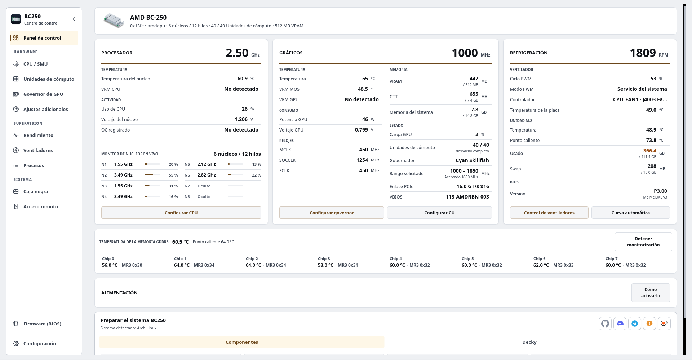

# BC250 Control Center

[English](../../README.md) · [Español](README.es.md) · [Português](README.pt-BR.md) · [Русский](README.ru.md) · [Deutsch](README.de.md) · [Français](README.fr.md) · [Polski](README.pl.md) · [中文](README.zh-CN.md) · [日本語](README.ja.md)

<a href="https://ko-fi.com/movacx"></a>

Налаштування, розгін і моніторинг AMD BC-250 у Linux через робочий стіл, термінал або браузер.

Він охоплює керування частотами GPU (governor), налаштування CPU, Compute Units (CU), вентилятори, пам’ять, оновлення BIOS, апскейлінг і підготовку системи для підтримуваних дистрибутивів. Кожна зміна апаратної частини перевіряється за своїми межами та підтверджується перед застосуванням. Необов’язковий плагін Decky переносить щоденні налаштування в ігровий режим Steam.

<p align="center">
  <a href="https://movacx.github.io/bc250-control-center/gallery/#dashboard"></a>
</p>

Більше знімків екрана в [галереї](https://movacx.github.io/bc250-control-center/gallery/).

## Доступні інтерфейси

- **Робочий стіл · PyQt6:** повне налаштування та локальне адміністрування через `bc250-control-center`.
- **Термінал · curses:** робота в TTY, емуляторі термінала або через SSH за допомогою `bc250-control-center-tui`.
- **Веб · React:** моніторинг і керування обладнанням із телефона, планшета чи іншого комп’ютера в домашній мережі.

Усі три інтерфейси використовують спільні служби та привілейовані допоміжні програми. Звичайний пакет містить TUI та зібрані вебфайли. Node.js потрібен лише для повторного збирання вебінтерфейсу.

## Можливості

- Панель із CPU, GPU, охолодженням, навантаженням по ядрах, температурою GDDR6 для кожного чипа, встановленим BIOS і лініями живлення (для ліній потрібна апаратна модифікація I2C; у застосунку є фотоінструкція)
- Графіки продуктивності CPU, GPU, VRAM, RAM, диска й мережі, з оглядом датчиків і експортом у CSV
- Керування governor GPU (Cyan, з Oberon як альтернативою), безпечні діапазони частот і лабораторія напруги
- Налаштування CPU через SMU, тест стабільності та необов’язкове розблокування ядер
- Compute Units: маршрутизація та діагностика регістрів з окремими поточним і завантажувальним станами; доступні блоки залежать від плати
- Керування вентиляторами: ручний PWM, температурні криві, сталі профілі або передача CoolerControl, fancontrol чи fan2go
- Пам’ять: розмір VRAM, ZRAM, ZSWAP і swap
- Створення USB-носія для оновлення BIOS (P3.00 Chipset Menu, MeiMeiDXE v3, P5.00, P3.00, P2.00) з перевіркою кожного файлу
- Апскейлінг для окремих ігор: FSR4 INT8 через OptiScaler Client і HelixSR, з резервним копіюванням і відновленням файлів гри
- Підготовка системи залежно від дистрибутива, яка виконується у вбудованому терміналі
- Виправлення сумісності для GFX1013, async compute, ACPI та Mesa; Dolby Digital 5.1 через HDMI; керування телевізором через HDMI-CEC
- Звіти про проблеми в застосунку, з кодами помилок, кодами джерела та прикріпленою сирою помилкою
- 30 мов, світла й темна теми, масштабування інтерфейсу та навігація з геймпада

## Підтримувані дистрибутиви

- Arch Linux, CachyOS, Manjaro
- Fedora, Nobara
- Bazzite та інші варіанти Fedora Atomic
- SteamOS (бета)
- Ubuntu, Linux Mint, Debian 13

Потрібен Python 3.11 або новіший. Інші дистрибутиви, зокрема системи з OpenRC, розпізнаються й обробляються, наскільки це можливо, але тестуються не в кожному випуску.

## Встановлення

### AUR

Для Arch Linux, CachyOS і SteamOS:

```bash
yay -S bc250-control-center-git
```

### Пакети випусків

Завантажте пакет для свого дистрибутива з [останнього випуску](https://github.com/movacx/bc250-control-center/releases/latest).

Arch Linux, CachyOS, Manjaro:

```bash
sudo pacman -U ./bc250-control-center-*-any.pkg.tar.zst
```

Fedora, Nobara:

```bash
sudo dnf install ./bc250-control-center-*.rpm
```

Bazzite і Fedora Atomic (потрібне перезавантаження):

```bash
sudo rpm-ostree install ./bc250-control-center-*.rpm
systemctl reboot
```

Ubuntu, Linux Mint, Debian:

```bash
sudo apt install ./bc250-control-center_*.deb
```

Використовуйте `apt install`, а не `dpkg -i`, щоб залежності встановилися автоматично. Якщо пакет лишився напіввстановленим після `dpkg -i`, виконайте `sudo apt --fix-broken install`.

### SteamOS

SteamOS тримає системний розділ у режимі лише для читання, тож пакет можна встановити лише з вимкненим захистом. Відкрийте Konsole у режимі робочого столу й виконайте:

```bash
sudo steamos-readonly disable
sudo pacman-key --init
sudo pacman-key --populate archlinux holo
sudo pacman -Syy
sudo pacman -U ./bc250-control-center-*-any.pkg.tar.zst
sudo steamos-readonly enable
```

Рядки `pacman-key` і `pacman -Syy` оновлюють ключі та бази пакетів, які скидає оновлення SteamOS. Якщо пароль для користувача `deck` ще не задано, спершу виконайте `passwd`. Після оновлення SteamOS пункт **Reinstall BC250 Control Center** у меню режиму робочого столу виконає ці кроки за вас.

### Із вихідного коду

```bash
git clone https://github.com/movacx/bc250-control-center.git
cd bc250-control-center
./run.sh                          # запуск із робочої копії
bash scripts/install-local.sh     # або встановлення для поточного користувача
```

## Оновлення

Застосунок перевіряє нові випуски, показує список змін, перевіряє контрольну суму пакета й встановлює оновлення менеджером пакетів системи.

**SteamOS:** системне оновлення SteamOS видаляє пакети, встановлені в систему, зокрема цей застосунок. Після системного оновлення виконайте **Reinstall BC250 Control Center** у меню режиму робочого столу, а потім знову запустіть Prepare BC250 system. SteamOS запитує пароль користувача `deck`; якщо його немає, задайте його командою `passwd`.

**Перехід із 1.19:** програма оновлення 1.19 не може встановлювати пакети. Встановіть поточну версію вручну один раз; наступні оновлюватимуться самі.

```bash
# Bazzite / Fedora Atomic: замінити нашарований пакет 1.19
sudo rpm-ostree uninstall bc250-control-center --install ./bc250-control-center-*.noarch.rpm
systemctl reboot

# Копія, встановлена через install-local.sh: видаліть її, потім встановіть пакет
bash scripts/uninstall-local.sh
```

## Перші кроки

1. Запустіть BC250 Control Center. Екран першого запуску визначає мову й оформлення та пропонує встановити потрібні компоненти.
2. За бажанням пройдіть екскурсію, яка пояснює, що кожен модуль змінює на платі.
3. На панелі запустіть **Prepare BC250 system**. Застосунок покаже, що буде встановлено для вашого дистрибутива, і виконає це у вбудованому терміналі.
4. Перед застосуванням змін читайте рядок стану модуля: там зазначено, що готово, а чого бракує.

## Термінальний інтерфейс

TUI потребує Python 3.11 або новішого, `curses` і `psutil`; графічне середовище та PyQt6 не потрібні. Звичайний пакет уже містить TUI: запустіть `bc250-control-center-tui`. Щоб установити лише TUI, клонуйте репозиторій і виконайте скрипт від звичайного користувача:

```bash
git clone https://github.com/movacx/bc250-control-center.git
cd bc250-control-center
bash scripts/install-tui.sh
```

Скрипт установлює застосунок у `~/.local`, перевіряє залежності та запитує права адміністратора для відсутніх пакетів і захищених допоміжних програм. У Bazzite/Fedora Atomic ці програми потрібно встановити з RPM через `rpm-ostree`; сам скрипт TUI їх там не встановлює.

```bash
~/.local/bin/bc250-control-center-tui
bc250-control-center-tui --page gpu --theme mono
```

Якщо `~/.local/bin` немає в `PATH`, використовуйте повний шлях. Стрілки вибирають елемент, `Enter` відкриває його, `Esc` або `Tab` повертає до бічної панелі, а `?` показує довідку. Підтримуються миша та прокручування. Вивід операцій і запити пароля з’являються у вбудованій консолі; `Ctrl+C` перериває команду. Вибрана тема зберігається.

Для оновлення виконайте `git pull --ff-only` у тому самому репозиторії та знову запустіть інсталятор. Для видалення:

```bash
bash scripts/install-tui.sh --uninstall
```

За налаштованого SSH-сервера використовуйте `ssh -t user@board-ip bc250-control-center-tui`, замінивши обліковий запис і адресу.

## Вебінтерфейс

У розділі **Remote access** на робочому столі або в TUI запустіть вебдоступ і дозвольте підключення з локальної мережі. Відкрийте показану адресу або відскануйте QR і введіть ключ доступу. Доступні ім’я `bc250cc.local` та числова IP-адреса; розпізнавання імені залежить від мережі й пристрою.

Нові браузери можуть лише спостерігати. Звірте код у **Connected devices**, перш ніж дозволити керування обладнанням. Права й термін дії задаються окремо для кожного пристрою; привілейовані операції й далі потребують авторизації адміністратора Linux.

Вебінтерфейс містить панель моніторингу, CPU, GPU, CU, лабораторію напруги, вентилятори, графіки продуктивності, чорну скриньку та налаштування. Він адаптується до телефона та зберігає мову й тему в браузері. Для звичайного використання SSH не потрібен; вебсервер на платі має працювати.

У домашній мережі використовується HTTPS із локальним центром сертифікації. Перевірте відбиток перед імпортом публічного сертифіката. Застосунок не відкриває порти маршрутизатора та не створює публічних тунелів.

## Плагін Decky

BC250 Quick Access — необов’язкова панель у меню швидкого доступу ігрового режиму Steam. Вона дає керування GPU, Compute Units, CPU, вентиляторами та VRAM, профілі GPU й вентиляторів для кожної гри та показники async compute наживо. Розширені налаштування лишаються в настільному застосунку.

Встановіть його з розділу **Decky** на панелі. Decky Loader також встановиться, якщо його немає; більше ніщо в застосунку не встановлює Decky. Детальніше — у [README плагіна](../../integrations/decky/bc250-quick-access/README.md).

## Повідомлення про проблеми

У вікнах помилок показано діагностичний код (наприклад, `BC250-UPSCALE-001`), код джерела, що вказує функцію, де сталася помилка (наприклад, `GPU-0142`), і сиру помилку з трасуванням.

Скористайтеся **Повідомити про проблему** у вікні помилки або **Налаштування › Діагностика › Надіслати звіт**. Форма відкривається в застосунку з уже заповненими кодами, сирою помилкою, характеристиками системи та останніми помилками. Перед надсиланням усе можна переглянути; шляхи до домашньої теки замінюються на `~`. Якщо форму не вдалося надіслати, вона відкриється в браузері зі збереженими відповідями. Форма також доступна [у мережі](https://docs.google.com/forms/d/e/1FAIpQLSe3M1stf3bpCoorb4hCWFX9YC_TZ_Gv6WHWQDRe1AV5rJT6rA/viewform).

До звіту також додається апаратна діагностика, яку збирають без root на будь-якому дистрибутиві: ядро та заголовки, завантажені модулі датчиків і їхні повідомлення ядра (NCT6687, amdgpu), показники hwmon і `sensors`, рядки GPU та збоїв із журналу ядра, як завершилося попереднє завантаження (чисте вимкнення або раптове скидання), служби, пакети та кінець останнього журналу робочого процесу. Якщо журнал ядра недоступний вашому користувачу, робочий стіл один раз запитає пароль через polkit. Звіти, завеликі для форми, автоматично скорочуються, починаючи з найменш важливих частин; **Відкрити в браузері** все одно копіює повний текст.

Щоб прочитати все, що додає звіт, перш ніж його надіслати, відкрийте **Налаштування › Діагностика › Показати повну діагностику**: кожен розділ (ядро, попереднє завантаження, чорна скринька, датчики, GPU, служби, конфігурація, пакети, журнали) розгортається, розкладений по вкладках, доступний для пошуку, його можна скопіювати або зберегти у файл. У терміналі те саме виводить `bc250-control-center-cli diagnose --full`.

Повідомлення про проблеми на GitHub також вітаються. Вкажіть дистрибутив, версію ядра та вивід терміналу.

## Безпека

Розгін, розблокування Compute Units, зміна керування вентиляторами та прошивка BIOS можуть зробити систему нестабільною, призвести до втрати даних або пошкодити плату. Змінюйте одне налаштування за раз і майте спосіб відкотити зміну. Перевірки застосунку ловлять типові помилки, але не є гарантією.

## Подяки

Цей проєкт спирається на роботу спільноти BC-250. Проєкти нижче належать їхнім авторам; застосунок інтегрує їх через перевірені процеси, закріплені за конкретною версією. Ліцензії та обсяг кожної інтеграції наведено в [повідомленнях про сторонні компоненти](../THIRD_PARTY_NOTICES.md).

**GPU**
- [cyan-skillfish-governor](https://github.com/filippor/cyan-skillfish-governor/tree/smu): governor GPU
- [Oberon Governor](https://gitlab.com/mothenjoyer69/oberon-governor): альтернативний governor
- [bc250-gfx1013-fix](https://github.com/DryhoppedIPA/bc250-gfx1013-fix) і [bc250-steamos](https://github.com/keyboardspecialist/bc250-steamos): ядро та Mesa/RADV для GFX1013
- [linux-cachyos-bc250](https://github.com/MastaG/linux-cachyos-bc250): ядро та Mesa/RADV для Arch і CachyOS
- [bc250-async-compute-bazzite](https://github.com/tri3gubki-ops/bc250-async-compute-bazzite): async compute на Bazzite 44, з патчами RADV, які також збираються для Arch, CachyOS і Fedora з ядром 7.2 або новішим

**Апскейлінг**
- [bc250-fsr4](https://github.com/dmorazasanchez/bc250-fsr4) і [bc250-fsr4-fork](https://github.com/daniel-h-0/bc250-fsr4-fork): OptiScaler Client, FSR4 для кожної гри
- [HelixSR](https://github.com/lonewolf0622/HelixSR): реконструкція DLSS Model E в іграх із FSR 3.1

**CPU і Compute Units**
- [bc250_smu_oc](https://github.com/bc250-collective/bc250_smu_oc): визначення та налаштування CPU через SMU
- [bc250-core-unlock](https://github.com/rw-r-r-0644/bc250-core-unlock) і [bc250-efi-core-unlock](https://github.com/Hexxeh/bc250-efi-core-unlock): розблокування ядер
- [bc250-acpi-fix](https://github.com/e-tho/bc250-acpi-fix): стани продуктивності CPU через ACPI
- [bc250-cu-live-manager](https://github.com/WinnieLV/bc250-cu-live-manager), [bc250-cu-live-manager-SteamOS](https://github.com/F5GO/bc250-cu-live-manager-SteamOS) і [bc250-40cu-unlock](https://github.com/duggasco/bc250-40cu-unlock): Compute Units

**Датчики, пам’ять і вентилятори**
- [BC250-Telemetry](https://github.com/onlinermm/BC250-Telemetry): телеметрія регуляторів напруги (VRM) і фото для інструкції I2C
- [bc250-memory-temperature](https://github.com/pan-Rijovich/bc250-memory-temperature): температура GDDR6
- [bc250_memcfg](https://github.com/fanoush/bc250_memcfg): розмір VRAM через CMOS
- [nct6687d](https://github.com/Fred78290/nct6687d): датчики NCT і PWM вентиляторів
- [linux-cec](https://gitlab.steamos.cloud/holo/linux-cec): cecd, демон HDMI-CEC від Valve

**Прошивка**
- [bc250-bios](https://gitlab.com/TuxThePenguin0/bc250-bios): оригінальний BIOS P3.00 і Chipset Menu
- [AMD-BC-250-UEFI-v2.2-Firmware-Menu-Script](https://github.com/Forbidden-Darkness/AMD-BC-250-UEFI-v2.2-Firmware-Menu-Script): UEFI Shell і MeiMeiDXE v3
- [BC-250](https://github.com/kenavru/BC-250): дзеркало набору оновлення ASRock (P2.00 і P5.00)
- [bc250-custom-bios-logo](https://github.com/tmghd272/bc250-custom-bios-logo): власний логотип завантаження

**Пов’язані проєкти** (застосунок їх не використовує; ліцензії за даними GitHub)
- [bc250-vrm-dkms](https://github.com/Hexxeh/bc250-vrm-dkms) і [bc250-memory-dkms](https://github.com/Hexxeh/bc250-memory-dkms) (GPL-2.0): температури VRM і пам’яті як модулі ядра
- [bc250-bazzite-suite](https://github.com/RobertoTorino/bc250-bazzite-suite) (GPL-3.0): набір для налаштування Bazzite
- [bc250-vcn-research](https://github.com/Shalasere/bc250-vcn-research) і [amdgpu-wddm](https://github.com/D-Ogi/amdgpu-wddm): дослідження кодування відео VCN і відкритий драйвер для Windows (ліцензію не оголошено; лише посилання)

## Структура проєкту

```text
bc250-control-center/
├── src/bc250cc/              Ядро без графічного інтерфейсу
│   ├── domain/               Правила та межі кожного модуля (GPU, CPU, CU, вентилятори, прошивка…)
│   ├── application/          Сценарії використання, що поєднують ці правила
│   ├── infrastructure/       Доступ до системи: датчики, служби, пакети, GitHub
│   ├── platform/             Відмінності між дистрибутивами та системами завантаження
│   └── shared/               Версія, шляхи й контракти, спільні для всіх процесів
├── frontends/
│   ├── desktop/              Настільний застосунок на Qt
│   │   ├── pages/            Один файл на модуль (панель, GPU, CPU, вентилятори, прошивка…)
│   │   ├── components/       Повторно використовувані частини інтерфейсу
│   │   ├── onboarding/       Екран привітання та екскурсія
│   │   ├── console/          Вбудований термінал
│   │   ├── theme/            Теми, стилі, кольори та значки
│   │   └── i18n/             Переклади на 30 мов
│   ├── tui/                  Термінальний інтерфейс, навігація та консоль операцій
│   ├── web/                  HTTPS-сервер, сесії та процеси виконання операцій
│   │   ├── app/              Вихідний код React та інструменти збирання
│   │   └── dist/             Зібрані вебфайли, що постачаються із застосунком
│   └── cli.py                Режим командного рядка
├── integrations/decky/       Плагін Decky Quick Access для ігрового режиму
├── privileged/               Те, що працює від root: ізольовано й перевірено
│   ├── helpers/              Один помічник на кожне привілейоване завдання
│   ├── lib/                  Код, спільний для цих помічників
│   └── policies/             Дозволи Polkit
├── packaging/                Пакети .pkg.tar.zst, .rpm і .deb та PKGBUILD для AUR
├── scripts/                  Скрипти запуску, локальний інсталятор і системні утиліти
├── assets/                   Значки, знімки екрана та веб-галерея
├── docs/                     Документація, повідомлення про сторонні компоненти та переклади цього README
└── tests/                    Тести модулів, служб, робочого столу, TUI, вебу та пакетів
```

## Участь у проєкті

Найкорисніший внесок — звіт про помилку, особливо з вказаним дистрибутивом, версією ядра та тим, що вивів термінал. Якщо ви користуєтеся дистрибутивом, якого немає вище, розкажіть, як він працює, добре чи погано.

Ліцензія [MIT](../../LICENSE).
