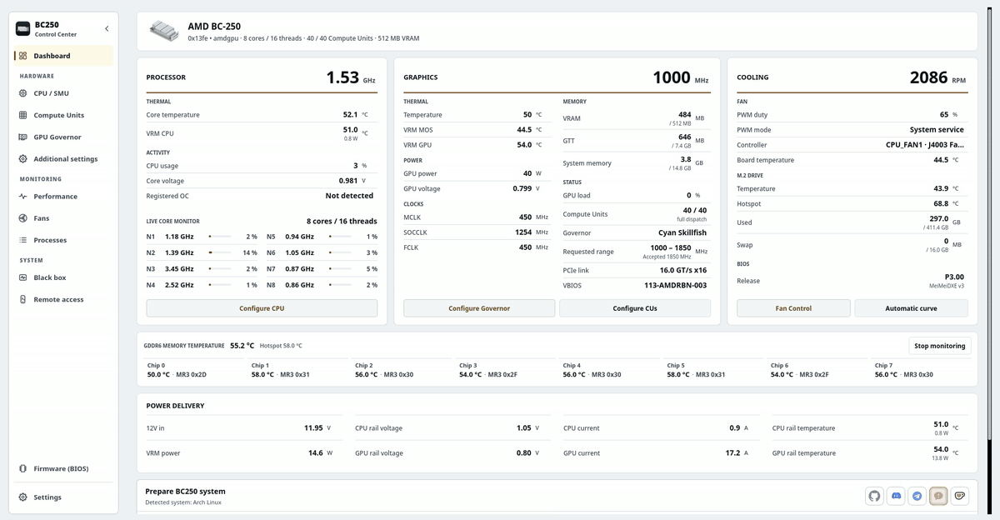

# BC250 Control Center

从桌面、终端或网络浏览器在 Linux 上设置、调整和监控 AMD BC-250。

它涵盖了受支持发行版的 GPU 调控器、CPU 调整、计算单元、风扇、内存、BIOS 更新介质、升级和系统准备。这些接口共享应用程序服务、硬件限制和特权助手。可选的 Decky 插件将日常控制带入 Steam 的游戏模式。

<p align="center">
  <a href="https://movacx.github.io/bc250-control-center/gallery/#dashboard"></a>
</p>

<p align="center">
  <a href="../../README.md"></a>
  <a href="README.es.md"></a>
  <a href="README.pt-BR.md"></a>
  <a href="README.ru.md"></a>
  <a href="README.uk.md"></a>
  <a href="README.de.md"></a>
  <a href="README.fr.md"></a>
  <a href="README.pl.md"></a>
  <a href="README.zh-CN.md"></a>
  <a href="README.ja.md"></a>
</p>

<p align="center">
  <a href="https://ko-fi.com/movacx"></a>
</p>

更多屏幕截图位于[图库](https://movacx.github.io/bc250-control-center/gallery/)。

## 选择您的界面

| 接口 | 最适合 | 启动 |
| --- | --- | --- |
| **桌面·PyQt6** | 完整的设置、调整、诊断和本地管理 | `bc250-control-center` |
| **终端·curses** | 本地 TTY、终端模拟器或 SSH 会话 | `bc250-control-center-tui` |
| **Web·React** | 通过家庭网络上的手机、平板电脑或另一台计算机进行监控和硬件控制 | 在桌面应用中启动**远程访问**，然后打开其地址或扫描二维码 |

正常安装包括终端界面和编译的Web资源。 [仅限终端的安装程序](#terminal-mode)适用于没有桌面的计算机。浏览器界面需要运行开发板的Web服务器；它不需要 SSH 或 Node.js 即可正常使用。

## 功能

- 仪表盘：显示 CPU、GPU、散热、每核负载、每颗芯片的 GDDR6 温度、已安装的 BIOS 以及供电轨（供电轨需要 I2C 硬件改装；应用内附带带照片的指南）
- CPU、GPU、VRAM、RAM、磁盘和网络的性能图表，附带传感器视图和 CSV 导出
- GPU 调速器管理（Cyan，备选 Oberon）、安全的频率范围和电压实验室
- 通过 SMU 调校 CPU、稳定性测试以及可选的核心解锁
- 计算单元：路由和寄存器诊断，分别报告实时和启动状态；可用单位取决于主板
- 风扇控制：手动 PWM、温度曲线、持久化配置，或交由 CoolerControl、fancontrol 或 fan2go 接管
- 内存：VRAM 大小、ZRAM、ZSWAP 和交换分区
- 制作 BIOS 更新 U 盘（P3.00 Chipset Menu、MeiMeiDXE v3、P5.00、P3.00、P2.00），每个文件都经过校验
- 按游戏升频：通过 OptiScaler Client 使用 FSR4 INT8，以及 HelixSR，并支持备份和还原游戏文件
- 按发行版进行系统准备，在内置终端中运行
- 针对 GFX1013、async compute、ACPI 和 Mesa 的兼容性修复；通过 HDMI 输出 Dolby Digital 5.1；通过 HDMI-CEC 控制电视
- 应用内问题报告，附带错误代码、来源代码以及原始错误信息
- 30 种语言，浅色和深色主题，界面缩放以及手柄导航
- 带有键盘导航、鼠标支持、实时遥测和嵌入式操作控制台的终端界面
- 具有移动布局、配对 QR 和每设备硬件权限的本地网络 HTTPS Web 界面

## 支持的发行版

- Arch Linux、CachyOS、Manjaro
- Fedora、Nobara
- Bazzite 及其他 Fedora Atomic 变体
- SteamOS（测试版）
- Ubuntu、Linux Mint、Debian 13

需要 Python 3.11 或更高版本。其他发行版（包括使用 OpenRC 的系统）会尽量被识别和支持，但并非每个版本都经过测试。

## 安装

### AUR

适用于 Arch Linux、CachyOS 和 SteamOS：

```bash
yay -S bc250-control-center-git
```

### 发布包

从[最新版本](https://github.com/movacx/bc250-control-center/releases/latest)下载适合你发行版的包。

Arch Linux、CachyOS、Manjaro：

```bash
sudo pacman -U ./bc250-control-center-*-any.pkg.tar.zst
```

Fedora、Nobara：

```bash
sudo dnf install ./bc250-control-center-*.rpm
```

Bazzite 和 Fedora Atomic（需要重启）：

```bash
sudo rpm-ostree install ./bc250-control-center-*.rpm
systemctl reboot
```

Ubuntu、Linux Mint、Debian：

```bash
sudo apt install ./bc250-control-center_*.deb
```

请使用 `apt install` 而不是 `dpkg -i`，以便自动安装依赖。如果 `dpkg -i` 留下了未完成的安装，请运行 `sudo apt --fix-broken install`。

### SteamOS

SteamOS 将系统分区保持为只读，因此只有在关闭该保护后才能安装此包。在桌面模式中打开 Konsole，然后运行：

```bash
sudo steamos-readonly disable
sudo pacman-key --init
sudo pacman-key --populate archlinux holo
sudo pacman -Syy
sudo pacman -U ./bc250-control-center-*-any.pkg.tar.zst
sudo steamos-readonly enable
```

`pacman-key` 和 `pacman -Syy` 两行会刷新密钥环和软件包数据库，这些内容会在 SteamOS 更新时被重置。如果你还没有为 `deck` 用户设置密码，请先运行 `passwd`。SteamOS 更新后，桌面模式菜单中的 **Reinstall BC250 Control Center** 会替你完成这些步骤。


## 更新

应用会检查新版本、显示更新日志、验证软件包校验和，并通过系统的包管理器安装更新。

**SteamOS：** SteamOS 系统更新会删除安装到系统中的软件包，包括本应用。系统更新后，请在桌面模式菜单中运行 **Reinstall BC250 Control Center**，然后再次运行 Prepare BC250 system。SteamOS 会要求输入 `deck` 用户的密码；如果还没有设置，请用 `passwd` 设置。

**从 1.19 升级：** 1.19 的更新程序无法安装软件包。请手动安装一次当前版本；之后的版本会自动更新。

```bash
# Bazzite / Fedora Atomic: replace a layered 1.19 package
sudo rpm-ostree uninstall bc250-control-center --install ./bc250-control-center-*.noarch.rpm
systemctl reboot

# A copy installed with install-local.sh: remove it, then install the package
bash scripts/uninstall-local.sh
```

## 快速开始

1. 启动 BC250 Control Center。首次运行的界面会设置语言和外观，并提供安装所需组件的选项。
2. 可选：完成引导教程，了解每个模块会对主板做出哪些更改。
3. 在仪表盘中运行 **Prepare BC250 system**。它会显示你的发行版将安装哪些内容，并在内置终端中执行。
4. 应用更改前请阅读模块的状态行，它会说明哪些已就绪、哪些缺失。

<a id="terminal-mode"></a>

## 终端模式

TUI 在终端仿真器、Linux TTY 或 SSH 会话中运行。它共享桌面应用程序的硬件控制和监控服务。 Python 3.11 或更高版本，需要 `curses` 和 `psutil`； PyQt6 不是。

### 安装桌面应用程序后

常规套餐包含 TUI。开始：

```bash
bc250-control-center-tui
```

### 仅终端安装

克隆存储库并以普通用户身份运行安装程序：

```bash
git clone https://github.com/movacx/bc250-control-center.git
cd bc250-control-center
bash scripts/install-tui.sh
```

安装程序将应用程序放置在 `~/.local` 中并检查其 Python 依赖项。它请求管理员授权安装缺失的软件包和受保护的硬件助手。它不安装 PyQt6 或桌面启动器。在 Bazzite/Fedora Atomic 上，此脚本会跳过系统帮助程序安装；必须通过 RPM 使用 `rpm-ostree` 安装帮助程序，然后重新启动。

启动界面：

```bash
~/.local/bin/bc250-control-center-tui
```

如果 `~/.local/bin` 已在 `PATH` 中，请使用 `bc250-control-center-tui`。更新从源码安装的版本时，请在同一仓库运行 `git pull --ff-only`，然后重新运行安装脚本。卸载命令：

```bash
bash scripts/install-tui.sh --uninstall
```

### 导航

| 输入 | 行动 |
| --- | --- |
| `↑` / `↓` 或 `j` / `k` | 选择一个项目 |
| `Enter` | 打开一个部分或运行一个操作 |
| `Esc` 或 `Tab` | 返回侧边栏 |
| `[` / `]` | 切换部分选项卡 |
| `/` | 搜索 |
| `PgUp` / `PgDn` | 滚动页面或操作输出 |
| 鼠标 | 选择部分和控件；用滚轮滚动 |
| `?` | 显示帮助 |
| `q` | 退出 |

操作在集成控制台中显示其输出。根据要求输入管理员密码； `Ctrl+C` 中断正在运行的命令。控制台在完成后保留结果和日志位置。

要打开特定页面或使用单色输出：

```bash
bc250-control-center-tui --page gpu --theme mono
```

对于 SSH，主板必须启用并可访问 SSH 服务器：

```bash
ssh -t user@board-ip bc250-control-center-tui
```

将 `user` 和 `board-ip` 替换为董事会的 Linux 帐户和地址。

## 网页界面

在桌面应用程序或 TUI 中打开**远程访问**，启动网络访问并启用**可从本地网络访问**以从其他设备进行连接。选择那里显示的地址或扫描其可见的二维码。保持本地名称和数字 IP 可用：名称解析取决于客户端和网络。

使用板上显示的访问密钥登录。新的浏览器会话只能监听。在**连接的设备**中，在授予硬件控制权之前验证浏览器的设备代码。该权限与特权操作所需的 Linux 管理员密码是分开的。所有者可以撤销访问权限并为每个会话选择到期时间。

网络提供仪表板、CPU、计算单元、GPU、电压实验室、风扇、性能、黑匣子和设置。性能包括CPU、GPU、内存、磁盘、网络和单个传感器历史记录。主题和语言按浏览器保存。

LAN 访问使用 HTTPS。每次安装都会创建一个本地证书颁发机构；浏览器可能会发出警告，直到其公共证书在该设备上受到信任。在信任之前先比较显示的指纹。禁用 LAN 访问后，只有板本身可以通过环回进行连接。该应用程序不会打开路由器端口或配置公共隧道。

用户不需要 Node.js：包传送构建的 Web 资产。

## Decky 插件

BC250 Quick Access 是 Steam 游戏模式快速访问菜单中的可选面板。它提供 GPU、计算单元、CPU、风扇和 VRAM 控制，按游戏设置的 GPU 和风扇配置文件，以及实时的 async compute 读数。高级配置仍保留在桌面应用中。

请从仪表盘的 **Decky** 部分安装。如果缺少 Decky Loader，它也会一并安装；应用中没有其他部分会安装 Decky。详情请参阅[插件 README](../../integrations/decky/bc250-quick-access/README.md)。

## 报告问题

错误窗口会显示诊断代码（例如 `BC250-UPSCALE-001`）、标明出错函数的来源代码（例如 `GPU-0142`），以及带有回溯信息的原始错误。

在错误窗口中使用 **报告此问题**，或在 **设置 › 诊断 › 发送报告** 中操作。报告表单会在应用内打开，并已填好代码、原始错误、系统规格和最近的错误。发送前你可以检查全部内容；主目录路径会被替换为 `~`。如果无法提交表单，它会在浏览器中打开，并保留你已填写的答案。该表单也可[在网页上](https://docs.google.com/forms/d/e/1FAIpQLSe3M1stf3bpCoorb4hCWFX9YC_TZ_Gv6WHWQDRe1AV5rJT6rA/viewform)使用。

报告还会附带一份硬件诊断，无需 root 即可在所有发行版上收集：内核和头文件、已加载的传感器模块及其内核消息（NCT6687、amdgpu）、hwmon 和 `sensors` 读数、内核日志中的 GPU 和崩溃行、上一次启动的结束方式（正常关机或突然重置）、服务、软件包，以及上一个工作流日志的结尾。当你的用户无法读取内核日志时，桌面会通过 polkit 询问一次密码。过大而无法放入表单的报告会自动裁剪，先删除最次要的部分；**在浏览器中打开** 仍会复制完整文本。

要在发送前阅读报告附加的所有内容，请打开**设置 › 诊断 › 查看完整诊断**：每个部分（内核、上次启动、黑匣子、传感器、GPU、服务、配置、软件包、日志）均可展开、分类到选项卡中、可搜索，并且可以复制或另存为文件。终端使用 `bc250-control-center-cli diagnose --full` 打印相同的内容。

也欢迎在 GitHub 上提交 issue。请附上你的发行版、内核版本和终端输出。

## 安全

超频、解锁计算单元、更改风扇控制或刷写 BIOS，都可能导致系统不稳定、数据丢失或损坏主板。每次只更改一项设置，并保留撤销的方法。应用的检查可以发现常见错误，但并不能保证万无一失。

## 致谢

本项目建立在 BC-250 社区的工作之上。下列项目归其作者所有；应用通过经过审查并固定版本的流程与它们集成。每个集成的许可证和范围列在[第三方声明](../THIRD_PARTY_NOTICES.md)中。

**GPU**
- [cyan-skillfish-governor](https://github.com/filippor/cyan-skillfish-governor/tree/smu)：GPU 调速器
- [Oberon Governor](https://gitlab.com/mothenjoyer69/oberon-governor)：备选调速器
- [bc250-gfx1013-fix](https://github.com/DryhoppedIPA/bc250-gfx1013-fix) 和 [bc250-steamos](https://github.com/keyboardspecialist/bc250-steamos)：适用于 GFX1013 的内核和 Mesa/RADV
- [linux-cachyos-bc250](https://github.com/MastaG/linux-cachyos-bc250)：适用于 Arch 和 CachyOS 的内核和 Mesa/RADV
- [bc250-async-compute-bazzite](https://github.com/tri3gubki-ops/bc250-async-compute-bazzite)：Bazzite 44 上的 async compute，其 RADV 补丁也为 Arch、CachyOS 以及内核 7.2 或更高版本的 Fedora 构建

**升频**
- [bc250-fsr4](https://github.com/dmorazasanchez/bc250-fsr4) 和 [bc250-fsr4-fork](https://github.com/daniel-h-0/bc250-fsr4-fork)：OptiScaler Client，按游戏使用 FSR4
- [HelixSR](https://github.com/lonewolf0622/HelixSR)：在支持 FSR 3.1 的游戏中使用 DLSS Model E 重建

**CPU 与计算单元**
- [bc250_smu_oc](https://github.com/bc250-collective/bc250_smu_oc)：通过 SMU 进行 CPU 检测与调校
- [bc250-core-unlock](https://github.com/rw-r-r-0644/bc250-core-unlock) 和 [bc250-efi-core-unlock](https://github.com/Hexxeh/bc250-efi-core-unlock)：核心解锁
- [bc250-acpi-fix](https://github.com/e-tho/bc250-acpi-fix)：通过 ACPI 实现 CPU 性能状态
- [bc250-cu-live-manager](https://github.com/WinnieLV/bc250-cu-live-manager)、[bc250-cu-live-manager-SteamOS](https://github.com/F5GO/bc250-cu-live-manager-SteamOS) 和 [bc250-40cu-unlock](https://github.com/duggasco/bc250-40cu-unlock)：计算单元

**传感器、内存与风扇**
- [BC250-Telemetry](https://github.com/onlinermm/BC250-Telemetry)：VRM 遥测以及 I2C 指南中使用的照片
- [bc250-memory-temperature](https://github.com/pan-Rijovich/bc250-memory-temperature)：GDDR6 温度
- [bc250_memcfg](https://github.com/fanoush/bc250_memcfg)：通过 CMOS 设置 VRAM 大小
- [nct6687d](https://github.com/Fred78290/nct6687d)：NCT 传感器和风扇 PWM
- [linux-cec](https://gitlab.steamos.cloud/holo/linux-cec)：cecd，Valve 的 HDMI-CEC 守护进程

**固件**
- [bc250-bios](https://gitlab.com/TuxThePenguin0/bc250-bios)：原版 P3.00 BIOS 和 Chipset Menu
- [AMD-BC-250-UEFI-v2.2-Firmware-Menu-Script](https://github.com/Forbidden-Darkness/AMD-BC-250-UEFI-v2.2-Firmware-Menu-Script)：UEFI Shell 和 MeiMeiDXE v3
- [BC-250](https://github.com/kenavru/BC-250)：ASRock 更新工具包的镜像（P2.00 和 P5.00）
- [bc250-custom-bios-logo](https://github.com/tmghd272/bc250-custom-bios-logo)：自定义启动徽标

**相关项目**（应用未使用；许可证以 GitHub 显示为准）
- [bc250-vrm-dkms](https://github.com/Hexxeh/bc250-vrm-dkms) 和 [bc250-memory-dkms](https://github.com/Hexxeh/bc250-memory-dkms)（GPL-2.0）：以内核模块形式提供的 VRM 和内存温度
- [bc250-bazzite-suite](https://github.com/RobertoTorino/bc250-bazzite-suite)（GPL-3.0）：Bazzite 配置套件
- [bc250-vcn-research](https://github.com/Shalasere/bc250-vcn-research) 和 [amdgpu-wddm](https://github.com/D-Ogi/amdgpu-wddm)：VCN 视频编码研究和一个开源 Windows 驱动（未声明许可证；仅作链接）

## 项目结构

```text
bc250-control-center/
├── src/bc250cc/              核心部分，无图形界面
│   ├── domain/               每个模块的规则和限制（GPU、CPU、CU、风扇、固件…）
│   ├── application/          组合这些规则的用例
│   ├── infrastructure/       系统访问：传感器、服务、软件包、GitHub
│   ├── platform/             不同发行版和启动系统之间的差异
│   └── shared/               所有进程共享的版本、路径和契约
├── frontends/
│   ├── desktop/              Qt 桌面应用
│   │   ├── pages/            每个模块一个文件（仪表盘、GPU、CPU、风扇、固件…）
│   │   ├── components/       可复用的界面组件
│   │   ├── onboarding/       欢迎界面和引导教程
│   │   ├── console/          内置终端
│   │   ├── theme/            主题、样式、颜色和图标
│   │   └── i18n/             30 种语言的翻译
│   ├── tui/                  终端界面：curses屏幕、页面和操作控制台
│   ├── web/                  HTTPS 后端、经过验证的操作人员和浏览器界面
│   │   ├── app/              React 源代码和构建工具（仅用于开发的 Node.js）
│   │   └── dist/             由 Python 提供服务并以包形式提供的编译资源
│   └── cli.py                Command-line mode
├── integrations/
│   ├── decky/                用于游戏模式的 Decky Quick Access 插件
│   └── report-endpoint/      用于用户提交报告的 Cloudflare 端点
├── privileged/               以 root 运行的部分，隔离且经过审查
│   ├── helpers/              每个特权任务对应一个辅助程序
│   ├── lib/                  这些辅助程序共享的代码
│   └── policies/             Polkit 权限
├── packaging/                .pkg.tar.zst、.rpm 和 .deb 包，以及 AUR 的 PKGBUILD
├── scripts/
│   ├── entrypoints/          桌面、CLI、守护程序和 TUI 启动器
│   ├── development/          Web 构建和开发实用程序
│   ├── system/               分发和系统准备工作流程
│   └── qa/                   包装、集成和分发检查
├── assets/                   图标、截图和网页图库
├── docs/                     文档、第三方声明以及本 README 的翻译
└── tests/                    单位、服务、桌面、TUI、Web 和包装检查
```

有关层边界，请参阅 [Architecture](../ARQUITECTURA_MVC.md)，有关接口入口点和开发命令，请参阅 [Frontends](../../frontends/README.md)。
